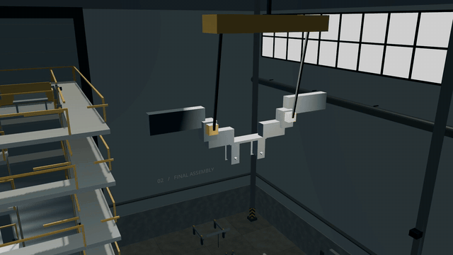
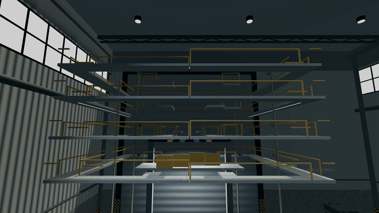
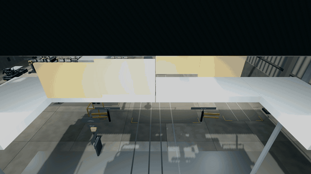
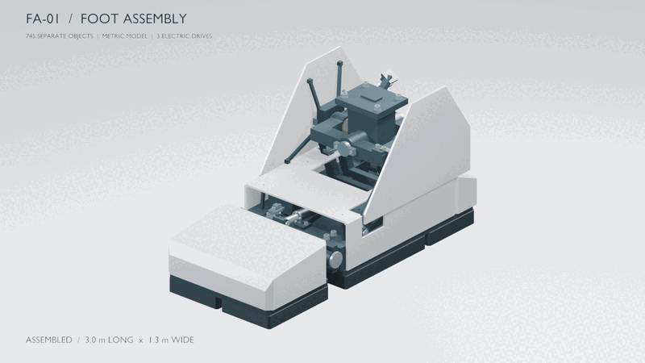
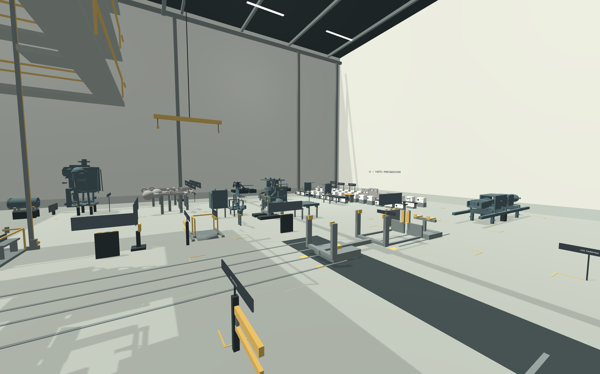
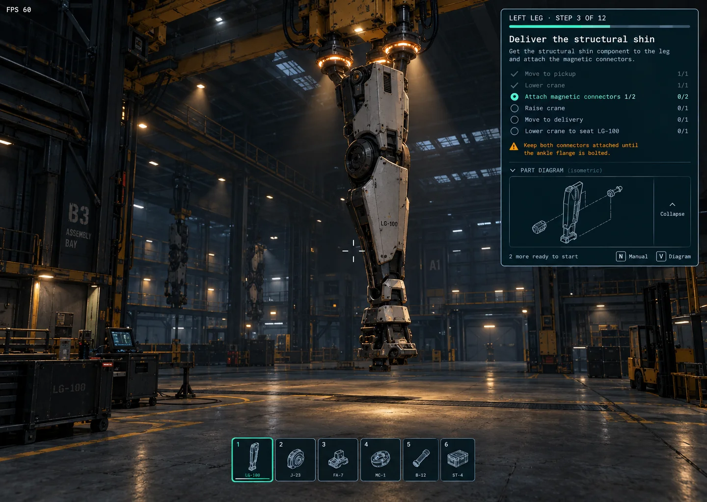
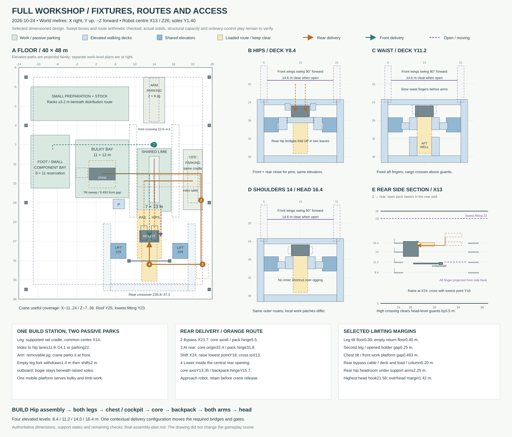
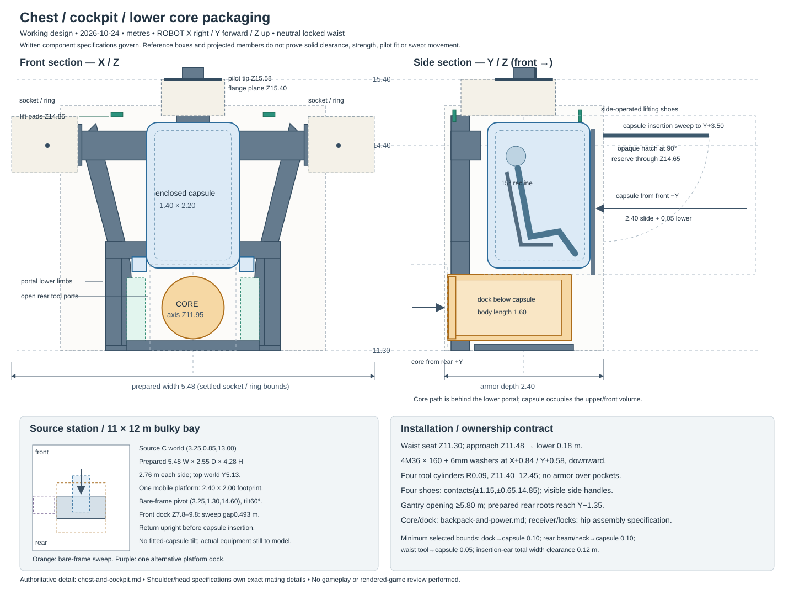
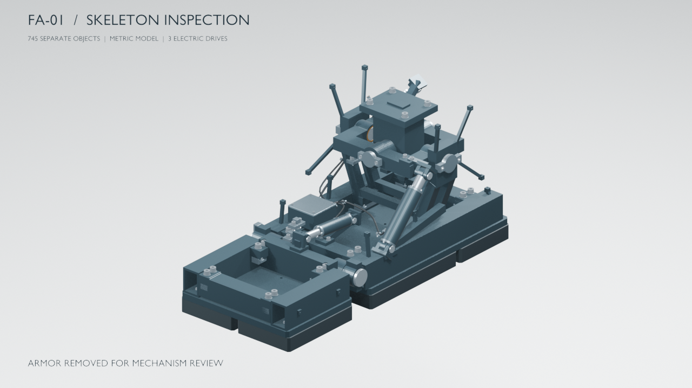

# Gundam Build Simulator

**Start with a handful of bolts. End beneath a giant robot you assembled.**

A first-person mecha workshop built in Godot. Stock your pockets, follow illustrated manuals, build mechanisms at preparation stations, then use cranes and moving platforms to bring the larger assemblies together. The full-game design targets an **18-metre piloted mecha**; the playable prototype takes you from the left foot to the final crown in one continuous hangar.

[Play the prototype](#play-the-prototype) · [Watch the workshop](#watch-the-workshop) · [Concept & design](#concept--design) · [Development](#development)



*The final crown installation and robot reveal. This capture predates the current lighting and gantry detail pass.*

## Watch the workshop

Three looping GIFs follow the equipment through the big assembly milestones. Each plays inline and shows the full **10-second** sequence.

| Seat the hip assembly | Dock the leg | Finish the robot |
| --- | --- | --- |
|  |  |  |

These are scripted progress films using the workshop's equipment controllers, with supplied earlier construction and accelerated motion. They predate the latest visual uplift. See the [recording guide](game/workshop/README.md#progress-videos) for camera edits and reproduction.

### One foot. 745 separate parts.

The FA-01 source model keeps every frame, shell, actuator and fastener individually identifiable. Its construction film shows how those pieces become a foot roughly **3.0 m long × 1.3 m wide**.



## Inside the hangar

The satisfaction is in the sequence: find the right hardware, expose the connection, seat the part, and watch a small mechanism become part of something much larger.

- **Build at the bench.** Prepare two heel pads and a 91-piece pitch actuator, then secure them to the left foot. This opening build uses 135 physical identities from the 745-piece source model.
- **Work from a living manual.** Illustrated chapters break the build into goals and checklists that tick themselves as you work. Ghost previews show valid placements.
- **Handle the scale.** Turn the foot in its fixture, move heavy loads by crane, and ride personnel platforms to reach higher connections.
- **Keep building.** Continue through the hip assembly, both legs, chest, core, backpack, arms, pauldrons, head and crown. Save your workshop and return to it later.

| Small parts, close attention | Room for the whole machine |
| --- | --- |
|  |  |

*Earlier prototype screenshots: the heel-pad view shows the original preparation workflow; the overview shows the hangar blockout. Lighting, manuals and gantry detail have since evolved.*

The current game is a **work-in-progress structural assembly prototype**. The detailed foot establishes the component approach; much of the wider robot remains blockout geometry, with further mechanisms, armor and finished art still to come.

## Play the prototype

Use **Godot 4.7.2**. On macOS, double-click [play.command](play.command), or run this from the repository root:

```sh
./play.command
```

The launcher finds the local Godot tool cache, a `godot` executable on your PATH, or `/Applications/Godot.app`. To select your own executable:

```sh
GODOT_BIN=/path/to/godot ./play.command
```

On other platforms, open [game/workshop/project.godot](game/workshop/project.godot) in Godot and run the project. The first launch imports the assets.

Begin at the preparation stations and wall cabinets beside the left foot. Follow the manual through the heel pads and pitch actuator, then turn the completed foot upright for the crane handoff.

| Input | Action |
| --- | --- |
| WASD / mouse | Move / look |
| Space | Jump |
| E | Stock a pocket, carry a component or operate equipment |
| 1–0 | Select a small-part pocket |
| Left click | Attach at the highlighted connection |
| Q / B | Set down a carried component / clear the selected pocket |
| Hold R + mouse / double-tap R | Rotate / reset a preparation station |
| M | Open the manual |
| Tab | Show or hide the current-step panel |
| Z | Undo in the selected manual |
| Escape | Pause and release the mouse |

Save through **Save**, **Save & quit**, or by closing the window. A normal relaunch restores the saved workshop; **New workshop** starts over. See the [save design](design/game/robot-workshop-plan.md#saves-and-checkpoints) for what is restored.

Want to jump to the heavy machinery? Stage launches supply the earlier construction:

```sh
./play.command -- --stage=actuator   # heel pads fitted; build the pitch actuator
./play.command -- --stage=pelvis     # foot complete; begin the hip assembly delivery
./play.command -- --stage=complete   # explore the completed structural robot
```

See the [workshop guide](game/workshop/README.md) for all stages, equipment controls and implementation details. A stage launch skips loading your existing save; explicitly saving that run replaces it.

## Concept & design

### The workshop we are building toward



*DiffUI **panel C**, preserved from `.diffui/panel-c.webp`. Concept art and interface direction; this is not a gameplay screenshot.*

The concept pairs the scale of an industrial hangar with the clarity of a model-kit manual: the work stays visible, the current goal sits beside it, and parts are recognizable before you pick them up. Warm task lighting, readable machinery and a compact checklist give the workshop its intended character.

### Plan the space around the build

The hangar needs room for a suspended load, a person reaching its fasteners, and the equipment that gets both into position. The layout study maps fixtures, delivery routes and access levels before they become playable machinery.

[](design/game/final-assembly-layout.svg)

[Explore the workshop layout and assembly plan →](design/game/final-assembly-plan.md)

### Design the machine from the inside out

Cockpit space, the removable core, shoulder connections and lifting points all compete for room inside the torso. The chest study makes those interfaces explicit; the gantry study carries the same attention into the equipment surrounding it.

| Chest & cockpit packaging | Gantry construction study |
| --- | --- |
| [](design/torso/chest-and-cockpit-layout.svg) | [](design/game/gantry-detail-study.svg) |

*Design schematics describe packaging and spatial intent; they are not structural certification or a guarantee that every detail is implemented.*



*The FA-01 source model beneath the shells: separate mechanisms and hardware, generated through a reproducible Blender pipeline.*

| Explore further | What you will find |
| --- | --- |
| [Game design](GAME_DESIGN.md) | The workshop loop, carrying, targeting, manuals and undo |
| [Robot design](ROBOT_DESIGN.md) | Whole-robot scope and body assembly specifications |
| [Foot & ankle specification](design/legs/foot-and-ankle.md) | Dimensions, interfaces, actuators and hardware |
| [Reference sheets](design/legs/foot-and-ankle/images/README.md) | Engineering-style concept images and their prompts |
| [FA-01 model](models/foot-fa01/README.md) | Source assets, exports, Blender workflow and audits |
| [Current workshop state](design/game/workshop-state.md) | Current implementation, active rules and open decisions |
| [Playtest checklist](design/game/robot-workshop-playtest-checklist.md) | Player findings and work still awaiting hands-on feedback |

## Development

**Godot / GDScript** powers the workshop; **Blender / Python** generates the detailed source model. Start with the [current workshop state](design/game/workshop-state.md) before changing gameplay.

```sh
./play.command --editor
python3 game/workshop/tools/run_regressions.py
python3 game/workshop/tools/run_regressions.py --only stage_contract_test workshop_smoke_test
```

Routine verification uses isolated checks and one startup smoke. See the [testing guide](game/workshop/tests/TESTING.md) for coverage and the separate, opt-in diagnostics.

To regenerate the FA-01 scene and exports with **Blender 4.5 or later**:

```sh
blender --background --factory-startup --python-exit-code 1 --python models/foot-fa01/src/build.py
```

The [model README](models/foot-fa01/README.md#reproduce-the-build) covers rendering and verification. The repository retains the playable GLB, editable Blender scene and presentation media; generated intermediates and engine caches stay local.
