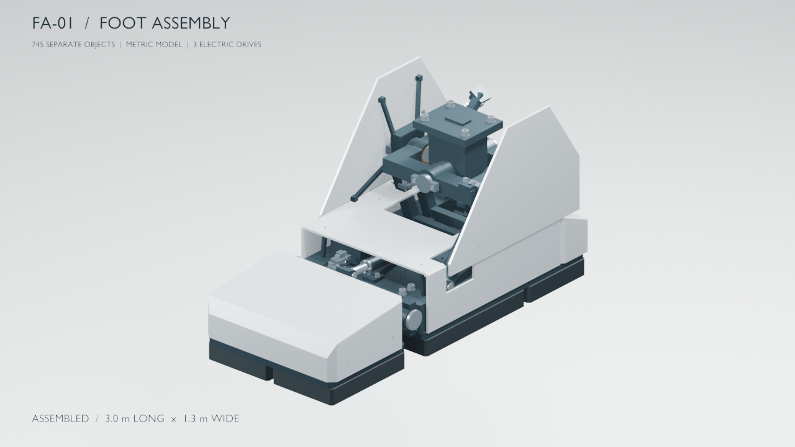
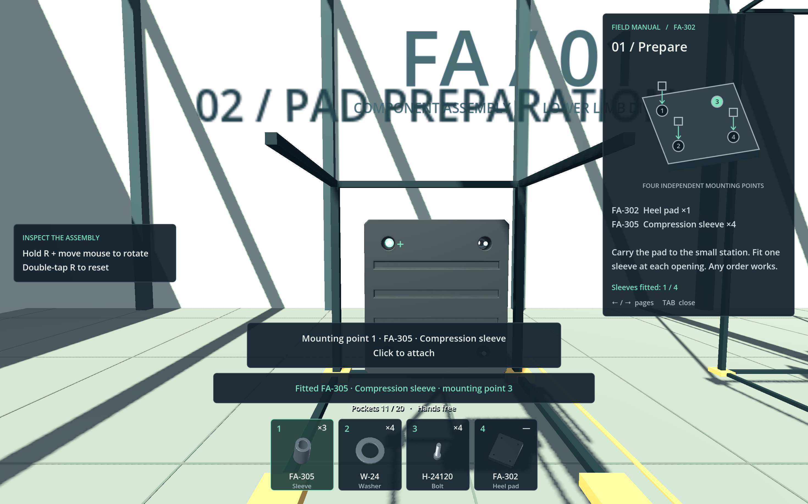

# Gundam Build Simulator

A first-person mecha workshop prototype: organise parts, follow illustrated manuals, and assemble a giant robot one component at a time.

The full-game design targets an **18 m piloted mecha**. The current playable milestone is a **13-piece heel-pad assembly** in Godot, backed by an FA-01 foot model with **745 separate parts** and a reproducible Blender generation pipeline.



## Watch the assembly


## Play the heel-pad demo

Use **Godot 4.7.2**. On macOS, double-click [play-heel-pad.command](play-heel-pad.command), or run it from the repository root:

```sh
./play-heel-pad.command
```

The launcher finds Godot on your PATH, in `/Applications/Godot.app`, or in the existing local tool cache. You can also specify an executable:

```sh
GODOT_BIN=/path/to/godot ./play-heel-pad.command
```

On other platforms, open [game/heel-pad-demo/project.godot](game/heel-pad-demo/project.godot) in Godot and run the project. The first launch imports the model.

Gather four sleeves, four washers, and four bolts from the labelled bins. Suspend the heel pad in the preparation station, install its sleeves, then carry the prepared pad to the foot and secure it with the washers and bolts. A ghost preview shows valid placements, while the illustrated HUD manual tracks progress.



| Input | Action |
| --- | --- |
| WASD / mouse | Move / look |
| E / Shift + E | Pick up a part / collect matching bin stock |
| 1–3 / 4 | Select sleeves, washers, bolts / hands |
| Left click | Attach at the highlighted point |
| Q | Set down a carried part or drop hardware |
| Hold R + mouse / F | Rotate / reset the station |
| Tab or M | Toggle the manual |
| Z | Undo the latest build action |
| Escape | Release the mouse and open help |

See the [demo README](game/heel-pad-demo/README.md) for the complete controls, behavior, verification, and limitations. Progress lasts for the current session. The rest of the foot is preassembled context; full-foot progression and the remaining robot are future work.

## Explore the model and design

The foot measures approximately **3.0 m long × 1.3 m wide**. Its inventory contains 229 other pieces or manufactured modules, 258 bolts/screws, and 258 matching washers. Parts retain individual identities for construction, export, and inspection.

| Start here | Contents |
| --- | --- |
| [Game design](GAME_DESIGN.md) | Workshop loop, carrying, targeting, manuals, dependencies, and undo |
| [Robot design](ROBOT_DESIGN.md) | Whole-robot scope and links to each body assembly |
| [Foot and ankle specification](design/legs/foot-and-ankle.md) | Dimensions, parts, actuators, hardware, and assembly sequence |
| [Reference sheets](design/legs/foot-and-ankle/images/README.md) | Engineering-style images and their generation prompts |
| [FA-01 model](models/foot-fa01/README.md) | Model deliverables, Blender workflow, exports, and audit records |
| [Modeling notes](models/foot-fa01/MODELING_NOTES.md) | Geometry decisions and visualization scope |
| [Prototype expansion plan](design/game/foot-prototype-plan.md) | Proposed stages beyond the playable heel-pad milestone |


## Development

Open the Godot editor with `./edit-heel-pad.command`. Gameplay scripts, the workshop scene, tests, and source-part metadata live in [game/heel-pad-demo](game/heel-pad-demo/).

Run the existing state checks and rendered interaction checks from the repository root:

```sh
./play-heel-pad.command --headless --script tests/state_test.gd
./play-heel-pad.command -- --demo-test
```

The model generator uses Blender's built-in Python API. With **Blender 4.5 or later** available as `blender`, regenerate the scene and exports with:

```sh
blender --background --factory-startup --python-exit-code 1 --python models/foot-fa01/src/build.py
```

The [model README](models/foot-fa01/README.md#reproduce-the-build) documents rendering and verification. Git retains the playable game's GLB, the editable Blender scene, final presentation images, and the construction film. The model output GLBs and ZIP archives are generated locally and ignored, along with rendered video frames, inspection previews, engine caches, logs, Python bytecode, and Blender backups.
