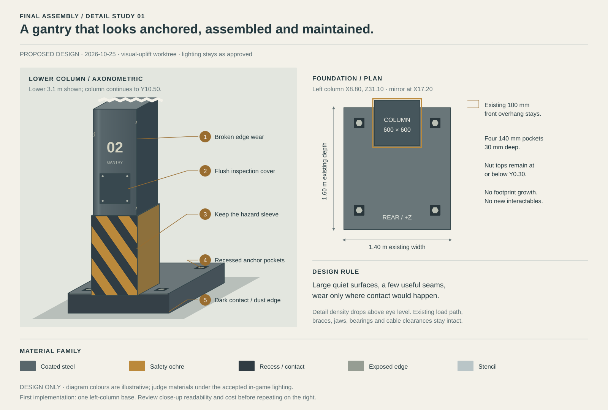

# Final gantry and robot assembly plan

Updated 2026-10-24 after the coordinated fixture and route pass. This is the
canonical full-workshop layout and major-section assembly plan. It selects
fixture contacts, equipment motions, parking, loaded routes and worker access
against the component contracts. These are **dimensioned design envelopes**, not
implemented equipment, structural certification or actual-solid clearance proof.
That documentation pass did not change the workshop scene, saves or runtime. Subsequent
implementation is tracked in the [implementation ledger](history/m3-wide-evidence-20261024.md#plan-implementation-ledger-through-task-09);
its partial equipment checks do not establish full-workshop or human access approval.

[Active workshop state](workshop-state.md) · [Layout drawing](final-assembly-layout.svg)
· [Robot dimensions](../proportions.md)

## Status and agreed direction

- Install **hip assembly → both legs → chest/cockpit → power core → backpack →
  both arms → head**. Preparation remains independent; gate installation on real
  support and access dependencies.
- Retain the leg journey's raised pose: soles world Y1.40. Eventual whole-robot lowering is
  undecided and is not included in these equipment motions.
- Use two side elevators and shared front/rear work platforms. Each elevator
  serves hip, waist, shoulder and head work.
- Use **one Limb Bay**, with one leg rig and one removable arm
  rig. One passive parking place for each prevents a half-built limb monopolizing
  the bay. Legs travel by rail; complete arms, including hands, travel by crane.
- Prepare hip assembly/socket/waist together and chest/frame/cockpit together. Keep
  shoulder armor off during arm connection. Build the head on its fixed neck.
- Reuse a single crane, an adjustable heavy module rig, one mobile work platform,
  the two elevators and contextual equipment controls. Do not add per-part machines.
- Preserve the satisfying leg-journey handling and local mistake correction. Full teardown
  and rendered-game review are not acceptance gates for this design pass.

The user approved the assembly direction and asked for this coordinated pass
without subagents. The derived dimensions below are selected planning decisions;
remaining detailed modeling must stay inside their reservations or revise this
plan explicitly. Component documents own mechanisms and fasteners; this document
owns equipment, routes and access. No competing planning snapshots are needed.

### Coordinate frame

Workshop coordinates are **world metres: X right, Y up, −Z forward**. Robot
coordinates are X right, Y forward, Z up. The raised mapping is:

`world = (13 + robot.X, 1.4 + robot.Z, 26 - robot.Y)`

| Landmark | Raised world datum |
| --- | --- |
| Sole / ankle / knee | Y1.40 / 2.40 / 6.50 |
| Left / right hip | (11.90 / 14.10, 10.60, 26) |
| Waist bearing / lean axis | Y11.90 / 12.30 |
| Chest mating plane / approach | Y12.70 / 12.88 |
| Core axis | X13, Y13.35; front–back |
| Left / right shoulder | (10.80 / 15.20, 15.80, 26) |
| Head base / helmet roof / crest | Y16.80 / 18.80 / 19.40 |
| Final feet | X11.25–12.55 / 13.45–14.75; Z23.80–26.80 |

## 1. Measured workshop and gantry layout

### Floor zoning and equipment quantities

Keep the existing **40 × 48 m floor**, world X−14..26/Z−9..39. Wall inner
faces are approximately X−13.85/25.85 and Z−8.85/38.85. Raise the proposed
full-workshop roof to Y25.0; the original leg journey's overhead equipment is insufficient.
The floor layout replaces conflicting prototype stock positions in a future
implementation; it does not claim to preserve every current rack.

| Area | Selected clear reservation / datum | Purpose |
| --- | --- | --- |
| Heavy Module Bay | **11 × 12 m**, X−2.25..8.75/Z6..18 | Hip assembly, chest/cockpit, core, open backpack and head-shell preparation on one adjustable rig. Chest seat source (3.25,0.85,13). |
| Shared long-limb bay | **7 × 13 m**, X10.5..17.5/Z7.8..20.8 | Both legs and arms, one at a time; centre X14, knee Z14.5. |
| Passive leg parking | X20..24/Z8..20.5; cradle centre X22, knee Z14.5 | Same leg rig, parked horizontally; no build console or turning here. |
| Passive arm parking | X11.8..16.2/Z−7..2.5 | Supported arm rig, about 2 × 9 m; shoulder source (14,1.55,−6.3). Crane transfers the whole retained rig. |
| Foot/small-component bay | X−11.5..−3.5/Z5..16 | Continue the existing detailed foot workflow; prepared-foot datum (−7,1.2,8). Internal full-foot tooling is the next component pass. |
| Small preparation and stock | X−11.5..8.75/Z−5..2 | Carryable mechanisms, hardware, sensors and reusable adapters. Keep stock ≤3.2 m high under the distribution routes. |
| Foot dispatch | (14,1.2,7); foot Z4.8..7.8 | Shared guided carrier into the supported leg root at Z9.4. |
| Mobile platform parking | X5.5..7.9/Z18.3..20.3 | One guarded adjustable work platform, stabilized footprint 2.4 × 2.0 m. |
| Loaded leg floor corridor | **X10.5..15.5/Z20.5..30.6** | Both hip approaches, tilt/rise and loaded holder; excludes pedestrians during motion. |

Main ground aisles are X8.9..10.4 and X17.65..19.15; front crosswalk
Z2.8..4.3 and gantry crosswalk Z20.5..22.0 connect them. Gate the latter during
rail travel and the left aisle during outboard empty-holder return. The front/right
alternative stays available. Rail crossings are flush, with moving-table gaps
covered/locked before pedestrian crossing. The implemented crosswalk gates hinge
at X8.4/17.6,Z20.5, outside the empty holder's X8.9..17.1 envelope. They swing
outward to open and close along the crosswalk entrances, with swept collision
checks. A separate ground occupancy interlock covers X8.9..17.1/Z20.5..30.6;
entry from another direction stops the rail. The shared crane console is now at
(7.8,0,22.8), clear of both the gate arc and the movable platform's parking berth.

**Equipment count:** one overhead crane/spreader; one transverse rail table;
one leg rig; one removable arm rig; one adjustable heavy module rig with exchangeable
contact inserts; one mobile work platform; two gantry elevators. Parking pedestals,
source dollies, removable guide beams and contact adapters are passive equipment.
The foot retains its existing foot rig and dispatch travel. These have
different physical jobs and do not create a new permanent console for each part.

**Motion query cost (2026-10-26):** retain live obstacle checks and the short
look-ahead, but explicitly straight rigid groups use endpoint overlaps plus one
continuous cast per shape. Equal endpoint orientations alone do not prove a
straight path; articulated routes and pose-dependent mating exclusions retain
sampling. Reuse revisioned rigid-load geometry and separate holder query boxes;
invalidate when construction or articulation changes. Avoid rewriting unchanged
live collision dimensions. [Rail-lag evidence and playtest](robot-workshop-playtest-checklist.md#rail-travel-lag--2026-10-26).

### Shared limb workshop with different departure routes

**Leg support.** Raise the horizontal leg root from the leg journey's Y1.35 to **Y1.85** for
the complete calf/holder envelope. Home knee is (14,1.85,14.5), root Z9.4.
Use a rear holder spine at robot Y−1.45, bounded −1.55..−1.35, behind the
calf's Y−1.15 rear bound. C-shaped yokes reach structural side pads at robot
X≈±0.80/Z2.80 and Z6.10; they avoid the central calf thrusters, knee axle Z5.10
and fork flange Z6.30. Permanent exposed frame pads avoid a late inaccessible
armor closure. Upper holder extent is robot Z6.30, not the former high contact.

Frame contacts become available as their receiving frames are retained. A removable
foot receiving bolster supports the prepared foot before shin frames exist. Keep
that bolster and the stationary rig engaged during construction and local brace
correction. The crane continues supporting each shin, fork or beam until both of
that connection's captive transport braces reach their engaged stops. Retention
makes the handles available; it never operates them. Neither ankle drives nor
knee rods carry the transport load.

**Explicit captive braces (2026-10-26).** Each leg has independently operated
outboard and inboard ankle, knee and beam-flange bridges. The ankle bridge joins
the foot side pad at leg Y0.40 to the shin at Y1.80; the knee bridge joins the
shin at Y4.50 to the fork cheek at Y5.56; the beam bridge joins the fork cheek at
Y5.56 to the beam at Y6.30. These are Godot leg-local coordinates (Y follows the
leg's length). Ankle/knee equipment starts attached to the actual shin stock;
beam equipment starts attached to the actual fork stock. On installation the same
nodes follow the leg, including intermediate rotations, hip mounting and rig
withdrawal. They never become loose inventory or appear on an empty leg.

The prototype uses captive sliding shoes and telescoping links, one handle on
each side; paired operation is deliberately independent. Handles sit at
X±0.74, Z−0.50 beside each fixed contact and remain within X±0.80. The measured
solid stow/deployment bounds below include both sides. Z is depth in this table.
The telescoping path is monotonic, so the full swept bounds equal the deployed
bounds. Handles stay inside that cross-section. No rail/crane route was changed.

| Bridge | Persistent attachment | Parked Y | Deployed / swept Y | X / Z in every pose |
| --- | --- | --- | --- | --- |
| Ankle | Shin upper contact | 1.520..1.920 | 0.280..1.920 | ±0.710 / −0.530..0.625 |
| Knee | Shin lower contact | 4.380..4.780 | 4.380..5.680 | ±0.710 / −0.530..0.130 |
| Beam flange | Fork cheek | 5.440..5.740 | 5.440..6.420 | ±0.710 / −0.530..0.130 |

Source poses use the inverse receiving-member transform, keeping each parked
bridge attached to its physical shin/fork through pickup and delivery; source
load sweeps include those captive solids. Their stowed cross-section fits the
existing ±0.80 / ±0.75 structural transport envelope. Before indexing, parking,
rolling or delivery, lock every brace whose joint has been retained. This permits
unfinished-leg parking and foot-only work without demanding a future fork/beam.
Before stowing the foot bolster, lock all retained joints. Crane connector release
requires the matching joint's locks, retaining crane support through engagement.

Only a neutral, stationary leg rig at construction height, with its foot bolster
engaged, permits local stowing. A bare fork does not reach the upper yoke at
Y6.10 (its flange ends at Y5.92), so stowing knee braces before beam retention
also requires both crane connectors reacquired at the stationary fork. Once the
retained beam reaches the upper yoke, the rig supports that joint. Locked or
partly deployed braces block undo of
their attachments and joint retention. Guarded motion uses the actual animated
boxes and waits for obstacles; a waiting handle can reverse its partial stroke.
Snapshots restore explicit engaged/parked stops; construction completion never
recreates an engagement. Stage preparation operates the same handle commands.
Final slide construction, materials and manufacture remain a component detail
pass; handle visibility/reach and the full transfer remain player rechecks.

The sweep uses these leg-local **robot-axis** transport bounds; later internal
workflows must preserve them or reopen the affected route explicitly:

| Loaded region | X about leg centre | Y front/back | Z above sole |
| --- | --- | --- | --- |
| Complete FA-01 foot/guards | ±0.65 | −0.80..+2.20 | 0..1.60 |
| Shin/calf | ±0.80 | −1.15..+0.75 | 1.60..4.60 |
| Knee / thigh | ±0.80 | ±0.75 | 4.60..5.60 /5.60..8.77 |
| Hip ball/collar tip | ±0.45 | ±0.45 | 8.75..9.65 |
| Holder rear spine | ±0.12 | −1.55..−1.35 | 2.65..6.25 |
| Side yokes | ±0.78..1.05 | −1.50..+0.05 | 2.80±0.13 and 6.10±0.13 |

Keep fixed yoke side arms outside |X|0.90 wherever they overlap calf depth;
only the moving contact fingers reach inward to the frame pads. Their0.15 m
opening stroke clears the body before the holder lowers/withdraws.

The cradle is 2.10 m wide normally, 2.30 m with its jaws open. Its bogie is
1.50 × 1.65 m, ≤0.60 m high, on the inherited 1.24 m rail gauge. A flush
transverse table spans **X10.5..23.4/Z13.25..15.75**. It moves the short bogie
while the supported leg overhangs it. Index from common X14 to left X11.9
(−2.1 m), right X14.1 (+0.1 m), or parking X22 (+8.0 m). Align and pin the
track ends before longitudinal movement; retain all four wheel contacts and
anti-tip restraints throughout indexing. Parking movement is horizontal only.

For a robot-local point `(a,b,c)` relative to the leg centreline, the selected
loaded transition is:

```
world.X = lane + a
lower = 0.30 clamp((90deg - theta) / 22.5deg, 0, 1)
world.Y = 0.5 + 1.35 sin(theta) - lower + dock + c cos(theta) + b sin(theta)
world.Z = kneeZ + (c - 5.1) sin(theta) - b cos(theta)
```

First travel knee Z14.5→26 with theta=90° and dock=0; then turn theta90°→0°;
then raise dock0→1.2. The leg root ends at Y1.4. This preserves the leg journey's supported
travel/turn/rise pattern while increasing horizontal floor clearance. Open the
hip front wings and stow the rear hip bridge before travel. The conservative
full leg and cradle sweep reaches Z30.572. The updated payload floor minimum is
0.200 m at the upright pre-dock pose; the original 0.300 m estimate below is
historical. The 0.30 m lowering is an implementation correction from the actual
rear cylinder parking-hook collision during the final turn. It begins only after
rotation starts, reaching full lowering at 67.5°; lowering during horizontal travel
would put the holder bearing into the floor. Source construction height stays1.85.
The implemented structural leg clears these actual solids in the mechanical test;
the complete armored leg envelope still needs its later actual-solid check.
Hold the leg throughout hip retention, cylinders, pins, services and neutral locks.

For rear construction at the station, raise the long rotation axis to **Y3.10**
and roll the supported leg about its long axis. Foot sweep radius is 2.294 m:
X11.706..16.294 and minimum Y0.806. Park the mobile platform and close the work
zone before rolling; work only at locked stops. Restore neutral roll and Y1.85
before indexing. At a stationary work pose, the platform can dock at left
X10.55..12.95 or right X15.05..17.45. Reserve an unobstructed **1.20 m knee-axle
corridor outward**: left axle enters from −X, right mirrored axle from +X.

**Empty holder return is a separate measured motion.** After the hip supports
and restrains the leg, open jaws 0.15 m, lower the fork 0.30 m and withdraw it
**1.40 m rearward**, putting its nearest tip0.20 m behind the calf.
Fold the released side yokes inward to the 2.00 m empty width, then shift the *fork head* 2.00 m outboard, to X9.9 or 16.1; the
bogie remains on its original hip rails beneath the feet. Cross-slide/linkage
height ≤1.0 leaves ≥0.4 m below the raised soles. The outboard mast and rear fork
clear both legs; no extra full-length return tracks are required. Keep the compact
fork within local X±1.0/Y−2.95..−1.35/Z2.65..6.30. Turn it back to horizontal
with root height `1.1 + 2.25 sin(theta)` while returning: its floor margin is
0.40 m and highest point 7.464 m. Re-centre only at home, clear of the robot,
then restore source settings. A loaded cradle never uses this outboard release path.

**Prepared-foot carrier handoff.** At dispatch, keep ankle/forefoot neutral
and the carrier's structural contacts engaged. Raise the upright sole datum
Y1.20→1.85, advance it Z7→9.4, then turn90° about worldX into the horizontal
leg pose. For foot-local `(a,b,c)`, the turn maps to
`(14+a, 1.85+c*cos(theta)+b*sin(theta), 9.4+c*sin(theta)-b*cos(theta))`.
The FA-01 foot box X±0.65/Y−0.80..2.20/Z0..1.60 stays within
worldX13.35..14.65/Z7.20..11.189 during the turn, with minimumY1.05.
The receiving bolster clamps the frame before the carrier releases/retracts;
stow that bolster only after the retained shin/frame supplies the next support.
This is a full-workshop source setting for the leg journey's existing supported handoff pattern,
not a claim that today's carrier already reaches the new datum. No platform or
loose supply occupies the transfer volume during the turn.

**Arm support and parking.** A removable 2 × 9 m cassette carries three adjustable
structural saddles/clamps at arm stations t1.35/4.05/6.05, joint bridge restraints
and the digit cradle. It shares the build bay but not the leg's contact geometry.
A four-end lift moves the whole retained cassette to/from the front parking
pedestals, with its lowest point at least Y4.80. After the arm lifts clear, fold released cassette clamps belowY1.70 before
upending the suspended load. Keep the cassette horizontal;
park any loose parts in stock first. Every partly built member must be positively
held by the cassette before switching bays. Passive parking for **both** carriers
allows a swap without needing a vacant station to hold the displaced carrier.

### Heavy module rig and source access

The shared rig uses adjustable crossbeams with structural saddles, clamps,
height adjustment and a braked tilt pivot. Change contact inserts for each load;
these are equipment, not robot inventory. Record occupied supports and locks in
future saves. Never release the last load-bearing clamp just to change pose.

| Load | Source support / access setting |
| --- | --- |
| Hip assembly | Hip datum (3.25,1.20,13); prepared bounds X±2.01/Y0.49..3.42 including the descending cylinder clevises/catches. Support the bridge's existing bearing patches and hold-down faces, leaving sockets and waist work open. Upper work uses the shared platform. |
| Chest/cockpit | Seat datum (3.25,0.85,13); mapping `(3.25+X, 0.85+Z-11.30, 13-Y)`. Prepared bounds X0.51..5.99/Z11.80..14.35, top Y5.13. |
| Bare chest service pose | Before cockpit insertion, shift the supported seat to (3.25,1.30,14.60), then tilt up to 60° forward about world X. Swept bounds X0.51..5.99/Y0.261..5.788/Z10.293..15.95. Return upright and to the normal seat before inserting the capsule. |
| Cockpit insertion | Supported source dolly/fixture guides, 2.40 m forward approach and 0.05 m final lowering. The front approach reaches Z9.50. No tilting the loaded capsule. |
| Core | Horizontal saddles under structural rings; preserve forward bridge and rear pad access. Use adjustable height/roll to expose connections, then lock for pickup. |
| Backpack | Open 90°, face down on perimeter contacts, clear of nozzles, strut eyes and services. Transfer in that same restrained orientation. |
| Head pieces | Upright structural feet/flange contacts centred X3.25/Z13; baseplate bottom Y0.60, other pieces Y0.85. |

The **one mobile guarded platform** has a stabilized 2.40 × 2.00 m footprint,
clear standing deck approximately 1.20 × 1.40 m and deck settings 1.60–2.40 m
with ground boarding/lowering. The player may ride it, with a hand load, between
docks on the lowered deck; loose loads on the deck block a transfer. It must not need a separate fixed staircase
outside that footprint. Chest side docks are left X−2.15..0.25 or right
X6.25..8.65, leaving 0.26 m to the upright load and the opposite side open for
walking. Front dock Z7.8..9.8 leaves **0.493 m** to the bare-frame tilt sweep.
Rear dock Z14.6..16.6 is used only in the normal upright source pose; stow it
before shifting or tilting the bare frame. Do not draw the one platform in all
positions as if multiple platforms existed. It parks outside both crane pickup
and limb rolling envelopes. Its guards, stabilizers and controls must fit these
bounds; actual footing/stability remains equipment engineering.

### Shared elevator access to hips and shoulders

Move both elevator shafts **behind the shoulder line**, to centres
**(6.6,*,29.0) and (19.4,*,29.0)**. This frees the front bridge swing and puts
shaft structure behind the arms. The same car services ground0.15, hips8.4,
waist11.2, shoulders14.0 and head16.4. With 0.20 m decks the minimum overhead
walking clearance is 2.20 m; car roof/gear must fit within 2.10 m above its deck.

| Access element | Selected world bounds / clear size |
| --- | --- |
| Complete shafts | X5.0..8.2 /17.8..21.0; Z27.4..30.6 |
| Cars | 2.6 × 2.6 m: X5.3..7.9 /18.1..20.7; Z27.7..30.3 |
| Shelf | Inside car's front wall, Z27.8..28.2; 1.50 m wide, left X5.60..7.10/right 18.90..20.40; shelf surface +0.65 above deck |
| Shelf capacity | One two-hand panel up to 1.45 × 0.35 × 1.20 m, or two one-hand parts. Panel top +1.85 fits the 2.10 m roof/gear budget. Car retains a 2.6 × 2.1 m rear turning area. |
| Car doors | Inboard and outboard, 1.5 m clear across Z28.5..30.0. Guides stay in corner bands Z27.4..27.7/30.3..30.6. |
| Outer walks, all elevated levels | Left X3.5..5.0/right 21.0..22.5, Z23.4..37.3; 1.5 m clear, rails add ≤0.10 m outside |
| Rear crossover | X5.0..21.0/Z35.8..37.3; 1.5 m clear, behind the rear lifting well |
| Inboard rear branches | X7.9..9.7 /16.3..18.1; Z28.5..30.0 |
| Rear work flanks, upper levels | X9.7..11.4 /14.6..16.3; Z27.4..30.1 at all three upper levels |
| Aft core fingers, only level 11.2 | Same X bounds, Z31.7..35.8, reached from rear crossover; worker centre ≥Z31.96. |

Shelf storage uses authored `handling.shelf_rotation_degrees` for both the fit
check and the actual pose. PV-120 stands upright (90° about X), with combined
visual/collision bounds **1.36 × 0.68 × 0.08 m** (width/height/depth). PV-200 leans
50° about Z: the three cartridge bounds are at most **1.320 × 1.166 × 0.240 m**.
Both fit the existing 1.45 × 1.20 × 0.35 m cargo volume without widening either
shelf, entering the side-door zone, or changing the landing/hip approach.
Four captive adjustable shelf clamps stay parked on the empty shelf and contact
authored surfaces of stored bulky cargo. Their stems run down to the shelf;
future components must author a supported orientation and truthful contact points,
rather than increasing the universal allowance. Capacity remains one two-hand
part or two one-hand parts. Store, actual upward/downward lift travel, exact-UID
retrieval and full-capacity rejection pass in the isolated `shelf_storage_test`;
visual support/readability and player use remain unreviewed.

No inner head-level shortcut passes beside the shoulder. It would obstruct the
arm's vertical crane lines. Walk from the front to the rear via the **outer
perimeter and elevator landings**, keeping the central body and cable wells open.
Both exits connect to useful work paths; opening a cargo bridge never traps a
player on an isolated landing. Normal continuous paths are ≥1.2 m clear, primary
paths 1.5 m. Gates and structure belong outside those widths.

The implemented sliding access barriers stow **inboard**, behind the closed
wings: their parked spans are X5.1..6.6 /19.4..20.9 at Z24.85. They slide across
the outer walks before wing unlocking. Outboard parking would intrude into the
already reserved X23.7 crane-line bypass and is excluded.

**Front bridge motion.** At each elevated level, two 8 m wings run from outer
roots (X5/Z24 and X21/Z24) to X13, with clear width Z23.4..24.6. Floors and
side trusses/rails fit Z23.3..24.7; truss/guard height 1.10 m, floor depth 0.20 m.
Use supported outer hinges and positive centre/outer locks. Each wing swings
90° **forward in plan**. Main stowed strips are X4.3..5.7 and 20.3..21.7/Z16..24;
work fingers telescope into/beneath their wing before it swings. This leaves a
**14.6 m open delivery window** (X5.7..20.3), more than the prepared chest's 5.8 m requirement.
Gate the outer walk before Z24.7 while stowed; its elevator/rear portion remains
connected. Wings move only empty, with the load outside their swept footprint;
close them only after the seated load and all lifting lines clear their sweep.
Extend work fingers only after the main wing is locked. Hip fingers extend1.2 m;
waist fingers use two telescoping stages for2.0 m extension. Both stow inside the
1.2 m wing depth and 0.2 m deck band with rails collapsed. Waist service fingers
stay stowed once arms arrive. These sequenced movements use the same access
configuration; the player does not operate each extension separately.

**Rear hip bridge motion.** At deck 8.4 two 2.9 m bridges run inward from
X10.1/15.9 toX13 acrossZ27.35..28.55. Each has **two 1.45 m leaves**: fold the
inner leaf back above the outer, then raise that stack90° at its root. Folded
guards stay inside the 0.40 m stack thickness; stowed bounds are nearX10.1/15.9
±0.20, Y8.4..10.05. This is below the next deck underside11.0 and outside the
loaded cradle by≥0.45 m. Both leaves fold **upward**, keeping the moving floor
above Y8.20 and clear of the held cradle below. A single leaf folding down
would sweep through the rear holder while closing.
Root aprons X8.2..10.1 /15.9..17.8,Z27.35..30.1 connect to the cars, supported
from lift towers/perimeter without ground posts in rail/empty-fork routes. The
calf ends atZ27.15, leaving0.20 m to the bridge. Closed deck undersideY8.2
clears loaded holder top 7.7 by 0.50 m. Unfold after docking while the cradle
still carries the leg; lock both joints before workers enter for rear pin work.
The bridge's fold height stays below the gantry bearing arms atY10.65.

| Work patch | Deck / eye height | Access and target |
| --- | --- | --- |
| Hip ring | 8.4 /10.03 | Front fingers X9.6..10.8 /15.2..16.4,Z24.3..25.8. Preserve the leg journey's stance near (10.4,8.4,25.4), mirror for right. Far ring bolt about 2.16 m from eye. |
| Hip cylinder pins | 8.4 /10.03 | Front standing Z24.30, rear 27.65, X aligned with target. Lower pins Y8.80, eye distances1.71–2.00 m. Two front/one rear insertion, reserve0.34 m plus tool clearance. |
| Gantry hold-down handles | 8.4 /10.03 | Rear stance X11.6/14.4,Z27.75. Posts stay at X11.60/14.40,Y10.80,Z26.55/26.75. Forward grips stick outboard of the posts; rear grips reach back toward the deck. Both stay below the bridge and clear of the socket, so neither grip is hidden inside its post or behind the other. |
| Waist bolts / side services | 11.2 /12.83 | Front/rear pockets X12.16/13.84,Y12.80–12.86,Z25.42/26.58. Side fingers X10.35..11.50 /14.50..15.65,Z24.6..26.6 clear the socket crowns; they are used before arms, then stowed before arm delivery. |
| Distal arm rig release | 11.2 /12.83 | Front patch X9.1..11.0 /15.0..16.9 and rear flanks; standing X10.05/15.95,Z24.3/27.7, reach≈1.69 m. |
| Shoulder retention / proximal rig | 14.0 /15.63 | Standing X10.6/15.4,Z24.3/27.7; ring heads≤1.48 m, rig≈1.15 m, drive pins≤1.77 m. |
| Core initial work | 11.2 /12.83 | Rear standing X11.1/14.9,Z27.8; maximum selected flange-bolt reach 2.231 m. |
| Backpack hinge / struts | 14.0 /15.63 | Rear flanks at X11.1/14.9,Z27.75..28.2, selected targets≤1.454 m. |
| Core maintenance re-rig | 11.2 /12.83 | Aft fingers: forward contact/handle from X14.9,Z32.0, distances≈2.14/2.05 m; rear pad from Z32.2≈2.04 m. |
| Head | 16.4 /18.03 | Front X11..15/Z23.4..24.6 and rear flanks. Rear neck bolts≈2.24 m before shells; crown rig≈1.52 m. |

Player body is Ø0.52 ×1.70 m; eye1.63 above deck, maximum interaction reach
2.35 m. Routine targets should be nearer1.8 m. Reach exceptions above require
open tool lanes and clear sight; they are not permission to fasten through solids.
Work-edge gates/guard sections open only for the active supported connection,
with outer guards retained. Do not put a solid toe board across downward hip pin
or ring sight lines. Shared shelves deliver cylinders and small head panels;
local clevis parking catches free the hands for fastening, without another lift arm.

### Gantry support and rear service reservation

Replace the old tall gantry crown with a **low, rear-braced hip assembly portal**.
An overhead bar across the rear would intersect the core/backpack crane cables.
Columns centred X8.8/17.2,Z31.1 are0.60 m square, body topY10.50. Crosshead bounds
X8.5..17.5/Y10.5..11.1/Z30.8..31.4. Feet occupy
X8.1..9.5 /16.5..17.9,Z30.9..32.5; rear braces stay Z31.4..33.0 near their
columns, outside the work flanks and beyond the elevator shafts.

Two cantilever arms occupy X12.35/13.65±0.18,Y10.65..10.95,Z26.5..31.1.
Bearing caps rise to **Y10.97** at Z26.52..26.78, mating the hip bridge
patches. Their undersides leave **2.25 m** over the rear hip deck. Four jaws
contact the selected bridge faces at Y11.23, with complete jaw envelope≤11.30.
Outboard handles at the coordinates above operate linked jaws, so workers see
and reach them beside the beams. Waist locks remain robot hardware, distinct
from gantry clamps. Structural capacity, bracing sections and bearing fits need
engineering; the load path and occupied envelope are now specified.

Keep the rear upper central opening **X11.4..14.6/Z27.2..35.3** clear of fixed
upper floors. The crosshead occupies only its stated lower band. The aft lifting
well is X11.4..14.6/Z31.7..35.3, open vertically to the crane. The closed pack
reaches Z28.2; its normal90° sweep reaches Z30.173, with conservative allowance
toZ30.3/Y16.6. Outer rear flanks remain usable with it open.

For later core service, fit two removable guide rails and **two crossframes**
anchored on the low rear-flank/aft-finger pads at X11.1/14.9,Z29.5 and 32.1.
Crossbeam topsY12.60; guide upstands contact nearY13.05. This supports rails to
Z32.3 without imaginary posts in the central floor opening. Core bottomY12.88
clears the crossbeams by≥0.28 m. A guarded chain/handwheel at robot
(+0.75,−2.75,10.9), before the crosshead, drives the captured carriage. Withdraw
**5.0 m** before vertical crane pickup; re-rig from the aft fingers, then remove
and stow this generic fixture kit. The waist is locked neutral for rear service.

### One crane and measured loaded routes

Useful crane coverage is **X−11..24/Z−7..36**. Runway columns at X−12.5/25.4
(width 0.60) and Z−7/3/19/37 stay outside the work aisles. Keep feet inside the
walls. RoofY25.0, truss underside24.5, bridge 23.70..24.25 and lowest trolley/
fitting **Y23.0** define the overhead budget. Put lights/services above that
limit outside the routes. One configurable two/four-end spreader, lifting shoes,
equalizing bridges and restrained payout serve all loads. These are new capabilities
beyond the leg journey's two-end crane, not claims about current implementation.

| Load | Source-to-destination path, in world metres | Support handoff / access state |
| --- | --- | --- |
| Prepared foot | From (−7,1.2,8), lift sole datumY5.0; move toZ7, across toX14, lower to(14,1.2,7). Keep structural carrier and ankle/forefoot locks engaged. | Guided dispatch carrier hands to temporary leg receiving bolster at rootZ9.4/Y1.85; receiver retains before carrier releases. Preserve the existing foot identity and supported turn. |
| Parked arm cassette | Whole retained cassette lifts with lowest pointY4.8; alongX14 between shoulder Z9.9 and−6.3. | Four lifting ends; parking pedestals/clamps take load before release. This passes ≥0.75 m above the horizontal foot envelope. |
| Hip assembly | Hip datum (3.25,1.2,13)→Y10.8→X13→Z26→Y10.6. Prepared bottom during carry10.09, top13.02 including the upper clevises/catches; rig budget≤14.5. | Open front wings11.2/14/16.4. Hip front/rear work decks stay available. Four jaws and waist locks before crane release; restore upper access for rig release. |
| Chest/cockpit | Seat (3.25,0.85,13)→Y12.88→X13→Z26→Y12.70. Rig budget≤18.23. | Open front 14/16.4; waist11.2 stays closed, guard top 12.3 is0.58 below incoming chest. Four bolts and waist locks before release from upper decks. |
| Complete arm | Source shoulder(14,1.55,9.9); raise horizontal toY9.6, perform the restrained upend/yaw/splay below, raise toY14.709, advance toZ19.5, align X10.508/15.492, advance toZ26, seat1.13 m up/in. | Open all four front levels before entering. Keep four ends/taglines tensioned. Close clear wings after seating, complete ring/neutral restraint/drives/services, then release proximal/distal rig and fit armor. |
| Core | From the Heavy Module Bay, at axisY6.0 cross alongZ13 toX23.7; travel rear to frame-originZ32.4; shift outboard toX24; raise axisY18.47 (lowest point18.0); cross toX13; lower axisY13.35; advance originZ28.2 then insert2.2 m toZ26. | All rear floors stay fixed. Raise outside the outer walks, then cross above their highest guards. At captured-guide engagement0.32 m, transfer forward support before removing its magnetic connector; the aft magnetic connector stays attached through retention. |
| Open backpack | From the Heavy Module Bay at hingeY5.5, cross alongZ13 toX23.7, move hingeZ31.8, shift outboard toX24, raise hingeY18.0, cross toX13, lower hingeY15.7, advance hingeZ27.2, lower0.2 m. | All rear floors stay fixed. Body during low travelY5.5..6.5; high crossingY18.0..19.0. Hinge pins, strut pins and positive open locks before release. Crane takes weight again before closure. |
| Head pieces | Source X3.25/Z13; raise until **lowest loadY19.0**, cross toX13 thenZ26, lower to the component's specified approach/seat. | Front wings remain closed; transit clears head-level guard top 17.5 by 1.5 m. Highest hookY21.58,1.42 below lowest obstruction. |
| Pauldrons | Source bottomY0.75; lift to **lowest loadY18.0**, route via front distributionZ13 to the shoulder X, thenZ26. Descend over the clear destination to the 1.6 m final approach and seat. | Keep upper platform cable wells open. Body top 19.4 and hook≈20.53; the final approach alone is not the across-workshop carry height. |

**Arm reorientation.** The source axes are u=+worldZ along the arm,
e=+worldY and f=+worldX, with the left jig mirrored. This exposes both rigging
pairs from the two bay sides instead of hiding one pair underneath. The conservative
box is t−0.43..7.45/e±0.55/f±0.75. Source bounds are
X13.25..14.75/Y1.00..2.10/Z9.47..17.35. At shoulderY9.6:

1. Upend90° about worldX: `u=(0,-sin(phi),cos(phi))`,
   `e=(0,cos(phi),sin(phi))`, `f=(1,0,0)`.
2. Yaw the vertical arm90° about worldY, mirrored appropriately:
   `u=(0,-1,0)`, `e=(sin(psi),0,cos(psi))`, `f=(cos(psi),0,-sin(psi))`.
3. Splay15° to its side: final `u=(±sin15,-cos15,0)`,
   `e=(±cos15,sin15,0)`, `f=(0,0,-1)`.

Use continuous constrained motions with four equalized ends and tensioned taglines;
the intermediate yaw is not a free suspended spin. Across both sides the upending
and splay body envelope stays X11.54..16.46/Z8.97..17.371, minimumY2.129.
Reserve1.80 m above the shoulder datum for the spreader/hook. Final seated
rigging planes are Z25.32/26.68, clear of front platforms ending24.7 and rear
platforms starting27.3. Actual cable fan-out must stay inside that clear corridor;
there are no head-side shortcut decks crossing it.

The 2026-10-24 source preflight corrects the final approach offset from 0.65 m
to **1.13 m**. At the earlier height, the ball advanced through the fixed front
drive clevis at t0.64; checking only the axial socket entry missed that transverse
collision. The corrected ball approach is 0.464 m lower and 0.124 m farther
outboard, then seats along the same −u axis. Both mirrored complete-body/full-rig
paths pass against the actual torso, fitted legs, opposite arm, cassette and
parked equipment. The upper rig anchors also stay outboard of the cup.
Actual swivel-end cable centres use f±0.72, 0.04 m beyond the nominal pad faces;
the spreader and cable solids stay within Z25.23..26.77 at the seated pose.
The main spreader is 1.35 m above the shoulder, with its hook top at +1.67 m,
inside the existing 1.80 m budget. These are mechanical source checks, not
walking, reach, rendered review or an implemented arm-installation workflow.

The core's guide handoff also changes the equalizer configuration. At captured
engagement, stow the forward bridge, then fold its unloaded spreader arm and
shift the head aft while the core remains stationary. The compact head clears
the rear spine/cockpit during one-end insertion. Restore the full rig at capture
before refitting the forward bridge for return. Authored dimensions and actual
solid checks are recorded in the [core implementation](../torso/backpack-and-power.md#robot-workshop-core-implementation--2026-10-24).

The [backpack source preflight](../torso/backpack-and-power.md#robot-workshop-backpack-source-and-route-preflight--2026-10-24)
includes its actual hinge eyes, stowed struts, pad shoes, spreader and all cables.
Hinge-eye material extends0.065 m below/forward of the nominal open-body rectangle,
inside the reserved mechanism/lifting-well margin. Actual high-crossing guard
clearance is0.435 m and lowering-point crosshead clearance0.335 m. The waypoints
above remain unchanged. During closure, the head stays at least2.08 m above the
hinge while the cables pay out; following the lowering pads with a short fixed
drop would put the spreader inside the cover. Player-operated installation and
closure are now integrated, including take-weight, open locks and lower draw
latches. Source/rig preflight and mechanical save/restore checks remain distinct
from the user's walking and connection-access playtest.

**Rear route has a low bypass and an outboard lifting well.** During low
travel at X23.7, core/backpack cable/spreader projection stays within X±0.90
of the route centre. Its inner edge22.8 clears the outer-walk rail edge22.6
by 0.20 m. The pack body reachesX24.9, leaving0.20 m to the right runway column
inner face25.1. Its inner edge22.5 passes *under* the outer walk, with1.70 m
vertical clearance from body top 6.5 to first-deck underside8.2.

**Do not cross inward at this low height:** vertical suspension lines would
intersect the continuous outer walks and aft work fingers. At the rear waypoint
(core frame-originZ32.4 / pack hingeZ31.8), shift the crane centre outboard to
**X24.0**, then raise until the lowest point is **Y18.0**. This outboard lifting
well reserves X22.8..25.2/Z31.7..34.7 throughY23.0, between runway columns
atZ19 and 37. Pack side clearance to the outer-walk rail is0.20 m; its right
edge25.2 leaves0.65 m to the wall, and its rear 34.6 is2.10 m before the next
column. Crane spreader/lines stay withinX23.1..24.9. Core uses this same well.

Traverse inward toX13 **above** the highest guard topY17.5, with0.50 m load
clearance. Core axis is18.47 (flange radius 0.47); its highest rig allowance is
about 20.25. Open-pack hinge is18.0, body top 19.0 and hook about 20.08. Both
fit belowY23.0. Once centred in the rear opening, lower core axis to 13.35 or
pack hinge to 15.7, then approach the robot. At that lowering position, core
frontZ31.75 clears crosshead rear 31.4 by 0.35 m; pack front 31.8 clears by 0.40 m
and its rear 34.6 clears crossover rail front 35.7 by 1.10 m. Its sides leave0.40 m
to the aft work fingers. The rear gantry has no high crown across these lines.
All rear walks/fingers remain fixed and usable outside the excluded cargo well.
Reverse these waypoints for a supported return; do not lower into the crosshead
or drag suspended lines through a walkway.

### Equipment states and interaction economy

| Delivery state | Front wings open | Rear hip leaves | Player route while moving |
| --- | --- | --- | --- |
| Hip assembly | 11.2,14.0,16.4 | Closed | Hip level and rear/perimeter routes |
| Leg travel/tilt/rise | 8.4 | Folded up in two leaves | Other levels and rear perimeter; ground corridor gated |
| Leg connection / holder release | None required | Closed | Both front/rear hip work patches, same elevator |
| Chest | 14.0,16.4 | Closed | Waist level, rear and perimeter routes |
| Arm upending/delivery | 8.4,11.2,14.0,16.4 | Closed | Rear/perimeter routes; restore front after seating |
| Core / backpack | None | Closed | Rear flanks and fixed aft fingers; low bypass, outboard lift, high crossing |
| Head / pauldron | None | Closed | Head/shoulder work patches; high transit above guards |

A delivery selects a **shared access configuration**, not eight independent
bridge puzzles. The same Advance/Stop/Return and crane Up/Down/Go vocabulary
operates contextual destinations and supported poses. Before movement, verify
occupancy clear, load retained, route ready and locks engaged; show the actual
reason if blocked. Bridge opening can be part of the guided delivery sequence,
with visible machines and gates. Connections still require walking to the part.
Temporary support exchanges are explicit: take weight → release old support →
move → seat/retain → release equipment. Preserve build identity, interrupted
states and local return; parking does not reset progress or duplicate stock.

## 2. Agree the major-section assembly sequence

The recommended player order remains selected. Preparation can happen independently;
installation prerequisites must represent real support or access constraints.
The table defines prepared deliveries and their receiving work, rather than a
complete inventory of every mechanism inside them. Mechanical dimensions and
hardware allocations belong to the linked component specifications.

| Order | Preparation and handling | Gantry connection / support release |
| --- | --- | --- |
| 1 — Hip assembly | Heavy Module Bay: build bridge, both socket housings, yaw/lean mechanism and neutral locks. Prepared envelope **4.02 W × 1.80 D × 2.93 H**, including the descending cylinder clevises and parking catches. Four structural lifting eyes; leave cylinders, rings and guards off. | Seat bridge bearing patches at world Y **10.97** and close four gantry hold-downs. Release crane only with structural support and waist locks confirmed. |
| 2 — Both legs | Limb Bay: prepare each leg on the leg rig, with integral hip ball, leg-side lugs and service tail. Index to the appropriate lane; travel, tilt and raise. | Existing ring retention, split stop cage, three hydraulic cartridges/six eye pins, positive neutral locks and services. Keep rail support through this work; withdraw the empty leg rig, then close guards. Repeat on the other side. |
| 3 — Chest/cockpit | Heavy Module Bay: upright frame with retained cockpit, refitted front ties, sockets and fixed neck. Current width **5.48 m**, depth **2.55 m**; height **4.28 m**, including the keyed neck tip. Four structural crane pads. | Seat at world Y **12.70** through **0.18 m** final lowering. Fit four M36 bolts/washers, verify support/waist locks, detach the magnetic connectors, connect side services and close connection areas. |
| 4 — Power core | Heavy module rig: horizontal **Ø0.84 m** cartridge, **Ø0.94 m** rear flange, **1.81 m** total axial bounds. Crane supports the initial rear approach at world Y **13.35** axis height. | Advance **2.20 m** towards the front. At 0.32 m captured-guide engagement transfer forward support to the guide, then seat flange, secure four captive bolts and rear interlock before final crane release. |
| 5 — Backpack | Heavy Module Bay: prepare **2.40 W × 2.80 H × 1.00 D** pack on perimeter supports in its 90° open orientation. Reuse crane and adjustable spreader. | Approach hinge 0.20 m high, lower, fit two hinge pins and two strut-base pins, lock both open struts, release crane and connect services. Reattach crane for controlled closure, seat both locators and latch. |
| 6 — Both arms | Shared limb bay: connected upper arm, forearm and hand; shoulder armor off. Restrain elbow/wrist/digits. Crane lifts horizontal shoulder datum to world Y **9.60**, then performs the guided upending motion. | Align the ball **1.13 m** down/out from its seat, advance up/in, retain split ring, establish neutral restraint and complete actuation/services. Release crane from accessible pads; fit pauldron. Repeat opposite arm. |
| 7 — Head | Small sensor preparation at bench; the heavy module rig and crane for larger shells. Build on the torso's fixed neck, with arms and backpack already fitted. | Baseplate → sides/rear wraps → structural top → sensors/connections → front faceplate → mask → decorative crown. Each lifted piece is retained before the magnetic connectors are released; keep front sensor path open until its work is complete. |

### First delivery: hip assembly

The [hip assembly specification](../torso/pelvis-and-waist.md) owns sockets, bearing
patches, hold-down faces, lifting eyes and waist locks. Build this unit on the
heavy module rig, leaving leg rings/cylinders/guards off. The crane puts its bridge
on the new Y10.97 contacts. From the rear hip deck, operate the four outboard
jaw handles and verify waist locks. Restore access above only when the load/rig
clears the wing sweep; detach the four lifting adapters from the 11.2 level.
The robot is then supported independently of the crane.

### Both legs: rail delivery and hip completion

Retain the leg journey's Ø0.90 ball/Ø0.30 neck, socket, interchangeable ring halves and four
upward M24×140 bolts/washers per hip. Complete leg-side lugs/services at the
station. Use the rail route above, then close the hip access bridges while the
cradle remains engaged. Fit ring, stop cage, three cylinders/six eye pins,
services and positive neutral locks. Cylinders ride the finite shelf and use
local clevis catches/resting saddles. Only then execute empty-holder withdrawal
and close guards. The opened holder leaves0.25 m to the first leg's conservative
±0.80 m body bound on the 2.20 m-spaced lanes. Enforce the selected transport
bounds through later armor design; a wider calf requires revisiting this route.

The robot workshop implementation now exercises both structural legs through this
route, with distinct mirrored source/receiving geometry and independent retention.
Both prepared feet begin on separate bay supports, at sole datums(−7,1.2,8)
and(−7,1.2,13). Four magnetic contacts use the exposed FA-100 rail tops at
foot-root X±0.50/Y−0.36/Z−0.20 and1.20. The crane takes support, lifts the sole to
Y5.0, moves toZ7, crosses toX14 and lowers onto the dispatch carrier. The carrier
returns empty after seating each foot; selecting another leg never moves an
occupied build. Source-rack right-side frames start0.7 m behind their left partners
to separate the exposed1.6 m crossmembers. These are mechanically checked blockout
details; walking, rigging access and connection usability await the user's playtest.

### Chest delivery: prepared frame and cockpit

The [chest specification](../torso/chest-and-cockpit.md) and
[packaging drawing](../torso/chest-and-cockpit-layout.svg) own the lower core
portal, capsule allocation and removable ties. Build the bare frame using the
supported tilted service pose, return it upright, insert/retain/connect the
capsule, refit ties, then lift the prepared unit. Four M36×160 bolts plus6 mm
washers retain it after 0.18 m lowering. Keep the crane attached and waist locked
until those fasteners are complete. Upper front/rear patches reach the reusable
lift-shoe handles;11.2 m side fingers reach waist services before the arms arrive.

### Rear modules before arms and head

The [core/backpack specification](../torso/backpack-and-power.md) owns capture,
retention, hinge, struts and services. The low outboard bypass, outboard lift/high crossing and aft lowering
well serve both deliveries without an overhead gantry obstruction. The core's
forward equalizing bridge detaches only after captured guides take that load;
complete flange retention/interlock before rear crane release. For the open
backpack, complete hinges and both locked struts before release, connect service
loops from rear flanks, then re-rig for controlled closure and latching.

Later core removal uses the reusable supported 5 m withdrawal described above,
with the complete robot fitted. This access provision does not reopen the
user-stopped full teardown acceptance investigation.

### Arm delivery: connected upper arm, forearm and hand

The [shoulder/arm specification](../arms/shoulder-and-upper-arm.md) owns the
angled socket, ring, actuators, rigging points and restrained hand envelope.
Build one connected arm on the shared cassette. Lock elbow/wrist/digits and
attach all four ends from visible side faces; take weight before unclamping.
Follow the continuous upend/yaw/splay route and 1.13 m up/in socket entry.
After seating, restore clear front bridges, fit ring and neutral restraint,
complete drives/services, then release proximal rig at 14.0 and distal rig at 11.2.
Fit the pauldron afterwards using its high carry route and front/rear tool faces.
The first arm remains restrained while the second is delivered.

Complete restrained hands occupy worldX8.582..17.418, with0.382 m lateral
clearance to shaft boundaries; the corrected pre-seat offset reduces the lateral
projection gap to approximately 0.090 m. Shaft depth Z27.4..30.6 independently
leaves at least 0.65 m behind the conservative arm depth around Z26, preserving
the 0.20 m minimum clearance to actual shaft structure. Keep
shelves, guides and cables inside the shaft reservation through **all** lift levels.

### Head construction at the gantry

The [head specification](../head.md) owns the exact order:
fixed spoke → baseplate → sides/rear wraps → structural top → sensors/connections
→ front faceplate → mask → decorative crown. Mount all head pieces from 16.4 m
work patches. The top leaves the front sensor slide accessible. Carry face/mask
on the shared shelf; crane the larger shells and crown on structural pads.
Use the outer perimeter to reach rear patches. No closely stacked extra lift
stop or platform through the shoulder/rigging corridor is required.

## 3. Design status and next implementation boundary

### Recommended next design passes

The five component-interface passes and this coordinated fixture/route pass are
complete **at dimensioned-envelope level**. The layout now includes real support
contacts, source work poses, carrier quantities, parking transfers, both hip lanes,
empty return, moving bridges, elevator/shelf volumes and cargo waypoints. The
selected changes are integrated into existing component documents and drawings.

Next, implement the [robot workshop blockout](robot-workshop-plan.md)
before detailed component workflows. Replace the leg journey in place, build both simplified
structural legs, and exercise the major-section routes with prepared stand-ins
and representative mounting work. The user owns walking and connection-access
playtesting; automated checks cover mechanical movement, support, content and saves.
Detailed leg/arm/torso mechanisms follow that broader workshop experience.

Before runtime expansion, author a single shared equipment blockout from these
coordinates and compare its actual solids, tool cylinders, worker capsules and
cables against the routes. Prioritize leg support/empty return and hip assembly/clamp
access, then chest source/delivery, then arm/rear/head overlays. Structural
capacity, real mass/rigging balance, wheel/tilt mechanisms and guard design remain
engineering work; the rectangles alone do not certify them.

### Validation and evidence scope

The coordinated pass reviewed component interfaces and sampled conservative
payload/holder boxes at 0.1° angular steps (source roll at 1°), plus route and
reach arithmetic. Rear crane routes were also sampled at≤0.025 m translation
steps with separate body and rigging prisms against conservative fixed platform,
guard, shaft, portal, column and wall boxes; both complete routes passed. These
checks reject a low inward cable crossing through the outer walkway. Hip assembly and
chest front deliveries also passed sampled equipment-box checks, using the
chest’s separate frame/socket/root bounds rather than fictitious box corners.

| Bounded check | Result / limiting margin |
| --- | --- |
| Full leg tilt, including rear spine/yokes | Original minimum floor0.300 m, revised to0.200 m by the supported lowering correction above; rear limitZ30.572 unchanged |
| Second leg with first fitted | 0.250 m lateral gap to opened holder |
| Empty fork turn/return | Minimum floor 0.400 m; highestY7.464 below rear hip deck underside8.2;1.40 m withdrawal clears the calf before sideways movement |
| Supported leg source roll | Minimum floor 0.806 m; X11.706..16.294 inside shared bay |
| Bare chest60° service sweep | Minimum floor 0.261 m; front platform gap 0.493 m |
| Complete-arm guided upend/yaw/splay | Minimum floor 2.129 m; body remains within shared bay's lateral envelope |
| Low rear bypass | 0.200 m cable-to-walk and body-to-column margins;1.700 m below first deck |
| Outboard lift / high crossing / aft lowering | Pack clears outer-walk rail by 0.200 m; high crossing clears highest guard by 0.500 m. Central lowering clears crosshead by 0.350/0.400 m and rear crossover by 1.100 m |
| Rear hip bridge folding | Upward two-leaf floor sweepY8.20..9.864, above held cradle top7.70 and below next floor11.0 |
| Rear hip walk under bearing arms | 2.250 m headroom |
| Highest head hook | Y21.580;1.420 m below lowest overhead obstruction |

These bounded checks are not continuous mesh collision detection, manufactured
fits, every connection's occlusion proof, gameplay tests or human playtest approval.
The retired leg-journey hip access regression established only its structural
connection. The user will playtest walking, visibility, reach and connection
access through ordinary controls. Automated adaptation checks cover content,
movement, support, interlocks and interrupted saves; they do not run walked
acceptance or access sweeps. No runtime tests or
rendered-game review were run for this documentation change.

Keep future intermediate calculations/captures in temporary or ignored verification
storage. Record one compact result in the relevant milestone; maintain these
canonical documents/drawings rather than adding parallel verification narratives.

Sources: [Workshop layout](../../game/workshop/assets/workshop-layout.json),
[layout structure](../../game/workshop/scripts/leg_bay_layout.gd),
[leg interfaces](leg-prototype-interface.md),
[player controller](../../game/workshop/scripts/player_controller.gd),
[hip assembly](../torso/pelvis-and-waist.md), [chest](../torso/chest-and-cockpit.md),
[core/backpack](../torso/backpack-and-power.md),
[shoulder/arm](../arms/shoulder-and-upper-arm.md), [head](../head.md).

## Visual uplift spike — 2026-10-25

Branch `spike/hangar-visual-uplift`, based on `476a69d`, is an isolated visual
experiment. The user's reference is a tall industrial hangar with warm task
lamps, cool roof fill, restrained haze, worn concrete, dark structure and ochre
machinery. It is a direction, not evidence of achievable runtime quality or FPS.
The accepted workshop remains on main. The spike uses its own user-data directory
(`Gundam Build Simulator Visual Spike`), so launching it cannot overwrite main's
workshop save. Do not carry that directory change into a production merge.

### Roadmap assessment

| Proposal | Assessment and next boundary |
| --- | --- |
| Lighting and post-processing first | Yes, but make renderer choice the first experiment. The current game uses Compatibility; volumetric fog, SSAO and SSR require Forward+. AgX, a WorldEnvironment, 17 spots, cool fill, haze and room dressing already exist. Preserve a readable working exposure; the user previously rejected a darker workshop. |
| PBR floor, metal and paint next | High value alongside the lighting. Roughness variation and small normals should make materials distinct without changing collision or assembly. Painted surfaces remain nonmetallic. A near-black background alone gives metal little to reflect; include a room reflection source. |
| Warning decals and bay lettering | Useful for meaningful wayfinding, not blanket decoration. Bay labels and hazard sleeves already exist. Preserve them; the mobile platform's actual route marking remains separate pending work. Decal nodes require Forward+ or Mobile; flat meshes/labels can retain Compatibility support. |
| Industrial asset packs | A later step after testing the lighting. Choose one consistent kit, trial one bay, then expand. Prefer glTF/GLB; FBX is supported, but engine-specific shaders, pivots, scale and collision still need adaptation. Keep authored equipment dimensions, attachment frames and moving envelopes. Check the chosen pack's engine-use licence and texture/draw-call costs before purchase. No packs were acquired for this spike. |
| AI-generated crane motion and control scripts | Treat assistance as an implementation tool, not a roadmap phase. Existing machines already implement riding, stopping, obstruction holds and support interlocks. A generic Tween must not bypass those rules. Cosmetic cable motion can follow the authoritative machinery later. |
| In-world console screens and tactile feedback | Trial one readable status screen after lighting acceptance; keep detailed manual/checklist text on the HUD. SubViewport screens need resolution, angled viewing and input testing. Positional motor/stop audio is likely a better early addition than camera shake during precision assembly. Godot uses AudioStreamPlayer3D for spatial audio; a generic SoundPool is not needed. |

Godot references: [renderer capabilities](https://docs.godotengine.org/en/stable/tutorials/rendering/renderers.html),
[environment and SSR limitations](https://docs.godotengine.org/en/stable/tutorials/3d/environment_and_post_processing.html),
[fog](https://docs.godotengine.org/en/stable/tutorials/3d/volumetric_fog.html),
[decals](https://docs.godotengine.org/en/stable/tutorials/3d/using_decals.html),
[import formats](https://docs.godotengine.org/en/stable/tutorials/assets_pipeline/importing_3d_scenes/available_formats.html),
[spatial audio](https://docs.godotengine.org/en/stable/classes/class_audiostreamplayer3d.html).

### Implemented scope and evidence

The spike enables Forward+ on desktop, SSAO, 48-step SSR, low-density volumetric
fog and restrained glow. Two shadowed warm roof spots supplement the existing
bay lighting; the global key has no fog contribution. Ambient/key/exposure stay
at the previously approved numeric baseline, though renderer/material changes
can change perceived brightness. Compatibility disables the advanced effects and
retains depth fog. HiDPI and the existing 3D render scaling are retained.

Concrete now has shared, deterministic 256 px albedo, roughness and normal maps;
paint uses local mapping so its texture travels with equipment. Darker cladding,
ochre equipment paint, cooler upper surfaces and lighter wall lettering establish
the palette. These are procedural material studies, not photo-quality textures or
authored edge wear. A single static-room-only reflection probe supplies offscreen
environment reflections without capturing moving loads. No layout, collider,
assembly, manual, control, source-model or audio changes are included.

Mechanical verification: `run_regressions.py --only workshop_smoke_test` passed
28 checks in 4.243 seconds, after importing the new worktree. The first run's
checks passed but the runner rejected sandbox errors creating the isolated
user-data folder; the unrestricted rerun passed. Evidence is in
`game/workshop/verification/regressions-20261025T085646.805542Z/` (paths inside the
report predate moving the worktree from `/private/tmp`). No diagnostics or
rendered review ran; headless startup does not exercise Forward+ rendering.
Subsequent player feedback on 2026-10-25: "wow, it looks so much better and runs
much more performantly too." Appearance and perceived performance now have
positive player evidence; exact FPS and the individual readability checks remain
unreported.

Proposed next work, following that feedback: integrate the accepted visual
direction while preserving main's latest gameplay work and normal save path;
then detail one assembly bay's floor and equipment surfaces as a repeatable
example. Keep small-part readability and the reported performance gain as
constraints. Follow with machine audio and a single console-screen trial.
The user subsequently chose to stay in the worktree and design one area's detail;
integration, audio and console screens are deferred. Remaining checks are in the
[visual spike playtest](robot-workshop-playtest-checklist.md#visual-uplift-spike--2026-10-25).
The proposed one-hour/week schedule is a useful
ordering, not a delivery estimate: renderer migration and import adaptation need
their own checkpoints. Lighting cannot supply the reference's detailed machinery
silhouettes, bevels, authored wear and close-up model detail.

### Gantry column detail study — 2026-10-25

**Initial concept; expanded into the full-gantry implementation below.**
Candidate: the left fixed gantry column at X8.8/Z31.1, especially
its foundation and lower 3.1 m. It has quiet surfaces large enough to carry useful
construction detail, and can establish a repeatable treatment without changing
the moving crane or the robot's retention hardware. Keep the accepted lighting.
The right column at X17.2 is the eventual repeat, after the first one reads well.
No sound, console screens or main-branch integration in this work.



The intent is a maintained load-bearing machine: dark coated steel, existing
ochre hazard sleeves, shallow seams, recessed fixings and restrained contact wear.
Avoid general rust, dense decorative bolts and luminous accents that compete with
real interaction targets. This drawing is a design illustration, not a game render
or a structural engineering approval.

| Element | Proposed visual detail | Envelope and implementation constraint |
| --- | --- | --- |
| Foundation | Preserve the existing 1.40 × 1.60 × 0.30 m foot. Add an 8 mm edge chamfer and a dark 10 mm contact band at its bottom. | Replace the visual mesh inside the existing bounds; preserve the authored collider, origin and upper walking surface. No separate pedestal or wider skirt. |
| Anchor fixings | Four square 140 mm pockets, 30 mm deep, with approximately 80 mm hex heads, washers and a short stud end. Centres X8.3/9.3, Z31.10/32.25. | Nut/stud tops at or below Y0.30; pocket floors Y0.27. Model recesses in the replacement foot, rather than overlaying coplanar faces. These are fixed scenery, without pickup metadata or targets. |
| Column | Retain its 600 mm square section, top Y10.50. Add a subtle longitudinal fabrication seam on an outward face and small edge bevels. | All detail inside the existing X8.5..9.1/Z30.8..31.4 envelope. No ribs, pipes or brackets extending into passage space. The existing 640 mm hazard sleeve remains the outer visual envelope below Y1.50. |
| Inspection cover | A 420 × 450 mm flush cover, Y1.68..2.13, on the forward face; four small captive fixings, a 2 mm dark perimeter seam. | Maximum inset 3 mm. No handle, hinge swing, status lamp or implied player action. Match the panel's colour closely to the column. |
| Identity | A modest pale `02 / GANTRY` stencil above the cover, centred around Y2.4. | No invented capacity ratings, maintenance dates or controls. Surface colour, no emission; keep the existing bay signs as primary wayfinding. |
| Wear | A few exposed-metal flecks on vulnerable corners; small streaks below the cover screws; dusty material where the base meets the floor. | No continuous silver outline. Keep most coating intact and wear concentrated below eye level. Use normals/roughness for fine marks, not additional geometry. |
| Floor contact | A low-contrast dirt/roughness fringe, at most 80 mm outside the foot, fading into the existing epoxy. | No raised lip, new slab or collider. This is contact staining, not a safety or travel boundary. Mobile-platform route marking remains a separate task. |

Authored geometry check: the foot covers X8.1..9.5/Z30.9..32.5, while the column
starts at Z30.8. Its existing 100 mm front overhang is shown explicitly. This
study preserves it; do not move or enlarge the foot as an incidental art change.
The current hazard wrap extends another 20 mm beyond each column face. Keep the
rear braces, crosshead, bearing caps, cantilever arms and jaws as authored. No
new detail belongs in the rear lifting well or the assembly access openings.

Material targets build on the spike: coated steel `#58666b`, safety paint
`#bb893b`, recesses `#303c43`, pale stencil `#b9c5c7`. Paint stays nonmetallic;
only exposed anchor hardware and small chips receive a metal response. The
diagram uses shaded colours for form and does not predict in-game brightness.

Implementation plan: create one replacement base/column visual assembly attached
to the existing fixed blockout pieces, with shared materials and instanced fixings.
Hide only the replaced visuals, leaving solids and equipment references intact.
Keep tiny wear in textures; no additional lights, reflection captures or per-frame
scripts. Initial budget for the two eventual copies: at most 8,000 added triangles,
four shared material resources and eight additional draw submissions in the main
view. These are review budgets, not measured performance claims.

Review plan before expanding the treatment:

1. Check the actual replacement mesh bounds against the named source solids;
   check recess faces for coplanar overlap and the unchanged upper foot surface.
   Fingerprint layout/recipes to prove that only visual resources changed.
2. Audit that fixed anchor hardware introduces no stock identities, manual steps,
   interaction targets, collisions or support/attachment changes. Relevant manual
   pages and part allocations are unchanged; no new assembly workflow is proposed.
3. Run the startup smoke and a focused mesh/envelope audit through the routine
   runner. Classify any new runnable fixture in the test inventory. A generic
   geometry-audit self-test alone does not verify the replacement meshes.
4. The user inspects the base from normal walking height and the nearby deck:
   do the anchors and cover look like fixed scenery, does the contact read, and
   are the interactive parts still visually dominant? A rendered comparison and
   performance diagnostic can be run if explicitly requested. Do not infer those
   results from headless checks.

No game geometry or materials were changed in the original study commit. The accompanying
startup-menu change is independent and is recorded in the workshop state.

### Full gantry detail — 2026-10-25

**Designed and implemented in `spike/hangar-visual-uplift`.** The user expanded
the column study to the whole final mech gantry and asked for implementation,
with existing measurements and blockouts as the governing constraint. The
[measured whole-system layout](final-assembly-layout.svg) remains the spatial
drawing; the column illustration above establishes the close-up finish. This
pass covers the low support portal, foundations, cantilevers, bearing caps,
jaws, four levels of access platforms, folding wings/bridges, telescoping
fingers, guards and the two side lifts' solid structure. It adds no sound or
console screens and stays in the visual worktree.

#### Design and measured contract

The visual hierarchy is a dark coated-steel load path inside a lighter ochre
access system. Chamfers catch the existing task lighting. Solid anti-slip steel
decks and narrow amber edges distinguish walking surfaces; machined bearing
caps and rods distinguish mechanisms. Pale bay and level stencils orient the
player without adding glowing targets. Keep paint largely intact, with sparse
corner chips, restrained seams and roughness variation. Real controls retain
their existing nodes and interaction outlines.

The authoritative sources are `assets/workshop-layout.json`, its blockout
authoring script and the actual runtime visuals after equipment setup. Coordinates
below are world metres: X right, Y up, −Z forward; robot origin (13, 1.4, 26).

| System | Preserved measured envelope / behavior |
| --- | --- |
| Columns | Centres X8.8/17.2, Z31.1; 0.60 m square, Y0..10.50. Earlier prose incorrectly used 11.10 for the body top; corrected above to match the blockout. |
| Crosshead | X8.5..17.5, Y10.50..11.10, Z30.8..31.4. No tall crown across the upper service opening. |
| Foundations | Each 1.40 × 0.30 × 1.60 m (X/Y/Z), centres (8.8/17.2, 0.15, 31.7). Preserve the column's existing 100 mm front overhang and the 640 mm hazard sleeves. |
| Rear braces | Preserve the four authored 0.35 × 0.65 × 0.35 m step blocks behind each column; no replacement diagonal extending beyond them. |
| Cantilevers and seats | X12.35/13.65 ±0.18, Y10.65..10.95, Z26.5..31.1. Bearing caps top Y10.97; complete jaws at most Y11.30. Keep all four moving jaw groups and handle references. |
| Access levels | Deck tops Y8.4, 11.2, 14.0, 16.4. Outer paths X3.5..5.0 / 21.0..22.5; rear crossing Z35.8..37.3. Preserve the authored nominal 200 mm decks and their runtime visual insets. |
| Folding access | Front wings swing forward through 90° after fingers retract. Rear hip bridge retains its two 1.45 m leaves and folding/collapsing guards. Detail follows each original moving parent. |
| Service clearance | Upper centre X11.4..14.6 / Z27.2..35.3 remains open; aft lifting well Z31.7..35.3 remains open to the crane. No decorative braces, pipes or platforms cross these spaces. |
| Side elevators | Origins (6.6, 0, 29) and (19.4, 0, 29), 3.20 m square shafts, 2.60 m square cars; stops 0.15, 8.4, 11.2, 14.0, 16.4. Retain controller-owned doors, visibility, shelves, buttons and travel. |

#### Implemented treatment

`scripts/gantry_dressing.gd` runs once after equipment construction, before save
restoration. It replaces mesh resources on the original visual nodes. The mesh
builder reads each live BoxMesh size; it does not recreate geometry from nominal
dimensions. This preserves the blockout's 8/16 mm finger insets and offsets,
12 mm wing/guard insets, and the lift's shortened rail/post visuals. The new
vertices stay inside those bounds, including through intermediate platform poses.
No authored layout, collider, support, assembly recipe, manual or stock identity
changes. No new per-frame processing, lights or reflection captures.

- Foundations: 8 mm chamfers; four real 140 mm square, 30 mm deep anchor pockets
  per foot. Washers, hex nuts and stud ends sit below the original top surface,
  combined into one hardware mesh per foundation.
- Columns: chamfered coating and a real 420 × 450 mm inspection recess, 3 mm
  deep at Y1.68..2.13. Four captive screw heads per cover stay inside the original
  face. Existing hazard sleeves remain intact.
- Frames, rails, cantilevers and mechanisms: shared coated-steel, safety-paint
  and machined-metal finishes, small chamfers, fine fabrication seams and sparse
  exposed-metal flecks on bevels.
- Access floors and lift cars: opaque closed tread plates, metric anti-slip
  pattern and 35 mm amber edges. There is no false see-through grating over
  solid collision. Fine shader detail fades with screen footprint to limit shimmer.
- Stencils: two column identities, one crosshead `02 / FINAL ASSEMBLY`, and eight
  level labels. These are lit, depth-tested Label3D surfaces 1 mm off the existing
  faces, without shadows or interaction targets.

The single-column proposal's floor dirt fringe, bottom contact band and bespoke
screw streaks are deferred; this pass uses shared procedural variation. The
mech itself, crane, preparation rigs, console screens and audio are outside this
gantry treatment. Asset-kit selection remains a separate decision.

The implemented budget is **353 treated members, 50 cached mesh resources,
six shared materials, 17,660 total triangles across treated geometry and added
hardware**, four added combined hardware meshes and eleven stencils. The audit
ceiling is 30,000 triangles. These are geometry/resource counts, not measured
GPU submissions or FPS; the player's earlier performance approval predates this
detail pass.

#### Verification and remaining review

The isolated `gantry_dressing_test` covers actual runtime blockout/lift geometry:
unchanged collision identities/shapes/transforms/masks, unchanged authored data,
retained visual nodes/parents/visibility, exact original mesh bounds, contained
hardware, outward face normals/winding, real pocket depths and the unchanged
foundation top. It checks jaw-handle outline integration, seven supplied
intermediate folding poses and all four raised lift stops. These are geometry
and controller-integration checks, not walked acceptance or full delivery tests.
Part/manual audit: no stock, recipe, placement or manual sources changed;
decorative hardware has no physical identity, pickup metadata or new targets.

Routine verification: `run_regressions.py --only gantry_dressing_test
workshop_smoke_test` passes **52 + 29 checks**. Evidence:
`game/workshop/verification/regressions-20261025T094117.663075Z/` and
`game/workshop/verification/gantry-dressing.json`. No diagnostics, rendered review
or GPU benchmark ran. Headless checks do not establish shader appearance or
control readability. The user's [focused gantry playtest](robot-workshop-playtest-checklist.md#full-gantry-detail--2026-10-25)
remains open, including walking, folding, visual contrast and performance.

### Visual uplift integration — 2026-10-25

The user approved the full gantry ("looks great") and requested merging the
visual uplift into main and deleting its worktree. Integrated alongside main's
newer manual conversions and manual-refresh optimization. Main keeps its normal
`Gundam Build Simulator` save location; the isolated spike save remains on disk
without migration. The spike worktree and branch are retired. Earlier worktree
restrictions above describe the spike's development history. Sound and console
screens remain deferred; individual playtest checks and measured FPS remain open.

Integration verification: all 36 routine cases pass in 29.141 s, including the
merged stage fixture, manual tests, gantry audit, startup and save round-trip.
Evidence: `game/workshop/verification/regressions-20261025T101102.018689Z/`.

## Launch cage v2 concept — 2026-10-27

**approved as direction 2026-10-27; build not approved**

**C6, 2026-10-27:** [Coarse aft-tower plan](gantry-v2/README.md) supersedes this concept’s fixed shell/shaft assumptions; hip support remains unresolved and the build is not approved.

Construction waits for less temporary robot parts and separate build approval.
This proposal follows the
[gantry access finding](robot-workshop-playtest-checklist.md#machine-operation-and-gantry-access--2026-10-26).
It does not replace the implemented layout above. The 2026-10-27 fixed landing
plates, hinge-edge rails and mirrored lowest-level guards are merged and
player-accepted. No v2 construction, route change or lowering is authorized by
this section. The user is wary of rebuilding the workshop around temporary
robot prefabs; preserve the accepted gantry finish and reuse the elevators.

### Two towers, removable work paths, unchanged robot interfaces

Build two genuinely mirrored side towers around the existing shafts, centred
at **X6.6 and19.4, Z29**, reflected about X13. Keep their 3.20 m square shaft
reservations, 2.60 m cars, side doors, shelves and ground/8.4/11.2/14/16.4 stops.
Tower structure wraps the shafts rather than occupying their car/guide volumes.
Member sections, foundation pads and arm pivots need a dimensioned envelope
study before implementation; a tower centre is not a sufficient clearance proof.
Avoid a 180° copy that reverses fore/aft guard placement, as C1 found on the
current wings and rear hip bridges.

At each work level, tower-mounted **swing-arm catwalks dock flush to the robot's
work patches**, then retract any short docking tongues and swing outboard into
measured tower parking pockets. Use positive dock locks and one flush floor
height, with small running seams at moving joints. Mirror the hinge directions,
work edges and controls. The dock targets are stable work-patch datums; no
catwalk fastens to placeholder armor. Retain at least1.20 m continuous clear
paths (1.50 m at primary landings), useful access from both car doors and a route
back to the same elevator when an arm is stowed. Eliminate blind gaps at the
finger/flank/branch/apron interfaces. Do not fill the robot's service openings
merely to shorten a walk. Work-edge guards must clear the downward hip work.

**Remove the fixed rear crossover on every level and the rear support crosshead.**
No permanent tower brace, overhead tie, utility run or replacement walkway may
recreate their obstruction across the robot's exit. Cross-side walking can use
the ground route while upper paths are stowed; front cross-connections, if
retained, must themselves swing clear. A worker should never have to cross an
open shaft or strand themselves on a catwalk to operate it. Controls remain
physical, visible from a supported stance and consistent with future AR.

Carry the hip with a separate pair of **load-bearing tower arms**, reaching the
existing bearing patches at X12.35/13.65, Z26.52..26.78, cap top **Y10.97**.
Keep the hip datum **(13,10.6,26)**, the four hold-downs and waist locks. The
longer lateral/diagonal cantilevers need explicit load-path and deflection design;
catwalk hinges cannot double as the robot's structural support. Model each
bearing contact and its retention before allowing crane release. The support
arms remain engaged throughout the raised assembly sequence; parking the work
catwalks must not move or release the hip.

### Work, delivery and eventual exit states

| State | Work catwalks | Hip support / release condition |
| --- | --- | --- |
| Assembly | Required levels docked flush and positively locked; both sides equivalent | Hip on tower bearing caps at Y10.97; four hold-downs and appropriate waist locks engaged |
| Delivery/service | Only paths intersecting that measured load/rig route stow; useful tower landings remain available | Hip support remains engaged; load receiver takes weight before crane release |
| Prepare for exit (deferred) | Workers return to landings; all work arms, tongues and services withdraw from the exit envelope | Keep hip supported while tooling is removed and lowering support is established |
| Lower and transfer (deferred) | Catwalks remain clear | Synchronized support lowers the robot as one assembly onto verified foot/ground or transport support; do not open the loaded bearing arms |
| Roll-out ready (deferred) | **All arms clear**, including unloaded hip supports; no fixed rear crossover | **Robot lowered**, weight transfer confirmed, clamps released, crane/rigging parked; route is toward +Z through the door |

The hangar door is directly aft at **Z38.78**, opening X2.25..23.75. Reserve a
continuous route from the robot to that opening, including the full robot,
arm/hand pose, backpack, feet and any roll-out carrier. Door height, threshold,
frame, actual collision aperture and the carrier's turning/stopping envelope all
need measurement. The current soles are atY1.40; their eventual lowering distance
and mechanism remain deferred. Lowering alone does not create rolling capability:
a supported transport cradle/dolly or a later locomotion design needs its own
approval. Never simulate departure by deleting supports under a hanging robot.
This concept reserves a possible exit; it does not claim the current robot can
leave the hangar.

### Clearances a build must re-audit

Use actual solids plus adapters, spreaders, magnetic connectors and every cable,
including intermediate arm rotations, parked equipment, loaded returns and
support handoffs. Earlier route passes cannot approve a new tower or catwalk.

| Delivery / system | Required renewed audit |
| --- | --- |
| Hip delivery | Full prepared hip and lifting rig, tower support insertion, bearing/jaw operation and crane release at unchanged hip datum |
| Leg corridor | X10.5..15.5/Z20.5..30.6; both loaded travel/tilt/rise paths, cradle top7.7 against hip-deck underside8.2, calf clearance, empty-holder withdrawal and mirrored docking. No new floor-level tower braces in these routes |
| Chest | Front approach, waist access, supported seat, all four lifting lines and upper catwalk parking; preserve the waist/chest mating datum |
| Core rails and crossframes | Removable pads at X11.1/14.9, Z29.5/32.1; two crossframes, guide upstands, 5.0 m service withdrawal, re-rig and fixture storage. Replace any support lost with the old flanks/crossover; no floating rail ends |
| Core/backpack delivery wells | Upper service opening X11.4..14.6/Z27.2..35.3 and aft well Z31.7..35.3 stay open. Recheck low X23.7 bypass, outboard X24 lift, X22.8..25.2/Z31.7..34.7 cable/rig envelope and high crossing above all new parked arms/guards |
| Backpack sweep | Closed pack toZ28.2, normal sweep toZ30.173 (allowanceZ30.3/Y16.6), open struts/locks, crane-assisted closure and return; no tower arm through hinge or strut lanes |
| Arm routes | Horizontal source and cassette transfer, upend/yaw/splay, 1.13 m lower/outboard pre-seat approach, opposite installed arm, cable planesZ25.23..26.77 and both shoulder work positions |
| Pauldron routes | Lowest loadY18.0 baseline, shoulder descent and final approach, rig spread and upper-level guard/parked-arm clearance on both sides |
| Head routes | Lowest loadY19.0 baseline, baseplate/shell/sensor/crown approaches, neck connection work and tallest hook/spreader under the23.0 m obstruction limit |
| Mobile platform | Existing park (6.7,0,19.3), all routes/docks, raising with riders/hand loads and its still-pending visible route markings; tower bases and parked work arms cannot consume these lanes |
| Elevators and workers | Entire car/door/guide/shelf travel and payload envelopes; 1.50 m landing doors, local calls, at least2.20 m interlevel headroom, stopped-car nudge and held-trip return. No new landing gates implied |
| Exit | Whole lowered robot and transport support to door, all support/work arm parking pockets, cables/services, floor/door collision and threshold; load-transfer interlocks |

**Crane dependency:** the crane operator view was rejected on 2026-10-27, so the
current authored crane routes and their loaded rig envelopes constrain tower-top
heights and catwalk parking. The Y18/Y19 route values above are that baseline. Reconcile every component's lowest carried solid
and highest spreader/cable, including outboard raising, before a v2 build
claims route clearance.

### Scope, effort and review gate

Estimate **8–13 focused development days**, plus player review time, for an
approved raised-pose cage prototype: 1–2 for dimensioned envelopes and support
layout, 2–3 for tower bearing arms/retention, 2–3 for mirrored catwalk motion and
controls, 2–3 for delivery/fixture integration, and1–2 for focused mechanical
verification and documentation. This excludes detailed art, structural
certification and the separate whole-robot lowering/transport/exit feature;
allow a further3–5 days of investigation before estimating that deferred feature.
This is a planning estimate, not a commitment or evidence of feasibility.

It **does not block** detailing feet, legs, hip sockets/waist, chest, core,
backpack, arms, pauldrons or head; those components mount to the existing hip
and downstream robot datums, with gantry bearing caps held atY10.97. Their part
interfaces, source models, recipes and manuals can progress. Coordinate changes
that enlarge a mounted envelope or change lifting contacts through the existing
component pipeline; tower beam artwork and final catwalk tips should follow
those measured envelopes. Do not redesign the robot merely to fit this concept.

Once a v2 build is separately approved, first produce a dimensioned collision/support plan covering
the table above and a representative hip-to-leg handling sequence. Prototype
one mirrored level and the hip support handoff before expanding to all levels.
Use the shared equipment/zone model, at-rest capture/apply, no save migrations,
and the current pause/resume obstruction policy; do not reintroduce the rejected
whole-route access sweep. Review supported mounting through intermediate poses
and downstream child transforms if the support implementation changes them.
Audit affected manual steps and support ownership together. Extend focused
routine geometry/access/lift/receiver tests as appropriate and classify any new
suite; named expensive diagnostics require a separate explicit request. Rendered
review is optional and requires a request. Walking, readability and assembly
access remain the user's playtest, tracked in the linked checklist.

**Checkpoint C update — 2026-10-27:** the user approved the two-tower/swing-catwalk
concept as direction only. Building it is not approved and waits for less
temporary robot parts. Lowering/transport remains deferred. The lowest-level
railing/access asymmetry came from the right wing being a 180° copy of the left;
it was mirrored about X13 and is covered by `gantry_dressing_test`.
