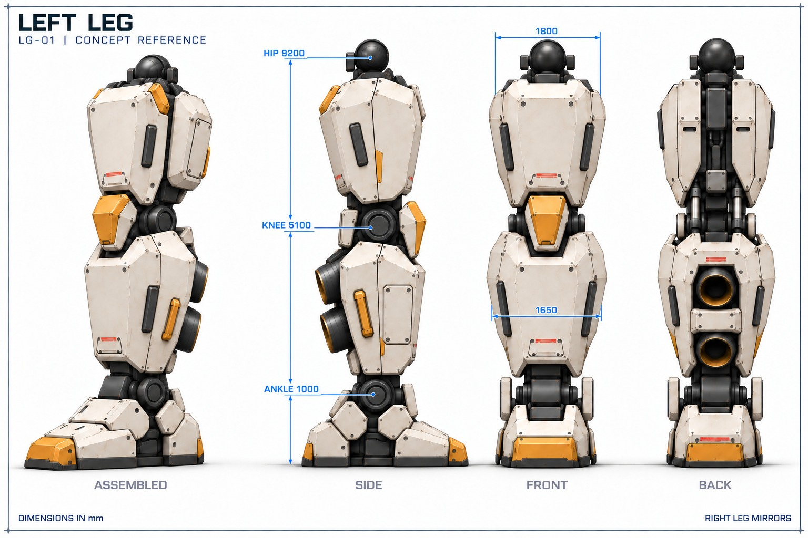

# LG-01 leg concept sheets (thigh, knee, shin and calf)

2026-11-01 · **Approved by the user**, with the known drawing errors below

Step 4 of the [visual design process](../../visual-design/README.md): the leg
drawn in the [approved look](../../visual-design/turnaround/README.md) on the
[approved silhouette](../../proportions.md), labelled with the part numbers in
the [leg component list](../leg-components.csv). One `gpt-6-astra` (high) agent
generated the sheets with Codex's `image_gen` tool, with two corrections each.
Only the approved v3 sheets are kept, as quality-92 JPEG; all nine prompts and
the agent's [review](notes.md) record how they were made.

| Sheet | Preferred | Shows |
| --- | --- | --- |
| Assembled | [lg01-assembled-v3](lg01-assembled-v3.jpg) | Three-quarter, side, front and back views with joint heights and widths |
| Armor and thrusters | [lg01-armor-v3](lg01-armor-v3.jpg) | Removable plates, kneecap, guards, shroud, bridge panel and thruster units, exploded and labelled |
| Structure and joints | [lg01-structure-v3](lg01-structure-v3.jpg) | Skeleton with armor removed and a knee close-up |

## Known drawing errors

The written specifications govern. These errors are in the drawings, not
design changes:

- **Knee cylinders** run from the thigh to the knee fork, so they could not
  bend the knee. Per [knee.md](../knee.md), they connect the thigh (upper
  mounts tucked under the thigh armor) to the shin (lower mounts at the rear
  sides of the knee).
- **Proportions:** the thigh (1.80 m) and calf (1.65 m) are drawn at nearly the
  same width, and the ankle-to-ground height is too large. The
  [proportions](../../proportions.md) govern.
- **Hip lug carriers:** there are three per leg at fixed positions
  ([thigh-and-hip.md](../thigh-and-hip.md#three-hydraulic-lower-lug-connections));
  the drawings don't show them clearly.
- **Workshop lifting pads** near 2.80 m and 6.10 m are not distinguishable
  from other dark details.
- Leaders on the armor sheet's knee guards point partly at the joint; the
  assembled sheet's width leaders don't span the widest edges.
- Seams, hatches, rails and nozzle spacing vary slightly between sheets.
- The foot on the assembled sheet is placeholder context; the foot is being
  redrawn separately.

## Workshop consequence

The approved thigh (1.80 m) and calf (1.65 m) widths exceed the leg
transport bound of X±0.80 m (1.60 m) at the knee and shin cradles in
[knee.md](../knee.md#workshop-support-and-axle-access--2026-10-24) and
[shin-and-calf.md](../shin-and-calf.md#workshop-support-boundary--2026-10-24).
The workshop cradles need revising (coarse boxes plus margin) when the leg
model is integrated.
