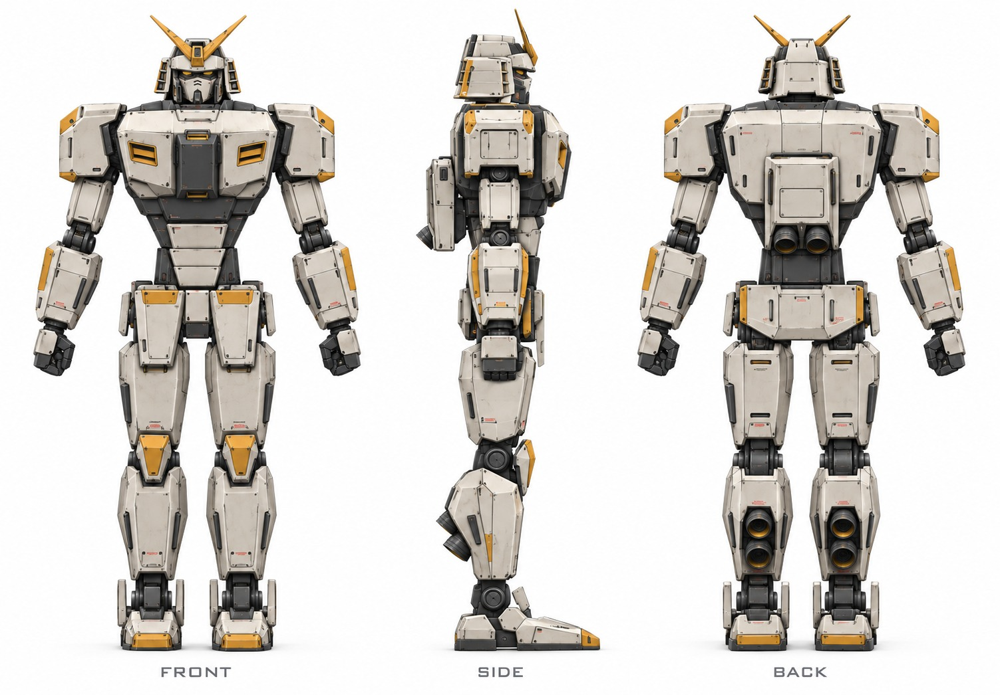

# Whole-robot concepts, round 1

2026-11-01 · **Direction B (industrial service), turnaround v1, selected by the user**

Generated from the [visual design brief](../README.md) with Codex's built-in
`image_gen` tool by four `gpt-6-astra` (high) agents, one per direction. Each
received the [approved silhouette](../../../models/silhouette-mannequin/README.md)
turnaround and low view as references, the brief's prompt verbatim and a limit of
one correction per image. Every folder holds the images (converted from PNG to
JPEG at quality 92 to keep the repository small), the exact prompts and
corrections, and the agent's own review in `notes.md`.

| Direction | Folder | Agent's preferred images | Notes |
| --- | --- | --- | --- |
| A, heroic flagship | [a-heroic-flagship](a-heroic-flagship/) | turnaround v2, three-quarter v2 | Corrected away classic-suit chest and face features |
| **B, industrial service** | [b-industrial-service](b-industrial-service/) | turnaround v2, three-quarter v2 | **User selected [turnaround v1](b-industrial-service/turnaround-v1.jpg)** over the agent's correction |
| C, samurai lacquer | [c-samurai-lacquer](c-samurai-lacquer/) | turnaround v1, three-quarter v2 | Three-quarter v2 lowers a raised pauldron |
| D, sharp prototype | [d-sharp-prototype](d-sharp-prototype/) | turnaround v1, three-quarter v1 | No corrections |

## The selection

The user preferred B's v1 to the agent's v2. The v2 correction had replaced v1's
paired ochre chest vents and slit-mouth faceplate, which closely echo the classic
RX-78, with plain plates and a dark mask. The user preferred v1 with those
features, so the next turnaround keeps v1's character (ochre chest intakes, a
mouth-grille face) but redraws both in this robot's own shapes.

## Model comparison

The same four tasks were also run with `gpt-6.1-terra` (high) for comparison.
Those images are kept locally in `../concepts-terra/` and ignored by Git. Image
quality was comparable because both models drive the same image tool. Terra was
faster (1.5–2.3 min against 2–4 min per direction), used fewer tokens and made
two corrections against Astra's six. It also kept a direction-A design that
looked like a classic suit even after its own notes flagged the resemblance.

## Authority

These are concept images. They are not dimensioned, and their views are not
fully consistent with each other. The [approved silhouette](../../proportions.md)
governs proportions and the component specifications govern construction.
