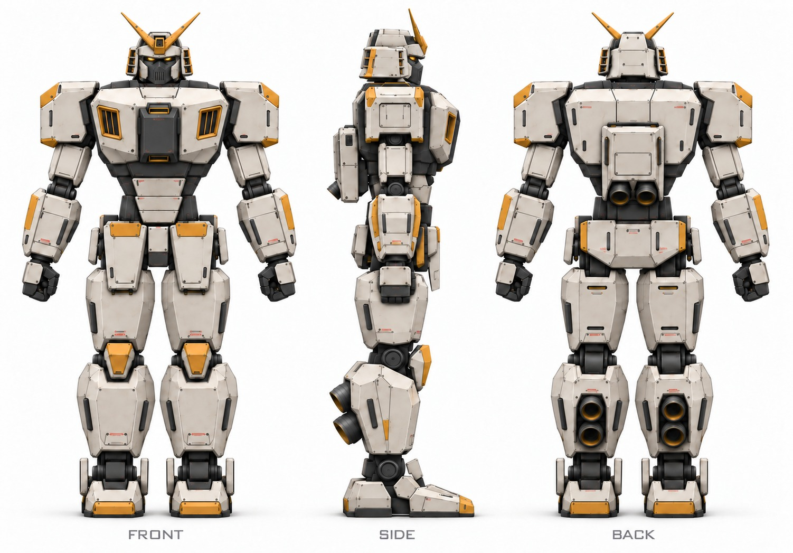
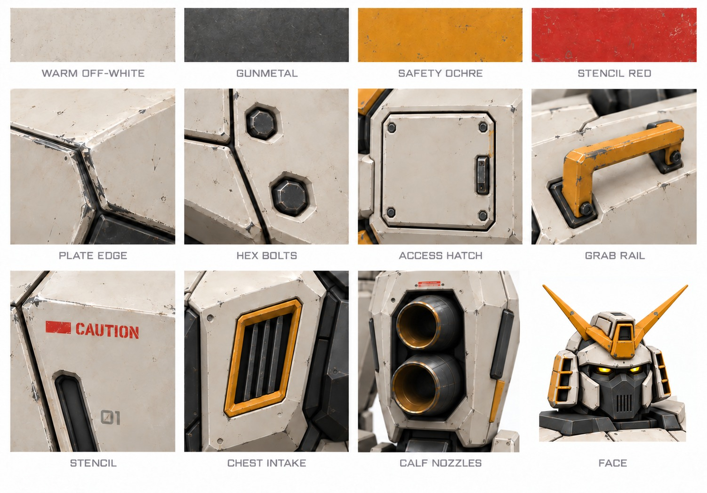

# Reference turnaround and style guide

2026-11-01 · **Approved by the user** (step 3 of the
[visual design process](../README.md))

Built from the user's selected concept,
[industrial service v1](../concepts/b-industrial-service/turnaround-v1.jpg), on
the [approved silhouette](../../../models/silhouette-mannequin/README.md). One
`gpt-6-astra` (high) agent generated each image with Codex's `image_gen` tool and
two corrections each. Only the approved v3 images are kept, stored as
quality-92 JPEG. All nine prompts, including the v1 and v2 generations and
corrections, record how they were made, and [notes.md](notes.md) holds the
agent's review.

| Image | Preferred | Use |
| --- | --- | --- |
| Turnaround | [turnaround-v3](turnaround-v3.jpg) | Front, side and back reference for component sheets and modelling |
| Low three-quarter | [three-quarter-v3](three-quarter-v3.jpg) | How the robot should feel from the hangar floor |
| Style sheet | [style-sheet-v3](style-sheet-v3.jpg) | Palette, surface treatment and signature details |

## Changes from the selected concept

- **Chest intakes:** one per pectoral, an ochre-framed opening with vertical
  gunmetal louvers, replacing the concept's twin horizontal vents that echoed
  the classic RX-78. The turnaround renders these as plain vertical slots; the
  style sheet's louvered intake is the intended detail.
- **Face:** an angular gunmetal mask with a raised central ridge and a
  vertical-slat mouth grille between off-white cheek plates, replacing the
  classic slit faceplate.
- **Masses:** heavier thighs and calves, back toward the approved silhouette.

## Style guide

Derived from the style sheet and the whole-body views. It guides the concept
sheets for each component (step 4) and the in-game visual models (step 5).

### Palette

Sampled from the style sheet swatches (approximate, before lighting):

| Role | Colour | Sample | Where |
| --- | --- | --- | --- |
| Primary armor | Warm off-white | `#D2C8BC` | Every main armor plate |
| Frame and joints | Gunmetal | `#4C4C4B` | Skeleton, joints, hands, abdomen band, sternum hatch, face mask, inside gaps |
| Accent | Safety ochre | `#D4861D` | Pauldron outer corners, knee caps, hip-guard tops, toe caps, forearm side strips, crest, intake frames, grab rails, calf-nozzle lips (bronze) |
| Markings | Stencil red | `#C2332A` | Caution bars and short warning stencils only |

Keep ochre to roughly a tenth of the visible surface, on edges and
corners rather than whole plates. Paint is satin, not glossy; frame metal is
slightly rougher and darker.

### Surfaces

- **Plates:** large faceted panels with a visible chamfer on every exposed
  edge, broken by a few deep panel lines. At 18 m scale, aim for chamfers of
  roughly 60–120 mm on main plates and panel lines about 25 mm wide. Avoid
  rounded or organic forms.
- **Layering:** plates overlap with dark shadow gaps that show the gunmetal
  frame, most of all at joints, the abdomen, behind the knees and at the ankles.
- **Fasteners:** hex bolts seated in recessed wells, in small groups at plate
  corners and hatch edges, not scattered evenly.
- **Service details:** bolted access hatches with a flush latch, ochre grab
  rails near service points, and short recessed slots and vents.
- **Markings:** a few red caution bars, short stencil labels and grey unit
  numbers ("01"). Markings should be legible up close and read as small accents
  from the gantry.
- **Wear:** light edge chipping and faint grime on off-white plates, kept
  subtle. The style sheet's close-ups are heavier than intended for the whole
  robot.

### Signature details

- **Head:** off-white helmet with stepped ochre-trimmed side guards, a heavy
  brow, glowing amber eyes, the gunmetal grille mask and an ochre two-blade
  crest on an ochre forehead block.
- **Chest:** a dominant off-white block with louvered ochre intakes and a dark
  central sternum hatch.
- **Calves:** two stacked bronze-lined bell nozzles per leg in a framed rear
  recess.
- **Hands:** gunmetal fists with off-white back plates.

## Known inconsistencies

From the agent's review and inspection:

- The turnaround's upper chest is shorter and projects forward less than the
  approved silhouette.
- Small seams, bolt counts, stencil positions and grab rails differ between
  views, and left/right mirroring is only approximate at detail scale.
- The chest intakes are plain slots in the turnaround but louvered in the
  three-quarter view and style sheet.
- These images are not dimensioned. The [proportions](../../proportions.md)
  govern sizes and the component specifications govern construction.
