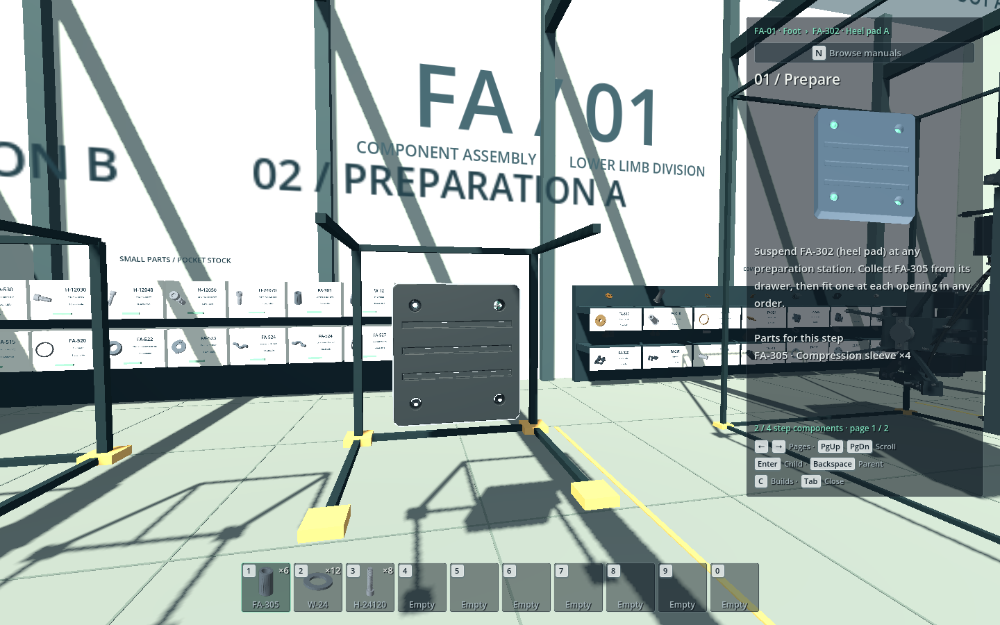

# Gundam Build Simulator — workshop prototype

Godot 4.7.2 · GDScript · Jolt Physics · macOS desktop · Shared assembly model and nested manuals



*Earlier suspension-station view; the default hangar now includes a supported foot bay, leg fixture and final assembly gantry.*

A first-person robot construction prototype with **175 playable physical identities**. Prepare two heel pads and a complete **91-piece pitch actuator**, then install them on the foot. This original branch has **135 pieces**. The expanded workshop adds 40 active pieces for the shin, knee, integral-ball thigh and pelvis retention; nine are existing foot hardware/harness identities promoted from context. The original 745-piece foot inventory is preserved. An assembled pelvis and both socket housings start clamped in the final-bay gantry.

Current playtest state (2026-10-23): the structural workflow passes automated
checks, while controls, equipment affordances and visible part transport need
iteration. Read the [recorded feedback and next steps](../../design/game/leg-workshop-next-steps.md)
before continuing workshop development.

The FA-513 motor starts on the floor beside preparation C. Pick it up with E, then click the empty station to suspend it. Build the exposed drive first; page 7 fits the FA-510 housing, followed by exterior fittings and cap closure. Its 14-page manual ends with the eyes and installation handoff. The foot manual owns both clevises and the two retained eye-pin connections.

## Launch

Double-click [play.command](../../play.command) in Finder. The game opens the expanded left-leg workshop in **non-exclusive (borderless) fullscreen**. A saved workshop resumes automatically into the pause menu; click **Resume** to continue. On a fresh workshop, click **Start building**. Escape releases the mouse and opens the grouped controls menu; **Resume** returns to the build. Godot uses a fullscreen desktop on macOS.

To inspect or edit the project, double-click [edit.command](../../edit.command), or open [project.godot](project.godot) in Godot 4.7.2.

From a terminal at the repository root:

```sh
./play.command
./edit.command
```

The launcher uses the task-local Godot installation at `$HOME/.cache/gundam-tools/Godot-4.7.2/Godot.app/Contents/MacOS/Godot`. It also accepts `GODOT_BIN` and can find a `godot` command or `/Applications/Godot.app`. The official macOS download was checked against its published SHA-512 manifest before installation. The launcher imports assets automatically when the import cache is absent.

## Collecting and building

1. Walk to the **wall cabinets**. Small parts have closed drawers with a **part ID, image, name and stock count**. Larger components remain visible on shelves. Storage has two rows, with the upper row at chest height.
2. Press **E** on a drawer to fill a pocket with up to **20 copies** from the available stock. A matching pocket is topped up; otherwise an empty pocket is used and selected. When all ten pockets are occupied, E replaces the selected stack and returns the displaced pieces to their drawer. An empty drawer never evicts stock.
3. The **ten persistent pockets** are hotkeyed to **1 2 3 4 5 6 7 8 9 0**. Their images, IDs and quantities show what you actually have. Switching manuals or pages never changes the bar. There is no shared item-count limit.
4. **B clears the selected pocket anywhere**, returning the whole stack to its drawer. Small parts never become loose world objects. **Q** sets down a carried shelf component or assembly. Hands operate separately from the hotbar; no numbered key is reserved for hands.
5. **N** opens the large manual browser: expand build folders, select a step, or use the clickable breadcrumbs to return to a parent. **Suggested only** filters builds and unfinished steps using the selected/carried component or the assembly you are looking at; turn it off to see every manual. **C** cycles matching build manuals while retaining each build's last page. N or Escape returns to play. **Enter** opens the linked child and **Backspace** returns to its parent. Arrows turn pages; **Page Up / Page Down** scroll longer instructions. Each page lists the same part IDs as the drawers and shelves, with names as clarification.
6. Carry either FA-302 heel pad with E and click an empty preparation station. Stock FA-305, W-24 and H-24120 in separate pockets. Fit four FA-305 sleeves, seat the pad at either heel position, then fit W-24 before H-24120 at each connection.
7. Pick up FA-513 from the floor beside preparation C and suspend it there to start the FA-500-P pitch build. Assemble the exposed drive using the fixture for support. Fit FA-510 after the rod, fasten the motor through the open rear and the retainer from outside, then add the guide, sensors, seals and caps. The foot manual then covers both FA-220 clevises, seating FA-500-P, and retaining both ends with FA-221, FA-222, W-12 and H-12030.
8. Use **E on the foot bay controls** to select **Upright**, **Sole left** or **Sole right**. The mechanical cradle turns the supported foot gradually. Walk around it and use the ramp/platform to reach the exposed connections. R rotates the small preparation fixtures; the foot uses its equipment controls.
9. After securing both pads and the pitch actuator, choose **Upright**, then **Transfer**. The rail carriage moves the foot to dispatch. Clear people and loose components from the movement path; an obstruction stops the equipment until the path is clear. Opening the pause menu also pauses equipment movement.

## From foot to supported leg

The hangar has three marked areas: the component workshop, the leg fixture and the final assembly bay. The [interface specification](../../design/game/leg-prototype-interface.md) records the structural subset and physical part ownership.

1. At the leg-area handling console, seat the dispatched foot in the leg fixture. The hoist lifts it off the carrier and moves it through the front aisle. The carrier stays at dispatch.
2. Select the **left leg** manual. Use the handling controls to install the shin; fit its four washer/bolt pairs and main ankle harness yourself. Leg hardware and hand-carried pieces are in the nearby cabinets and shelves.
3. Fit both knee bearings and thrust spacers. Hoist the fork into place, carry and install the axle from the west side, then fit the cap and its hardware from the east. Hoist the integral-ball thigh spar into place and fasten its flange.
4. Board either leg-side lift at ground level and use **E** on Up, Down or Ground. The work stops are 1.2 m for ankle connections, 3.8 m for the knee and 5.2 m for the fork flange, with an 8.7 m inspection stop. The lift carries the player and a hand-carried component. Work still requires ordinary reach, aim and a valid placement preview.
5. Once the leg is structurally complete, engage its hoist, transfer it through the clear aisle to the final bay, and seat the ball from below into the left pelvis socket.
6. Use the **pelvis** manual and handling controls to fit the two retaining-ring halves. Bring the shared LG-W24 washers from leg storage and collect the ring bolts beside the final bay. Ride the hip lift to 8.4 m and fasten all four connections from below.
7. Engage the gantry stabilizer, then release the hoist. The incomplete robot remains supported by the gantry.

For removal, reacquire the hoist before undoing the pelvis connections with **Z**. The same leg can be unseated and returned to its fixture, then dismantled in reverse; the foot can return to its original carrier. Movement and incomplete retention prevent unsafe transitions. Equipment does not consume replacement copies of the transported parts.

**Undo follows the selected manual.** Mounted children must be detached through the parent history before editing their internals. A detached child returns intact to a free preparation station. Small undone parts return to their matching or an empty pocket; if no suitable pocket has space, they return to their drawer. Undo never replaces another stack. Larger undone components appear on the output tray.

**Placement does not follow the selected manual.** Any compatible connection whose prerequisites and physical access rules are satisfied can be built, including on another page or assembly. Aiming and adding components refine manual suggestions without silently switching the reader. Assemblies retain their chosen recipes; suggestions do not infer a new recipe or allocate stock.

The earlier scenarios remain available:

```sh
./play.command -- --foot-workshop
./play.command -- --single-pad
./play.command -- --pads-only
```

## Saving and resuming

The default leg workshop uses **`user://leg-workshop-save.json`**. The earlier `--foot-workshop` scenario retains **`user://workshop-save.json`**; starting the leg prototype does not replace that progress. Each scenario autosaves every **30 seconds of active play**, on pause and on quit. Reopening restores the workshop into the pause menu. **Save** writes immediately; **Reload save** asks before discarding changes since the last save. **New workshop** asks before replacing the current scenario's slot. The menu reports the last save/resume or a failure.

On macOS these files live in `~/Library/Application Support/Godot/app_userdata/Gundam Build Simulator/`; each adjacent `.bak` is its last good backup. Progress includes physical identities and ownership, pockets, undo history, loose/carried objects, preparation stations, player position/view and manual state. The leg profile also preserves nested foot/leg/pelvis attachments, interrupted hoist and lift motion, stabilization and load release. Moving equipment resumes its saved route after you leave the pause menu.

Loads validate the complete snapshot before replacing the live workshop. A damaged primary can recover from the backup; unsupported versions or changed content are protected until you confirm **New workshop**. A save failure keeps the session open and offers an explicit **Quit without saving** action. There are no migrations, cloud sync or multiple slots yet.

Headless tests, captures and legacy CLI scenarios such as `--single-pad` and `--pads-only` do not load or write your normal saved workshop. Automated save checks use isolated temporary files. See the [save/resume plan and implementation contract](../../design/game/save-resume.md) for scope, validation and recovery details.

## Controls

| Input | Action |
| --- | --- |
| WASD / mouse | Move / look |
| Shift while moving | Move faster |
| Space | Jump from the floor or platform; release before jumping again |
| Hold Ctrl | Crouch for a lower inspection view; release to stand when there is headroom |
| E | Stock/refill a pocket, carry a component/assembly, or operate a bay control |
| 1 2 3 4 5 6 7 8 9 0 | Select one of the ten pockets |
| Left click | Attach the selected small part, or place the carried component/assembly |
| Q | Set down the carried component or assembly |
| B | Clear the selected pocket anywhere; its stack returns to storage |
| Hold R + move mouse | Rotate the preparation station you are looking at |
| Double-tap R | Restore that preparation station's working orientation (F remains an alternate binding) |
| Mouse wheel | Inspect zoom |
| Tab or M | Open/close HUD manual |
| N | Open/close the large manual tree browser; Escape also closes it |
| Left/right arrows | Change page in the selected manual |
| Page Up / Page Down | Scroll longer instructions and part lists |
| Enter / Backspace | Open child / return to its parent manual |
| C | Cycle matching build manuals; suggestions use the selected component or aimed assembly |
| V | Open the inspected build manual |
| Z | Undo the latest action in the selected manual |
| Escape | Open grouped controls, Resume, Save, Reload save, New workshop, or Save & quit; reload and replacement ask for confirmation |

Each of the ten pockets holds one small-part type, with up to 20 copies per stack. Assemblies and shelf components are carried separately using the assisted grip. Attachment reach is initially 2.35 m from the camera/player to the actual connection, and pad connections use a 15 cm targeting radius; actuator component targets use 24 cm. These are tunable prototype values.

## Implemented behavior

- Metre-scale source geometry: the preserved 745-mesh foot plus procedural leg/pelvis parts, with 175 active identities in the expanded scenario. The foot-only scenario retains its original 135-piece allocation.
- A 39.6 × 47 m hangar with 22 m roof clearance, separate component/leg/final areas, a pelvis gantry, overhead handling, three personnel lifts, local stock and reserved future construction space. Large pieces move between authorized supports; players fit reachable hardware themselves.
- Firm two-handed carrying. A collision-aware kinematic grip follows the camera without a spring or angular momentum. Translation is swept against scenery and turning checks intermediate orientations. Dropping restores normal rigid-body physics. Placement still checks the swept approach and destination against scenery and loose obstacles.
- Small preparation stations retain free rotation and double-tap R to reset. The default foot uses a mechanically supported cradle, controlled work positions, an access platform/ramp and a rail carriage to the handoff area. Rotation and transfer controls face inward from the platform's parallel outer railing. Equipment movement preserves mounted child poses and physical identities; parent construction and undo wait until it is stationary in the assembly bay.
- Reachable pickup and collection targets under the crosshair get a thin contour; fixed equipment keeps its Operate prompt without a contour. Up to four recently focused objects reuse hidden contours, which inherit their source meshes' motion and visibility. Geometry, material and assembly changes invalidate the relevant cache; stable focus avoids hierarchy scans and renderer transform updates. Compact world prompts follow the object and use keyboard keycaps; obstacles hide both. With no part selected, unfinished builds keep one whole-assembly pickup prompt. With a selected part, nearby connections take priority; E still picks up their containing assembly. Aiming at the whole in-progress workpiece uses its cached bounds to reveal a compatible, ready destination in yellow within 6 m. The prompt asks you to move closer or aim at the highlighted connection; precise, reachable aim turns it green. Yellow guidance alone never permits attachment. Scenery, missing prerequisites and moving equipment suppress distant guidance. A valid green attachment preview stands on its own, while blocked or incompatible actions retain explanatory feedback. Placement never outlines the entire receiving assembly. Prompt and preview share one approach check per update; actual clicks recheck collision, and settled carried parts skip redundant rotation sweeps.
- Translucent in-game manual, notification and inventory panels; opaque pause/help and manual-browser windows with the workshop visible around them. The compact ten-pocket bar uses square cards with readable IDs, functional variants and counts. Hand and two-hand components are centered by their geometry, with size-aware forward clearance and solid collision.
- Hold-to-crouch movement with a lower camera/collision capsule and an overhead clearance check before standing.
- Ten persistent pockets with baked part images, IDs and per-stack counts. The separate hands summary appears only while carrying and replaces pickup popups; selected pocket information stays in the action bar. The grouped Escape menu offers keyboard focus and resume, save/reload and confirmed new-workshop actions.
- Non-exclusive fullscreen at launch, with the HUD scaled to the display.
- Finite labelled drawers for small parts, open shelves for larger components, a preparation tray, and part-ID tooltips. Small stock has no loose 3D meshes or physics bodies; installed parts and attachment previews still use their source geometry.
- Interchangeable matching hardware. The chosen socket supplies the destination, while the installed object retains its physical identity.
- Preview and installed rendering use the receiving slot's source mesh and pose together. Some source fasteners bake their orientation into their vertices, so reusing another instance's mesh with only a new node transform gives an incorrect fit. The consumed physical identity remains in the assembly model and visual metadata.
- Suspended and mounted assemblies use static freeze mode to follow their parent through continuous rotation. Pickup restores the collision-aware carrying mode; dropping restores dynamic physics.
- A shared, input-independent assembly model for slot prerequisites, compatible types/variants, milestones, unique ownership, and undo. Two pad instances use one authored definition; their parent owns the seating and fastening slots.
- Independent mounting-point order, a ghost preview, reach/occlusion checks, and explicit failure feedback.
- A filesystem-style manual browser with expandable build folders, step progress and clickable breadcrumbs. It pauses play, reuses the existing diagram viewports and preserves each selected page.
- Authored diagrams retain their meshes when only installation progress changes. The actuator housing stays opaque throughout construction; the remaining motor fastening uses the open rear, and retainer fastening uses exterior lands. Once both caps are secured, the actuator hides explicitly enclosed components; undo restores them without making the housing translucent. Exterior fittings remain visible, including the radial retainer screws. Ordinary gameplay is capped at 60 FPS.
- A parent foot manual and three independent child manual sessions, with authored steps, remembered pages, model-based illustrations, automatic progress, and completion sound/glow.
- Manual-scoped build undo: small hardware returns to pockets or its drawer; undoing a mounting action returns the prepared child to an empty station. Walking, carrying, and storage arrangement are not rewound.

## Verification

Run the headless regression set from the repository root:

```sh
python3 game/workshop/tools/run_regressions.py
```

The runner discovers standalone test scripts, including inherited SceneTree
harnesses, and also executes normal launch, foot-only launch, single-pad,
two-pad, pitch, swapped-stock and pocket desktop scenarios. `--list` shows case
names; `--only NAME ...` reruns selected cases. It retains separate logs and input
hashes in a unique `verification/regressions-*` directory, rejects script errors
even when Godot exits successfully, and does not imply rendered approval.

The 2026-10-22 supported-leg milestone passed **38 cases / 4,539 checks**, with
unchanged input hashes. The [milestone record](../../design/game/leg-milestone.md#final-verification)
links the retained local report and records the scope and limitations.

The linked test scripts generate local JSON audits under `verification/`. Audits,
screenshots, meshes and review galleries are ignored local outputs. Historical
review results are summarized below, but their captures and exact input hashes
are no longer kept in Git. Fresh visual approval requires a new local capture
and inspection of the affected scope.

- [Manual page audit](tests/pockets_workshop_test.gd): 31 runtime page views across the single-pad, two-pad and pitch scenarios, covering step-only lists, quantities, prepared assemblies, instruction references, unique installation coverage and available stock. Overview/readiness pages have no component shopping list.
- [Pocket model audit](tests/pockets_model_test.gd): ten stacks of 20, top-up, full-bar replacement, clearing, empty-drawer atomicity, undo overflow and exact physical identities.
- [Pocket workshop audit](tests/pockets_workshop_test.gd): all ten number keys, immediate hotbar counts, manual independence, drawer/shelf images and IDs, two storage rows, clearing away from storage, separate carrying, scrolling and layout. Hotbar/catalogue images use no live 3D viewports.

- [Pitch model audit](tests/pitch_model_test.gd): inventory counts, manual construction order, cap dependencies, carrying exclusivity, long-part recovery, and combined 135-piece completion.
- [Part compatibility audit](tests/part_variants_test.gd): pooled stock, both copies at opposite compatible endpoints, exact identity on undo/reinstall, incompatible variants at ready connections, and actual imported geometry equivalence.
- [Pitch desktop audit](tests/pitch_build_test.gd): Collects and fits all 90 additions around the starting motor through desktop controls, compares actual installed vertices against the source at every construction page, previews all fitted child meshes and installs the completed actuator with all 18 mounting parts, checks station/foot rotation, and undoes the parent installation while retaining child progress. It also checks the housing-free first step, enclosed-part visibility, complete preview visibility and recovery on reopening the housing.

- [Manual navigation audit](tests/manual_navigation_test.gd): 22 checks of tree navigation, breadcrumbs, per-build page memory, pause/input behavior and unchanged inventory.
- [Diagram cache audit](tests/manual_diagram_cache_test.gd): 10 checks; authored figures reuse their panels and meshes through progress changes, while changed views and automatic diagrams still refresh.

- [Original state regression](tests/state_test.gd): 57 checks through the new model, including independent order, finite stock, pocket clearing/refilling, identity, completion, and full undo.
- [Generic model audit](tests/assembly_model_test.gd): 45 checks including invalid references/cycles, duplicate ownership, incompatible variants, shared stock, nested undo, and a separate three-slot recipe with a differently named parent. The alternate recipe is a state-level fixture, not new playable content.
- [Original interaction regression](tests/demo_test.gd): the single-pad interaction suite, including movement, firm carrying, reach/occlusion, crouch, station rotation, fullscreen, and restart cancellation.
- [Interaction feedback](tests/interaction_feedback_test.gd): reachable outlines, world prompt anchoring, obstruction/pause handling, green-preview feedback and compact HUD layout.
- [Pickup outline cache](tests/interaction_outline_test.gd): retained contours, continuous inherited motion, nested part changes, transparency, bounded eviction and source/manager cleanup without a renderer.
- [Snap discovery](tests/snap_discovery_test.gd): whole-workpiece bounds, distant and nearby yellow guidance, compatible stock, scenery, fixture rotation, exact-aim priority, one approach sweep per update and fresh collision checks on placement.
- [Centered carrying](tests/centered_carry_test.gd): off-origin geometry, continuous camera rotation, large components and real wall obstruction.
- [Supported foot fixture](tests/supported_fixture_test.gd): actual equipment controls, work access, obstruction and pause behavior, mounted children during movement, secured transfer and return. Headless results verify behavior; the user accepted the current workshop playtest after the later interaction refinements.
- [Workshop geometry audit](tests/workshop_geometry_test.gd): compares actual transformed triangles across all visible generated workshop meshes at 13 rotation angles and four transfer positions. Positive-area, same-facing overlaps within 0.25 mm fail with node paths, triangles, normals and overlap measurements. Edge contact and patches fully buried in another opaque box are allowed. A deliberately injected harness defect proves new geometry is collected and rejected automatically. This catches coplanar surface flicker; it does not prove the absence of arbitrary solid intersections, shader/shadow artifacts, duplicate faces inside one mesh or defects in imported robot parts.
- [Geometry audit regression](tests/geometry_surface_audit_test.gd): known harness failure, near-coplanar faces, valid contacts, transformed meshes, indexed/unindexed triangles and conservative occlusion checks.
- [Jumping](tests/jump_test.gd): grounded Space takeoff, platform landing, no double jump or held-key repeat, ceiling collisions, pause/browser input and carrying through takeoff and landing.
- [Save model](tests/save_model_test.gd): physical identities, compatible copies, pockets, mounted ownership and executable parent/child undo histories; malformed snapshots cannot mutate the live model.
- [Save storage](tests/save_store_test.gd): versioned JSON, checksums, backup rotation, failed writes, unsupported content, truncated files and isolated temporary storage.
- [Save/resume](tests/save_resume_test.gd): real unfinished builds, held/loose pieces, player and manual state, station rotation, loaded mounted geometry and collisions, powered foot rotation and both rail directions, post-load undo, autosave/menu actions and recovery from failed saves.
- [Leg workshop](tests/leg_workshop_test.gd): expanded room, full-scale frames, local storage, actual walking corridors and approach clearance beneath the socket.
- [Supported model](tests/supported_model_test.gd): named support ownership, authorized transfers, equipment-only handling, mounted undo and snapshot validation.
- [Leg content](tests/leg_content_test.gd): complete structural recipe, stock identities, compatible swaps, unique manual coverage and actual source geometry at the ankle, knee and hip interfaces.
- [Leg desktop build](tests/leg_build_test.gd): all 35 new hand/pocket installations through collection, ordinary targeting, valid previews and clicks. All seven hand-carried parts use walking and occupied lifts; checks include grounded work positions, opposite compatible copies, wrong-size rejection, manual diagrams and every underside hip fastener.
- [Leg equipment](tests/leg_equipment_test.gd): supported pickup/transfer/seating, real scene obstructions, pause/resume, retention and stabilizer interlocks, support contacts, release/reacquire and complete reversible dismantling.
- [Access lifts](tests/access_lift_test.gd): occupied travel, carried-part clearance, gates, headroom, blocked movement and pause behavior.
- [Leg persistence](tests/leg_save_test.gd): interrupted equipment routes, personnel lifts, hand-carried parts, partial hip fastening, released support, nested geometry, return/undo and rejection of inconsistent saves. It uses an isolated profile.
- [Two-build interaction audit](tests/multi_build_test.gd): 65 checks through the public controls and real targeting/physics, including shared stock, manual navigation, station exchange, swapped heel positions, completed installations, nested undo, and continuous R-drag between physics ticks. Rotation checks compare body, mesh and physics poses for both mounted pads.
- Earlier pad captures showed independent builds and completed pads. Those images
  are no longer kept in Git; rerun the affected review when visual evidence is
  needed.

```sh
./play.command --headless --script tests/state_test.gd
./play.command --headless --script tests/assembly_model_test.gd
./play.command --headless --script tests/pitch_model_test.gd
./play.command --headless --script tests/part_variants_test.gd
./play.command --headless --script tests/pitch_interface_test.gd
./play.command --headless --script tests/pockets_model_test.gd
./play.command --headless --script tests/manual_navigation_test.gd
./play.command --headless --script tests/manual_diagram_cache_test.gd
./play.command --headless --script tests/supported_fixture_test.gd
./play.command --headless -- --single-pad --demo-test
./play.command --headless -- --multi-test
./play.command --headless -- --pitch-test
./play.command --headless --fixed-fps 60 -- --pitch-test --swap-identical-parts
./play.command --headless -- --pockets-test
```

These commands run headlessly. The scenario tests exercise the desktop input adapter and actual physics/targeting without opening a window. Test input is isolated from live desktop events. The pitch test can also use `--fixed-fps 60` to advance simulated time faster. `--swap-identical-parts` supplies the second copy first through normal collection and checks the installed receiving geometry. Headless runs skip audio playback. Rendered verification is a separate, explicitly requested check. Automated checks verify functionality; human play remains the test of pacing and comfort.

For a repeatable empty-handed mouse-look measurement, keep the game in front
until this 20-second run closes:

```sh
./play.command --script tools/benchmark_mouse_look.gd -- --seconds=2 --input-events=8
```

It compares standing still with circular camera movement at arrival and beside
the foot, while timing input, targeting, ghosts and markers separately. Each
sample records frame time, actual draws, focus and render workload in a unique
`verification/mouse-look-*/audit.json`. The run rejects blocked camera input or
skipped rendering, including macOS stopping draws after an alt-tab. Headless runs
measure CPU work only. Synthetic events exercise Godot's viewport input pipeline;
they do not measure physical mouse sampling or input-to-display latency. Do not
use `--fixed-fps` for performance measurements. `--force-draw` is a separate
render-throughput diagnostic and does not establish normal presentation pacing.

For an explicitly requested workshop environment review, capture repeatable player
views with the actual renderer:

```sh
./play.command --windowed --resolution 1440x900 --disable-render-loop \
  --fixed-fps 60 --script tests/workshop_visual_review.gd -- --review-tag=survey
```

This writes 14 views of the ramp, platform, signs, storage, carrier joints and
guided rotation into a unique `verification/workshop-*` directory. The manifest
records camera poses, source hashes and image hashes. Inspect these images before
recording visual approval; this environment survey does not replace an assembly
manual review or a performance measurement.

Append `--review-harness` after `--review-tag=survey` for nine focused lower
carrier views, including five small camera offsets across a runner/wheel joint.
To run just the headless geometry checks:

```sh
python3 game/workshop/tools/run_regressions.py --only geometry_surface_audit_test workshop_geometry_test
```

For a focused rendered storage/pocket-label review, run `./play.command --disable-render-loop --fixed-fps 60 -- --pockets-test --pockets-review`. It prints a unique `LABEL_REVIEW_OUTPUT` directory containing the shared retaining-ring stack and both collar/gasket variants beside their storage labels and manual. The flag rejects the headless dummy renderer.

The repaired actuator passed a 2026-10-21 visual review of all 14 child pages
and three parent installation pages, including every placement, both receiving
frames, full assembly preview and continuous rotation. Receiving holes, seats,
fastener access, sensor/cap clearance and eye/pin interfaces were repaired in
the source models; step diagrams expose those connections. This is a historical
outcome: its inspected images and exact hashes are no longer in Git. Source
geometry agreement alone is insufficient for fresh visual approval.

The later motor-first review covered the changed sequence, rear motor/radial
retainer fastening, rear-cap clearance, opaque visibility and final mounting.
It recorded 117 model, 290 desktop and 113 geometry checks, plus scoped rendered
inspection. Closed-actuator visibility dropped from 203,291 to 128,528 triangles
(36.78%); this does not measure whole-scene FPS or laptop temperature. A separate
manual browser review covered navigation and layout. These review outputs are
local and are no longer kept in Git.

The historical scalability review checked stable
source identities, generic nested mounting, structural collision and carrying,
manual-independent placement with suggested manuals, and repeatable asset repair.
The final headless suite passed 17 cases / 1,790 checks; source tools passed 11 Python
tests and a real Blender reordered-generation audit of all 745 identities.
Inspected renderer evidence covered five child pages, all three parent installation
pages, both pads through rotation and undo, the suggestion browser, and a synthetic
four-level assembly with a large hollow frame. Source geometry was unchanged by
compaction: all 745 instances matched, while the GLB fell from 68.36 to 60.09 MB.
Its detailed report and images are no longer kept in Git; these historical
results do not establish current visual approval or whole-robot performance.

Reproduce the actuator captures using the real renderer, then generate the review gallery (Pillow required):

```sh
./play.command --disable-render-loop --fixed-fps 60 -- --pitch-test --pitch-review
python3 game/workshop/tools/build_pitch_review_gallery.py --input /path/printed/as/REVIEW_OUTPUT
```

This opens a window and captures before/preview/after placements, opaque/service/exposed inspection angles, HUD pages and continuous rotation. `--headless` is rejected for this mode. Each run prints a unique `REVIEW_OUTPUT` directory under `verification/`; supply that path to the gallery command. Keep its hashes, page decisions and inspected images together locally for comparison until review is complete.

For a focused repair, append `--review-pages=pitch-04,foot-06` to the capture command, selecting the changed and dependent pages explicitly. Normal build/ownership checks still run, but only selected pages produce images. Include `pitch-14` or `foot-06` when preparation or mounted rotation needs review. Capture generation does not grant visual approval. Inspect and record the affected pages; without the archived images, prior visual decisions cannot serve as a verified comparison baseline. The remaining default-workshop pages and both compatible pad placements still need the [full review process](../../design/game/foot-prototype-plan.md#manual-and-assembly-visual-review).

## Scope and current limits

This milestone delivers the earlier foot/pad/actuator build plus one structural left leg, supported transfer into an already assembled pelvis, hip retention and reversible removal in an expanded workshop. Both the expanded scenario and earlier foot-only workshop save locally in separate profiles. The leg's detailed powered actuators, armor and thrusters, full-foot progression, pelvis construction, second leg, waist/torso and AR input remain future work. The smaller single-pad and pads-only regression scenarios remain session-only.

The reusable construction model owns prerequisites, inventory, carrying capacity, milestones and undo. `component_interaction.gd` projects arbitrary authored component slots into desktop collection, grip, placement, and service views. Pad connections retain their established four-opening adapter. The generic model supports the new content without requiring pad-shaped rules.

Carried collision uses structural primitive compounds; authored fixed receiving frames can use exact mesh openings. Internal work uses an explicit assisted service policy, while scenery and carried-part approaches remain solid. It does not simulate threading, torque, load dynamics or every internal insertion. Powered articulation and services beyond the main ankle disconnect remain outside this structural milestone. The user accepted the earlier foot-workshop playtest on 2026-10-22; this expansion still needs human assessment of pacing, scale and handling. No rendered review was requested for the leg milestone. Laptop temperature and on-screen frame time still need measurement during normal play; the detailed foot remains a substantial rendering cost.

The room and new structural parts are functional blockouts. Layout, lighting, carrying distances and targeting tolerances remain tunable. Completion feedback is a sound and glow.

## Data model and project structure

- [workshop.gd](scripts/workshop.gd): room, imported geometry, player, targeting, carrying, station interaction, and completion presentation.
- [supported_fixture.gd](scripts/supported_fixture.gd): foot support, guided working poses, platform, rail transfer and movement clearance.
- [leg_workshop_layout.gd](scripts/leg_workshop_layout.gd), [leg_equipment.gd](scripts/leg_equipment.gd) and [work_access_lift.gd](scripts/work_access_lift.gd): expanded hangar, gantry, supported handling, release/removal interlocks and personnel platforms.
- [leg_source_geometry.gd](scripts/leg_source_geometry.gd): separate procedural source meshes for the leg and pelvis, including real bores, bearing seats and split retaining rings.
- [part_storage.gd](scripts/part_storage.gd): low cabinets, shelves, cached catalogue images and stock labels. Images are generated from the source GLB by `python3 game/workshop/tools/render_part_images.py` (Pillow required only for regeneration).
- [component_interaction.gd](scripts/component_interaction.gd): authored component targeting, shelf-piece carrying, incremental installed visuals, and service views.
- [assembly_model.gd](scripts/assembly_model.gd): reusable ownership, transfer, placement validation, milestones, and scoped history.
- [workshop_save.gd](scripts/workshop_save.gd), [save_model.gd](scripts/save_model.gd) and [save_store.gd](scripts/save_store.gd): local save lifecycle, validated model/world snapshots and atomic backup storage.
- [assembly_runtime.gd](scripts/assembly_runtime.gd): scene nodes and coordinate frames keyed by assembly identity, parent-slot mounting, descendant visuals and nested previews.
- [solid_handling.gd](scripts/solid_handling.gd): primitive compound collision, current assembly bounds, size-aware carrying and conservative rotation/placement sweeps.
- [assembly_state.gd](scripts/assembly_state.gd): pad-specific desktop projection over the shared model, plus the single-pad regression configuration.
- [loose_part.gd](scripts/loose_part.gd): solid carried and dropped objects.
- [manual_browser.gd](scripts/manual_browser.gd): expandable manual hierarchy, breadcrumbs and the large paused reader.
- [hud.gd](scripts/hud.gd) and [manual_diagram.gd](scripts/manual_diagram.gd): instructions, inventory, tooltips, help, and live illustrations.
- [interaction_outline.gd](scripts/interaction_outline.gd): depth-tested focus contours without changing source materials or assembly ownership.
- [assembly-definitions.json](assets/assembly-definitions.json): part types, child and parent slots, prerequisites, milestone sets, work locations, geometry references, and manual steps.
- [heel-pads.json](assets/heel-pads.json): 26 source identities, physical build instances, starting positions, and parent destinations.
- [pitch-workshop.json](assets/pitch-workshop.json) and [pitch-actuator-definitions.json](assets/pitch-actuator-definitions.json): 135-piece scenario and the actuator/parent recipe overlay. Regenerate with `python3 game/workshop/tools/author_pitch_actuator.py`; the authoring script resolves the exact pitch block in the source manifest and explicitly authors prerequisites separately from animation phases.
- [leg-prototype-content.json](assets/leg-prototype-content.json) and [leg-prototype-definitions.json](assets/leg-prototype-definitions.json): structural leg/pelvis scenario overlay, support permissions, physical source descriptors and manuals. Regenerate and audit with `python3 game/workshop/tools/author_leg_prototype.py`.
- [heel-pad.json](assets/heel-pad.json): original 13-piece regression scenario metadata.
- [Original model package](../../models/foot-fa01/README.md), [game design](../../GAME_DESIGN.md), and [prototype plan](../../design/game/foot-prototype-plan.md).

A slot accepts one part-type key (which includes a specific variant) or a child assembly definition with a required milestone. `requires` lists local slot IDs. Slots refer to imported GLB transforms through `pose_source`; accessible targets are authored separately. Manual steps reference the same slot IDs. Root parts begin assigned to their child assembly; logical containers never create extra physical inventory. Child placement transfers that container into a parent slot while retaining all descendant identities.

Part types describe compatibility; physical instance IDs describe individual stock. The pitch bearings, retaining rings, end sensors, eye pins and keepers share one type per family and either copy fits either matching slot. Pocket-sized copies stack together; larger copies share a shelf and are carried one at a time. Collar halves, eye housings, cap gaskets and clevises retain distinct fits with functional names. Pocket labels show the distinguishing variant beneath the family ID. Keep the slot's mesh/pose source separate from its consumed identity, including when the two copies are swapped.

The [component pipeline skill](../../.agents/skills/gundam-component-pipeline/SKILL.md) captures the path from a component's high-level Markdown through detailed interfaces/inventory, exploded references, source models and playable manuals. Its [foot/ankle precedent](../../.agents/skills/gundam-component-pipeline/references/foot-ankle-precedent.md) records the current proof-of-concept boundaries and revision differences.

Stations provide occupancy, rotation, and work-volume checks. Collection and construction rules do not depend on keyboard bindings or camera transforms; desktop targeting supplies the reach/occlusion and placement poses. Future AR input can call the same model operations.

The scene projection mounts a child into an explicit `(parent, slot)` and retains
its descendant identities and local frames. Only the top assembly supplies active
carrying collision; mounted child bodies inherit its transform. The current
expanded workshop mounts foot into leg and leg into pelvis; the nested runtime
regression also exercises four levels and two distinct receiving fixtures.

Authoring extensions for future modules:

| Field | Meaning |
| --- | --- |
| Scenario part `source_id` | Reusable geometry key, separate from unique physical `instance_id` |
| Scenario `parents` | Multiple fixture records; legacy `parent` is still accepted |
| Scenario `supports` / location `support:<id>` | Named equipment ownership and allowed assemblies/parts; transfers preserve existing identities |
| Part/assembly `carry_class: equipment` | Requires authorized equipment handling rather than hand pickup |
| Slot `support_required`, `source_supports` | Supported installation and removal permissions, independent of manual selection |
| Scenario `context_collision` | Source ID → `mesh` for fixed receiving frames that need exact openings; other context uses bounds. Carried assemblies use primitive compounds |
| Slot `snap_position`, `snap_rotation_degrees` | Explicit pose in the owner's local frame, otherwise derived from `pose_source`; an assembly destination places the child's logical frame |
| Assembly slot `child_anchor_slot` | Optional child connection used as the mounting anchor instead of the child's logical frame |
| Slot `target` (alias `target_position`) | Accessible interaction point in the owner's local frame; reach is measured here |
| Slot `target_offset` | Accessible interaction point in the source mesh's local coordinates, transformed by the slot pose; an explicit owner-local `target` takes priority. This changes aiming, not the installed pose |
| Part/slot `collision_shapes` | Authored primitive compound in the piece's mesh-local coordinates, preserving structural openings; individual source bounds are the fallback |
| Part/assembly `handling` | Centered assisted carrying; `distance` and current compound size set forward clearance. Legacy `offset` retains its forward component; lateral/height offsets no longer shift the grip off center |
| Assembly/slot `access_policy` | Mounted interiors remain locked by default; `mounted` explicitly permits work through a mounted owner subject to work-location rules |
| Assembly/slot `service_access` | `surface` requires an exposed connection; `open_station` allows fixture-assisted internal access until enclosure; `assisted` is an explicit unconditional receiver exception. All modes still test unrelated scenery. |

Pocket hardware remains visible and individually owned without automatically
adding a collider for every screw. Structural pieces supply carrying collision;
hardware can opt into an authored proxy when it affects the outer envelope.
Manual selection never supplies construction permission or service access.

The game GLB preserves the original export except for the 109 pitch pieces and their FA-103/FA-200 receiving frames. `models/foot-fa01/src/pitch_interfaces.py` repairs those specific instances without changing shared hardware templates or the roll/forefoot actuators. The merge audit checks that all other node records and mesh bytes are preserved. Imported transforms govern placement; the source manifest's Blender-axis custom position metadata must not be applied directly as Godot coordinates. Animation phases are not gameplay dependencies.

For source geometry revisions, regenerate the selected pieces from the current
authoritative source before merging (substitute your Blender executable):

```sh
blender --background --factory-startup --python-exit-code 1 --python models/foot-fa01/src/export_pitch_revision.py
python3 game/workshop/tools/merge_pitch_meshes.py
python3 game/workshop/tools/author_pitch_actuator.py
python3 game/workshop/tools/render_part_images.py
```

The merger removes unreferenced mesh, material, accessor and buffer records.
Repeating the same revision produces byte-identical output. Its audit compares
retained transforms, metadata, material records and geometry bytes independently
of their resource indices; it rejects unsupported animated/textured/extension
formats before writing. `--base`, `--revision`, `--output` and `--audit` allow
explicit inputs and a separate output for review. Always regenerate a revision
before applying it: compaction does not make stale geometry current.

Source identities are allocated by the checked-in [semantic role registry](../../models/foot-fa01/src/source-identities.json), not generation order. New roles need explicit unused IDs; existing IDs remain fixed. Hardware connections name their bolt/washer pairs. Scenario `instance_id` identifies a physical item, while optional `source_id` identifies reusable geometry (defaulting to `instance_id` for existing scenarios). Slot `pose_source` still selects the receiving geometry and orientation independently of the consumed item.

The exporter retains all 745 inventory identities and updates the selected records in the JSON manifest; the full Blender scene, film, CSV and standalone exports remain historical until the full model build is rerun. The [pitch interface repair](../../design/game/pitch-interface-repair.md) records the revised packaging and connections. `pitch_interface_test.gd` checks actual imported triangles for receiving holes, surrounding material and key seat/access clearances; it complements the rendered review.

Check identity stability and asset compaction independently of gameplay:

```sh
python3 -B -m unittest discover -s game/workshop/tests -p 'test_source_assets.py'
blender --background --factory-startup --python-exit-code 1 --python models/foot-fa01/src/verify_source_identity.py
```

The Blender audit deliberately changes generator order and checks the current
identity/role mapping, paired hardware and labels without
exporting replacement assets.

Godot is used under its [MIT license](https://godotengine.org/license/). Engine references: [GLB import](https://docs.godotengine.org/en/stable/tutorials/assets_pipeline/importing_3d_scenes/available_formats.html), [Jolt Physics](https://docs.godotengine.org/en/stable/tutorials/physics/using_jolt_physics.html), [3D collision shapes](https://docs.godotengine.org/en/stable/tutorials/physics/collision_shapes_3d.html), and [rigid-body behavior](https://docs.godotengine.org/en/stable/classes/class_rigidbody3d.html).

Carry implementation references: [kinematic freeze mode](https://docs.godotengine.org/en/stable/classes/class_rigidbody3d.html#enum-rigidbody3d-freezemode), [collision-aware body movement](https://docs.godotengine.org/en/stable/classes/class_physicsbody3d.html#class-physicsbody3d-method-move-and-collide), and [non-exclusive fullscreen](https://docs.godotengine.org/en/stable/classes/class_displayserver.html#enum-displayserver-windowmode).

Attached assemblies use the [static freeze mode](https://docs.godotengine.org/en/stable/classes/class_rigidbody3d.html#enum-rigidbody3d-freezemode), which leaves their movement to scene code. The rotation regression reproduces the old carrying-mode transform conflict during input between physics ticks, rather than relying only on settled transforms.
