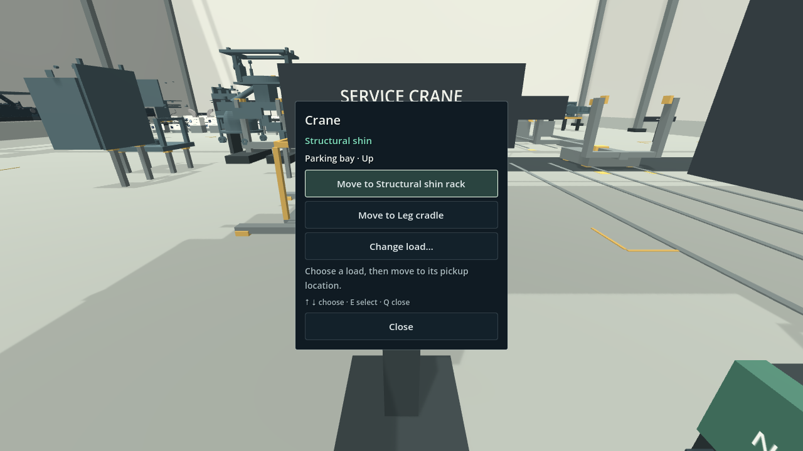
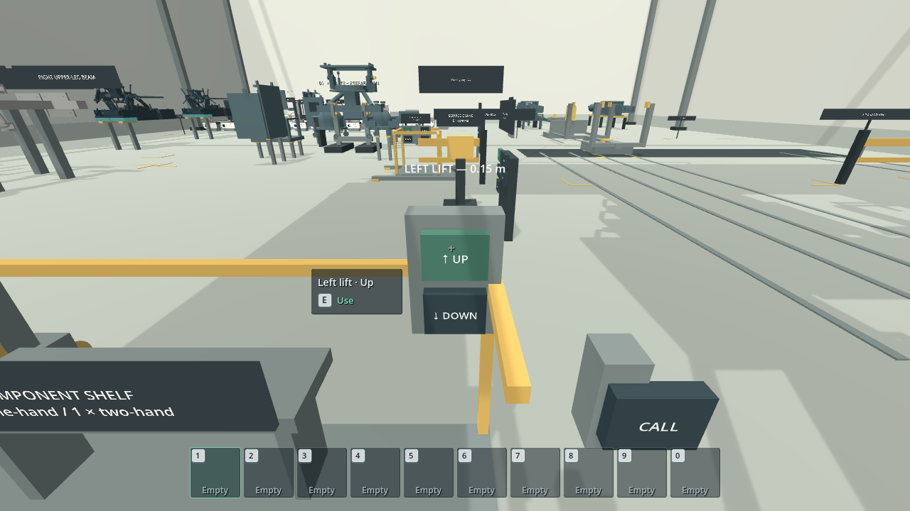
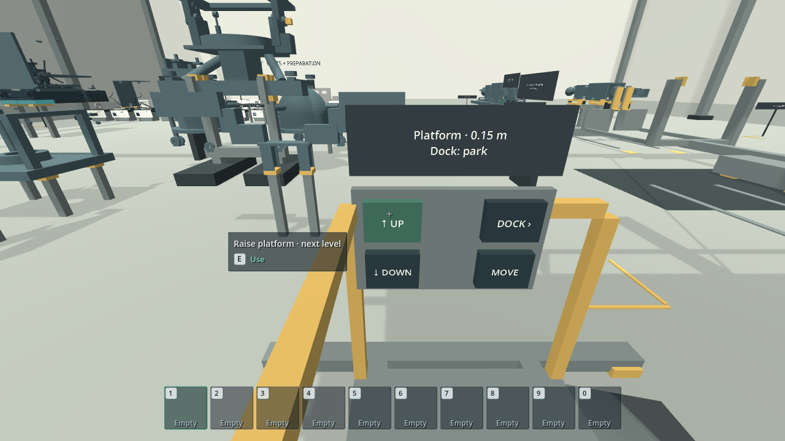
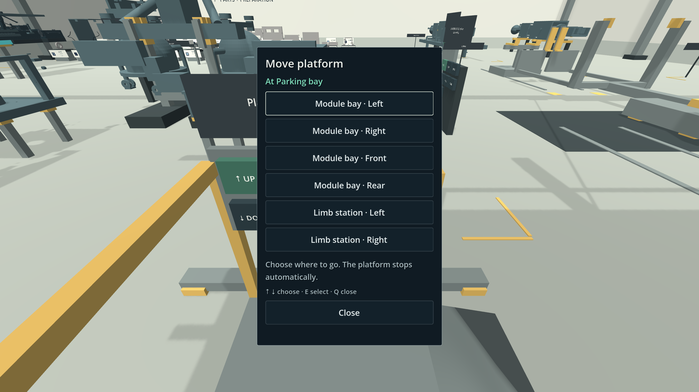

# Gundam Build Simulator — workshop prototype

Godot 4.7.2 · GDScript · Jolt Physics · macOS desktop · Shared assembly model and nested manuals



*Crane controls in the final-assembly hangar.*

`./play.command` opens the robot workshop, the one game. It begins with the
base foot build: **two heel pads and the 91-piece pitch actuator**, secured to the
left foot. That is **135 playable physical identities** from the preserved
745-piece source inventory. The foot rests in a turning fixture in the hangar's
foot bay, standing in for the left foot's store. The preparation stations,
heel-pad table and the foot's own wall cabinets share the hangar's parts and
preparation zone. Once the upright foot is complete, the build continues in the
same session: pelvis → both legs → chest → core → backpack → both arms →
pauldrons → head → crown. The right foot stays supplied complete.

Read the [current workshop state](../../design/game/workshop-state.md)
before continuing development. The workshop awaits playtest with the
[checklist](../../design/game/robot-workshop-playtest-checklist.md).

The FA-513 motor starts on the floor beside preparation C. Pick it up with E, then click the empty station to suspend it. Build the exposed drive first; page 7 fits the FA-510 housing, followed by exterior fittings and cap closure. Its 14-page manual ends with the eyes and installation handoff. The foot manual owns both clevises and the two retained eye-pin connections.

## Equipment controls

The crane console is movement only. The empty crane names its next pickup, the
first load in the layout's `crane.order` still waiting at its source, and offers
**Move to pickup · place**. A carried load offers **Move to delivery · place** or
**Put back**. **Raise crane / Lower crane** describe vertical motion. Unavailable moves explain their prerequisites. The workshop stays
visible, while the manual and inventory are tucked away until the console closes.
Click controls or use ↑/↓ and E/Enter. Esc pauses; Q closes. (The screenshot
above predates this and still shows the removed load chooser.)

Elevators have **Up / Down** onboard and **Call** at each landing. Each press
travels to the next level and stops automatically. The mobile work platform has
its own **Up / Down** pair plus one **MOVE** button. Move opens a centered menu
like the crane's; choose a destination to start travelling there at ground level.
The menu closes when travel starts. Down at ground does nothing. To return to
parking, open Move and choose **Parking bay**. Interrupted travel offers **Resume
to… / Return to…** in the same menu. Q/Close cancels without moving; Esc pauses.

Elevators, the mobile platform, shelf cargo, loaded crane and leg holder check
only nearby travel for obstacles. They wait, name the obstruction and resume
when it clears. Loose blockers are outlined when you are not aiming at another
pickup. **STOP** cancels automatic resumption until you explicitly resume.
A waiting platform or holder can return; a waiting crane transport offers
**Return to…** along its existing route. Crane lifting/lowering retains its
support-transfer interlocks. The platform's marked floor lane is still pending.







Rail, foot-rig and heavy-module-rig buttons also carry face labels. Their
existing staged movement and Stop/recovery functions remain available.

These screenshots were captured with Godot's real renderer from supplied camera
poses, with the manual closed for the physical-panel views. UI presentation was
inspected; **regressions were not run**, as requested. Follow the
[focused controls checklist](../../design/game/robot-workshop-playtest-checklist.md#focused-controls-check--2026-10-24)
for hands-on verification. Reproduce the screenshots with:

```sh
./play.command --windowed --resolution 1440x900 --disable-render-loop \
  --fixed-fps 60 --script tests/equipment_ui_review.gd -- --review-tag=review
```

Append `--platform-only` after the review tag to capture just the platform controls,
destination menu and supplied interrupted-trip recovery menu.

The capture manifest records input/image hashes. Its supplied empty-crane poses
illustrate UI states and do not establish successful delivery or reachability.

## Launch

Double-click [play.command](../../play.command) in Finder. The game opens the robot workshop in **non-exclusive (borderless) fullscreen**, paused; click **Start building**. Your build is saved each time you set a component and restored when you relaunch (see [Saves and checkpoints](../../design/game/robot-workshop-plan.md#saves-and-checkpoints)); **New workshop** in the pause menu starts over. Escape releases the mouse and opens the grouped controls menu; **Resume** returns to the build. Godot uses a fullscreen desktop on macOS.

`play.command` passes its arguments to Godot, so the same command opens the
editor and runs tests. From a terminal at the repository root:

```sh
./play.command                                  # play from the start
./play.command -- --stage=pelvis                # play from a later stage
./play.command --editor                         # open the project in the Godot editor
python3 game/workshop/tools/run_regressions.py --only stage_contract_test
```

Godot options go before `--`; game options such as `--stage` go after it. You can
also open [project.godot](project.godot) in Godot 4.7.2.

The launcher uses the task-local Godot installation at `$HOME/.cache/gundam-tools/Godot-4.7.2/Godot.app/Contents/MacOS/Godot`. It also accepts `GODOT_BIN` and can find a `godot` command or `/Applications/Godot.app`. The official macOS download was checked against its published SHA-512 manifest before installation. The launcher imports assets automatically when the import cache is absent.

## Stages

`./play.command -- --stage=<stage>` starts later in the build. It scripts the
earlier work with the same model and equipment commands as the mechanical tests,
then hands over paused. Fastenings and rigging are supplied, so this is not
playtest evidence. A stage launch never loads the save, but Save overwrites it
with the stage plus your progress since; closing the window saves only if you
changed the build after the stage. Restart re-runs the shortcut and keeps the save. Wait for
the preparation overlay to close before using the controls. Tests start at a
stage the same way, with `boot_workshop("<stage>")` in [tests/kit](tests/kit).

| Stage | Starts with |
| --- | --- |
| `foot` | The fresh game (the same as no flag) |
| `actuator` | Both heel pads fitted; build the pitch actuator |
| `pelvis` | The foot complete; deliver the pelvis to the gantry |
| `left_leg_build`, `left_leg_dock` | The left leg's construction, then its docking |
| `right_leg_build`, `right_leg_dock` | The same for the right leg |
| `chest`, `core`, `backpack` | Each torso delivery |
| `left_arm`, `right_arm`, `pauldrons` | Each arm, then both pauldrons |
| `head`, `head_sensors` | The head's structure, then its sensors, faceplate, mask and crown |
| `complete` | The retained and connected whole robot, with the crane parked |

## Building the left leg

The [robot workshop plan](../../design/game/robot-workshop-plan.md) describes
every stage; the [playtest checklist](../../design/game/robot-workshop-playtest-checklist.md)
lists what to check in each. Start at the leg with `./play.command -- --stage=pelvis`
and deliver the pelvis first. The original leg-only journey's evidence is
[archived](../../design/game/history/leg-workshop-m3-plan.md).

1. At the **crane console**, choose **Move to pickup** for the finished foot and
   crane it onto the dispatch carrier. At the **foot carrier**, use **Advance** to
   raise the foot, then Advance again to turn and seat it on the horizontal holder.
   The carrier withdraws after the receiving supports take the foot. Stop
   interrupts motion.
2. At the **crane console**, choose **Move to pickup**. The crane brings the
   next leg part in build order (shin, knee fork, upper-leg beam) and says what
   is missing if that part isn't ready yet. **Lower crane**, then Q to leave the console. E-pick and aim/click each magnetic
   end onto a separate marked point. Return to the console: **Raise crane → Move to delivery →
   Lower crane**. Fit the task's retaining hardware before detaching/stowing
   the magnets, raising the empty crane and parking it.
3. Follow the **Structural left leg** manual for ankle fasteners, the main
   disconnect, bearings, spacers, fork, axle, cap and beam fastening. Small
   hardware uses pockets; knee components and the harness use ordinary carrying.
   The axle enters from the side marked as its extraction aisle. Harness and
   knee work can proceed independently after the ankle flange is secured.
   Fit the harness from the side away from the crane racks, standing back toward
   the knee so its upright bundle has room to turn clear of the ankle brace.
4. With every structural connection complete and the crane parked, open the
   **Pelvis gantry** manual. Use the local rail **Advance** controls for travel,
   upright tilt and upward docking. The holder continues supporting the leg.
5. Carry either **PV-120** half onto a personnel lift, click the component shelf
   to store it, and ride **Up**. Retrieve and seat it, then fit its two washer/bolt
   pairs from below. Ride **Down** to ground and repeat with the other half. The
   shelf holds one two-hand component, so the halves make separate trips.
6. Both halves and all four pairs permit **Advance** to release the holder.
   The secured leg stays mounted to the pelvis. The right leg follows the same
   steps with the supplied right foot.

Use **Z** to correct mistakes, subject to the existing support and dependency
guards. Before undoing hip retention, use Advance to reacquire holder support;
wait for its engaged status. To select a completed build, press **N** and turn
off **Suggested only**.

## Collecting and building

1. Walk to the **wall cabinets**. Small parts have closed drawers with a **part ID, image, name and stock count**. Larger components remain visible on shelves. Storage has two rows, with the upper row at chest height.
2. Press **E** on a drawer to fill a pocket with up to **20 copies** from the available stock. A matching pocket is topped up; otherwise an empty pocket is used and selected. When all ten pockets are occupied, E replaces the selected stack and returns the displaced pieces to their drawer. An empty drawer never evicts stock.
3. The **ten persistent pockets** are hotkeyed to **1 2 3 4 5 6 7 8 9 0**. Their images, IDs and quantities show what you actually have. Switching manuals or pages never changes the bar. There is no shared item-count limit.
4. **B clears the selected pocket anywhere**, returning the whole stack to its drawer. Small parts never become loose world objects. **Q** sets down a carried shelf component or assembly. Hands operate separately from the hotbar; no numbered key is reserved for hands.
5. The top-right **current step** panel shows the chapter, step, a one-sentence goal and a checklist that ticks itself from the build and the machines, with counts such as 1/2 and a note for the current item. **Tab** hides or shows the panel. **M** opens the **manual**: chapters with each step marked Done, In progress, Ready to start or Locked. Select a step to read its objectives; **Enter** tracks it. M or Escape returns to play. **Page Up / Page Down** scroll pages that still use prose. Objectives use the same part IDs as the drawers and shelves.
6. Carry either FA-302 heel pad with E and click an empty preparation station. Stock FA-305, W-24 and H-24120 in separate pockets. Fit four FA-305 sleeves, seat the pad at either heel position, then fit W-24 before H-24120 at each connection.
7. Pick up FA-513 from the floor beside preparation C and suspend it there to start the FA-500-P pitch build. Assemble the exposed drive using the fixture for support. Fit FA-510 after the rod, fasten the motor through the open rear and the retainer from outside, then add the guide, sensors, seals and caps. The foot manual then covers both FA-220 clevises, seating FA-500-P, and retaining both ends with FA-221, FA-222, W-12 and H-12030.
8. Use **E on the foot bay controls** to select **Upright**, **Sole left** or **Sole right**. The mechanical cradle turns the supported foot gradually. Walk around it and use the ramp/platform to reach the exposed connections. R rotates the small preparation fixtures; the foot uses its equipment controls.
9. After securing both pads and the pitch actuator, choose **Upright**. The crane collects the finished foot from the fixture for the leg build. Clear people and loose components from equipment paths; an obstruction stops the equipment until the path is clear. Opening the pause menu also pauses equipment movement.

## Assembly and undo

**Undo follows the selected manual.** Mounted children must be detached through
the parent history before editing their internals. A detached child returns
intact to a free preparation station. Small undone parts return to their matching
or an empty pocket; if neither has space, they return to their drawer. Undo never
replaces another stack. Larger components normally appear on the output tray;
slots authored to return to hands, such as the hip retaining halves, return the
unfastened component to your hands.

**Placement follows physical compatibility and access.** Any compatible ready
connection can be built, including on another page or assembly. Aiming and adding
components refine manual suggestions without silently switching the reader.
Assemblies retain their chosen recipes and physical identities.

## Saving

A normal launch saves to `user://workshop-save.json` (on macOS,
`~/Library/Application Support/Godot/app_userdata/<project name>/`) each time a
component is set, and restores it on the next launch. The crane reloads parked;
hands, pockets and loose parts return to their drawers; a machine moving at save
time reloads at its last stop. An invalid save is deleted, never migrated. **New
workshop** deletes it. Tests, tools and `--stage` launches never touch it. A
machine's `capture()`/`apply()` must round-trip its at-rest state, including its
supported load; see [Saves and checkpoints](../../design/game/robot-workshop-plan.md#saves-and-checkpoints).
Equipment still captures and restores its own state, which the stage runner uses.

## Controls

| Input | Action |
| --- | --- |
| WASD / mouse | Move / look |
| Shift while moving | Move faster |
| Space | Jump from the floor or platform; release before jumping again |
| Hold Ctrl | Crouch for a lower inspection view; release to stand when there is headroom |
| E | Stock/refill a pocket, carry a component/assembly, or operate a bay control |
| 1 2 3 4 5 6 7 8 9 0 | Select one of the ten pockets |
| Left click | Attach the selected small part, or place the carried component/assembly |
| Q | Set down the carried component or assembly |
| B | Clear the selected pocket anywhere; its stack returns to storage |
| Hold R + move mouse | Rotate the preparation station you are looking at |
| Double-tap R | Restore that preparation station's working orientation (F remains an alternate binding) |
| Mouse wheel | Inspect zoom |
| Tab | Show/hide the current step panel |
| M | Open/close the manual; Escape also closes it. ↑/↓ select a step, Enter tracks it |
| Page Up / Page Down | Scroll steps that still use prose |
| Z | Undo the latest action in the aimed build, otherwise in the current step's build |
| Escape | Open grouped controls, Resume, New workshop (Restart build in --stage launches; asks for confirmation) or Quit |

Each of the ten pockets holds one small-part type, with up to 20 copies per stack. Assemblies and shelf components are carried separately using the assisted grip. Attachment reach is initially 2.35 m from the camera/player to the actual connection, and pad connections use a 15 cm targeting radius; actuator component targets use 24 cm. These are tunable prototype values.

## Implemented behavior

- Metre-scale source geometry: the preserved 745-mesh foot, with 135 active identities in the foot build, plus procedural leg, pelvis, torso, arm and head blockouts.
- One final-assembly hangar hosts the whole build: parts and preparation zone, foot bay, pelvis gantry, indexed leg holder, personnel lifts with shelves, mobile platform, service crane and module fixtures. Equipment preserves real support ownership while players fit reachable hardware.
- Firm two-handed carrying. A collision-aware kinematic grip follows the camera without a spring or angular momentum. Translation is swept against scenery and turning checks intermediate orientations. Dropping restores normal rigid-body physics. Placement still checks the swept approach and destination against scenery and loose obstacles.
- Small preparation stations retain free rotation and double-tap R to reset. The foot uses a mechanically supported cradle with controlled work positions and an access platform/ramp; the crane collects it from the fixture. Equipment movement preserves mounted child poses and physical identities; parent construction and undo wait until it is stationary in the assembly bay.
- Reachable pickup and collection targets under the crosshair get a thin contour; fixed equipment keeps its Operate prompt without a contour. Up to four recently focused objects reuse hidden contours, which inherit their source meshes' motion and visibility. Geometry, material and assembly changes invalidate the relevant cache; stable focus avoids hierarchy scans and renderer transform updates. Compact world prompts follow the object and use keyboard keycaps; obstacles hide both. With no part selected, unfinished builds keep one whole-assembly pickup prompt. With a selected part, nearby connections take priority; E still picks up their containing assembly. Aiming at the whole in-progress workpiece uses its cached bounds to reveal a compatible, ready destination in yellow within 6 m. The prompt asks you to move closer or aim at the highlighted connection; precise, reachable aim turns it green. Yellow guidance alone never permits attachment. Scenery, missing prerequisites and moving equipment suppress distant guidance. A valid green attachment preview stands on its own, while blocked or incompatible actions retain explanatory feedback. Placement never outlines the entire receiving assembly. Prompt and preview share one approach check per update; actual clicks recheck collision, and settled carried parts skip redundant rotation sweeps.
- Translucent in-game manual, notification and inventory panels; opaque pause/help and manual-browser windows with the workshop visible around them. The compact ten-pocket bar uses square cards with readable IDs, functional variants and counts. Hand and two-hand components are centered by their geometry, with size-aware forward clearance and solid collision.
- Hold-to-crouch movement with a lower camera/collision capsule and an overhead clearance check before standing.
- Ten persistent pockets with baked part images, IDs and per-stack counts. The separate hands summary appears only while carrying and replaces pickup popups; selected pocket information stays in the action bar. The grouped Escape menu offers keyboard focus, resume, confirmed restart and quit.
- Non-exclusive fullscreen at launch, with the HUD scaled to the display.
- Finite labelled drawers for small parts, open shelves for larger components, a preparation tray, and part-ID tooltips. Small stock has no loose 3D meshes or physics bodies; installed parts and attachment previews still use their source geometry.
- Interchangeable matching hardware. The chosen socket supplies the destination, while the installed object retains its physical identity.
- Preview and installed rendering use the receiving slot's source mesh and pose together. Some source fasteners bake their orientation into their vertices, so reusing another instance's mesh with only a new node transform gives an incorrect fit. The consumed physical identity remains in the assembly model and visual metadata.
- Suspended and mounted assemblies use static freeze mode to follow their parent through continuous rotation. Pickup restores the collision-aware carrying mode; dropping restores dynamic physics.
- A shared, input-independent assembly model for slot prerequisites, compatible types/variants, milestones, unique ownership, and undo. Two pad instances use one authored definition; their parent owns the seating and fastening slots.
- Independent mounting-point order, a ghost preview, reach/occlusion checks, and explicit failure feedback.
- A filesystem-style manual browser with expandable build folders, step progress and clickable breadcrumbs. It pauses play, reuses the existing diagram viewports and preserves each selected page.
- Authored diagrams retain their meshes when only installation progress changes. The actuator housing stays opaque throughout construction; the remaining motor fastening uses the open rear, and retainer fastening uses exterior lands. Once both caps are secured, the actuator hides explicitly enclosed components; undo restores them without making the housing translucent. Exterior fittings remain visible, including the radial retainer screws. Ordinary gameplay is capped at 60 FPS.
- A parent foot manual and three independent child manual sessions, with authored steps, remembered pages, model-based illustrations, automatic progress, and completion sound/glow.
- Manual-scoped build undo: small hardware returns to pockets or its drawer; undoing a mounting action returns the prepared child to an empty station. Walking, carrying, and storage arrangement are not rewound.

## Verification

Run the headless regression set from the repository root:

```sh
python3 game/workshop/tools/run_regressions.py
```

The default is the explicit fast routine suite (four workers), including model,
small-scene physics, source geometry, Python runner contracts and one fresh-workshop
smoke test. `--list` lists routine cases; `--only NAME ...` narrows the selection.
Three warm runs on 2026-10-25 passed all 28 routine cases in 8.82 s, 8.72 s and
8.77 s, including startup/fingerprinting and excluding asset import.
A run over 60 seconds warns and finishes normally, then lists the slowest tests.
Improve slow tests rather than raising the performance budget. Hang timeouts,
engine errors, missing/failed summaries and changed inputs still fail verification.

Import assets separately before the first run with
`./play.command --headless --editor --import --quit`. Test timings exclude import.
Logs, input hashes and total/per-case timing live under `verification/regressions-*`.

Whole-build replays and expensive geometry investigations are separate diagnostics.
Run them only when explicitly requested, naming the relevant cases:

```sh
python3 game/workshop/tools/run_diagnostics.py --list
python3 game/workshop/tools/run_diagnostics.py --only arm_preflight_test
```

Diagnostics have no default/run-all selection and cannot be selected through the
routine runner. See [coverage migration and test contracts](tests/TESTING.md) for
retained assertions, isolated replacements and the exact diagnostic boundary.

Current status and remaining human acceptance are recorded in the
[workshop state](../../design/game/workshop-state.md).
The earlier [structural milestone](../../design/game/history/leg-milestone.md#final-verification)
records historical results for the retired hoist workflow.

The linked test scripts generate local JSON audits under `verification/`. Audits,
screenshots, meshes and review galleries are ignored local outputs. Historical
review results are summarized below, but their captures and exact input hashes
are no longer kept in Git. Fresh visual approval requires a new local capture
and inspection of the affected scope.

- [Manual page audit](tests/pockets_workshop_test.gd): runtime page views across the heel-pad and pitch builds, covering step-only lists, quantities, prepared assemblies, instruction references, unique installation coverage and available stock. Overview/readiness pages have no component shopping list.
- [Pocket model audit](tests/pockets_model_test.gd): ten stacks of 20, top-up, full-bar replacement, clearing, empty-drawer atomicity, undo overflow and exact physical identities.
- [Pocket workshop audit](tests/pockets_workshop_test.gd): all ten number keys, immediate hotbar counts, manual independence, drawer/shelf images and IDs, two storage rows, clearing away from storage, separate carrying, scrolling and layout. Hotbar/catalogue images use no live 3D viewports.

- [Pitch model audit](tests/pitch_model_test.gd): inventory counts, manual construction order, cap dependencies, carrying exclusivity, long-part recovery, and combined 135-piece completion.
- [Part compatibility audit](tests/part_variants_test.gd): pooled stock, both copies at opposite compatible endpoints, exact identity on undo/reinstall, incompatible variants at ready connections, and actual imported geometry equivalence.
- [Pitch desktop audit](tests/pitch_build_test.gd): Collects and fits all 90 additions around the starting motor through desktop controls, compares actual installed vertices against the source at every construction page, previews all fitted child meshes and installs the completed actuator with all 18 mounting parts, checks station/foot rotation, and undoes the parent installation while retaining child progress. It also checks the housing-free first step, enclosed-part visibility, complete preview visibility and recovery on reopening the housing.

- [Diagram cache audit](tests/manual_diagram_cache_test.gd): 10 checks; authored figures reuse their panels and meshes through progress changes, while changed views and automatic diagrams still refresh.

- [Original state regression](tests/state_test.gd): 57 checks through the new model, including independent order, finite stock, pocket clearing/refilling, identity, completion, and full undo.
- [Generic model audit](tests/assembly_model_test.gd): 45 checks including invalid references/cycles, duplicate ownership, incompatible variants, shared stock, nested undo, and a separate three-slot recipe with a differently named parent. The alternate recipe is a state-level fixture, not new playable content.
- [Pickup outline cache](tests/interaction_outline_test.gd): retained contours, continuous inherited motion, nested part changes, transparency, bounded eviction and source/manager cleanup without a renderer.
- [Centered carrying](tests/centered_carry_test.gd): off-origin geometry, continuous camera rotation, large components and real wall obstruction.
- [Geometry audit regression](tests/geometry_surface_audit_test.gd): known harness failure, near-coplanar faces, valid contacts, transformed meshes, indexed/unindexed triangles and conservative occlusion checks.
- [Supported model](tests/supported_model_test.gd): named support ownership, authorized transfers, equipment-only handling, mounted undo and atomic rejection.
- [Robot content](tests/robot_content_test.gd): robot stock, playable slots, crane-task sources and the complete leg and hip graph.
- [Stage contracts](tests/stage_contract_test.gd) cover orchestration and handover routinely; [stage sequence](tests/stage_sequence_test.gd) retains the complete build as a named diagnostic.
- [Leg content](tests/leg_content_test.gd): complete structural recipe, stock identities, compatible swaps, unique manual coverage and actual source geometry at the ankle, knee and hip interfaces.
- [Access lifts](tests/access_lift_test.gd): occupied travel, carried-part clearance, gates, headroom, blocked movement and pause behavior.
- Earlier pad captures showed independent builds and completed pads. Those images
  are no longer kept in Git; rerun the affected review when visual evidence is
  needed.

```sh
python3 game/workshop/tools/run_regressions.py --list
python3 game/workshop/tools/run_regressions.py --only staging_policy_test stage_contract_test workshop_smoke_test
python3 game/workshop/tools/author_leg_prototype.py --check
```

These commands run headlessly. The scenario tests exercise the desktop input adapter and actual physics/targeting without opening a window. Test input is isolated from live desktop events. The pitch test can also use `--fixed-fps 60` to advance simulated time faster. `--swap-identical-parts` supplies the second copy first through normal collection and checks the installed receiving geometry. Headless runs skip audio playback. Rendered verification is a separate, explicitly requested check. Automated checks verify functionality; human play remains the test of pacing and comfort.

For a repeatable empty-handed mouse-look measurement, keep the game in front
until this 20-second run closes:

```sh
./play.command --script tools/benchmark_mouse_look.gd -- --seconds=2 --input-events=8
```

It compares standing still with circular camera movement at arrival and beside
the foot, while timing input, targeting, ghosts and markers separately. Each
sample records frame time, actual draws, focus and render workload in a unique
`verification/mouse-look-*/audit.json`. The run rejects blocked camera input or
skipped rendering, including macOS stopping draws after an alt-tab. Headless runs
measure CPU work only. Synthetic events exercise Godot's viewport input pipeline;
they do not measure physical mouse sampling or input-to-display latency. Do not
use `--fixed-fps` for performance measurements. `--force-draw` is a separate
render-throughput diagnostic and does not establish normal presentation pacing.

For an explicitly requested workshop environment review, capture repeatable player
views with the actual renderer:

```sh
./play.command --windowed --resolution 1440x900 --disable-render-loop \
  --fixed-fps 60 --script tests/workshop_visual_review.gd -- --review-tag=survey
```

This writes 14 views of the ramp, platform, signs, storage, carrier joints and
guided rotation into a unique `verification/workshop-*` directory. The manifest
records camera poses, source hashes and image hashes. Inspect these images before
recording visual approval; this environment survey does not replace an assembly
manual review or a performance measurement.

Append `--review-harness` after `--review-tag=survey` for nine focused lower
carrier views, including five small camera offsets across a runner/wheel joint.
To run just the headless geometry checks:

```sh
python3 game/workshop/tools/run_regressions.py --only geometry_surface_audit_test
```

For a focused rendered storage/pocket-label review, run `./play.command --disable-render-loop --fixed-fps 60 --script tests/pockets_desktop_test.gd -- --pockets-review`. It prints a unique `LABEL_REVIEW_OUTPUT` directory containing the shared retaining-ring stack and both collar/gasket variants beside their storage labels and manual. The flag rejects the headless dummy renderer.

The repaired actuator passed a 2026-10-21 visual review of all 14 child pages
and three parent installation pages, including every placement, both receiving
frames, full assembly preview and continuous rotation. Receiving holes, seats,
fastener access, sensor/cap clearance and eye/pin interfaces were repaired in
the source models; step diagrams expose those connections. This is a historical
outcome: its inspected images and exact hashes are no longer in Git. Source
geometry agreement alone is insufficient for fresh visual approval.

The later motor-first review covered the changed sequence, rear motor/radial
retainer fastening, rear-cap clearance, opaque visibility and final mounting.
It recorded 117 model, 290 desktop and 113 geometry checks, plus scoped rendered
inspection. Closed-actuator visibility dropped from 203,291 to 128,528 triangles
(36.78%); this does not measure whole-scene FPS or laptop temperature. A separate
manual browser review covered navigation and layout. These review outputs are
local and are no longer kept in Git.

The historical scalability review checked stable
source identities, generic nested mounting, structural collision and carrying,
manual-independent placement with suggested manuals, and repeatable asset repair.
The final headless suite passed 17 cases / 1,790 checks; source tools passed 11 Python
tests and a real Blender reordered-generation audit of all 745 identities.
Inspected renderer evidence covered five child pages, all three parent installation
pages, both pads through rotation and undo, the suggestion browser, and a synthetic
four-level assembly with a large hollow frame. Source geometry was unchanged by
compaction: all 745 instances matched, while the GLB fell from 68.36 to 60.09 MB.
Its detailed report and images are no longer kept in Git; these historical
results do not establish current visual approval or whole-robot performance.

Reproduce the actuator captures using the real renderer, then generate the review gallery (Pillow required):

```sh
./play.command --disable-render-loop --fixed-fps 60 --script tools/pitch_review.gd
python3 game/workshop/tools/build_pitch_review_gallery.py --input /path/printed/as/REVIEW_OUTPUT
```

This opens a window and captures before/preview/after placements, opaque/service/exposed inspection angles, HUD pages and continuous rotation. `--headless` is rejected for this mode. Each run prints a unique `REVIEW_OUTPUT` directory under `verification/`; supply that path to the gallery command. Keep its hashes, page decisions and inspected images together locally for comparison until review is complete.

For a focused repair, append `-- --review-pages=pitch-04,foot-06` to the capture command, selecting the changed and dependent pages explicitly. Normal build/ownership checks still run, but only selected pages produce images. Include `pitch-14` or `foot-06` when preparation or mounted rotation needs review. Capture generation does not grant visual approval. Inspect and record the affected pages; without the archived images, prior visual decisions cannot serve as a verified comparison baseline. The remaining default-workshop pages and both compatible pad placements still need the [full review process](../../design/game/foot-prototype-plan.md#manual-and-assembly-visual-review).

## Scope and current limits

The workshop delivers the foot build and the robot's structural blockout: pelvis, both legs, torso, arms and head. Detailed powered mechanisms, armor, saving and AR remain future work.

The reusable construction model owns prerequisites, inventory, carrying capacity, milestones and undo. `component_interaction.gd` projects arbitrary authored component slots into desktop collection, grip, placement, and service views. Pad connections retain their established four-opening adapter. The generic model supports the new content without requiring pad-shaped rules.

Carried collision uses structural primitive compounds; authored fixed receiving frames can use exact mesh openings. Internal work uses an explicit assisted service policy, while scenery and carried-part approaches remain solid. It does not simulate threading, torque, load dynamics or every internal insertion. Powered articulation and services beyond the main ankle disconnect remain outside this structural milestone. The user accepted the earlier foot-workshop playtest on 2026-10-22 and the leg-bay equipment trials on 2026-10-23. Human playtest acceptance of the robot workshop remains separate. No rendered review was requested. Laptop temperature and on-screen frame time still need measurement during normal play; the detailed foot remains a substantial rendering cost.

The room and new structural parts are functional blockouts. Layout, lighting, carrying distances and targeting tolerances remain tunable. Completion feedback is a sound and glow.

## Data model and project structure

- [workshop.gd](scripts/workshop.gd): room, imported geometry, player, targeting, carrying, station interaction, and completion presentation.
- [supported_fixture.gd](scripts/supported_fixture.gd): foot support, guided working poses, platform, rail transfer and movement clearance.
- [leg_bay_layout.gd](scripts/leg_bay_layout.gd), [indexed_leg_rail.gd](scripts/indexed_leg_rail.gd), [service_crane.gd](scripts/service_crane.gd), [lift_shelf.gd](scripts/lift_shelf.gd) and [work_access_lift.gd](scripts/work_access_lift.gd): hangar layout and its leg holder, crane, shelves and lifts.
- [leg_source_geometry.gd](scripts/leg_source_geometry.gd): separate procedural source meshes for the leg and pelvis, including real bores, bearing seats and split retaining rings.
- [part_storage.gd](scripts/part_storage.gd): low cabinets, shelves, cached catalogue images and stock labels. Images are generated from the source GLB by `python3 game/workshop/tools/render_part_images.py` (Pillow required only for regeneration).
- [build_stages.gd](scripts/build_stages.gd): stage names, the `--stage` flag, boundary checks and scripted progression.
- [workshop.gd](scripts/workshop.gd), [player_controller.gd](scripts/player_controller.gd), [desktop_input.gd](scripts/desktop_input.gd), [targeting.gd](scripts/targeting.gd), [workshop_world.gd](scripts/workshop_world.gd) and [primitives.gd](scripts/primitives.gd): bootstrap, movement, modal input, targeting, layout construction and shared material palette.
- [equipment.gd](scripts/equipment.gd), [equipment_registry.gd](scripts/equipment_registry.gd), [hand_slot.gd](scripts/hand_slot.gd), [motion_sweep.gd](scripts/motion_sweep.gd) and [pose_codec.gd](scripts/pose_codec.gd): shared equipment, interlocks, hand ownership, motion checks and pose serialization.
- [workshop-layout.json](assets/workshop-layout.json): authoritative hangar, rail, lift, shelf, parent-home and crane placement data read by runtime and Python authoring. Regenerate with `python3 game/workshop/tools/author_workshop_blockout.py`.
- [scenario_staging.gd](scripts/scenario_staging.gd) and [workshop_automation.gd](scripts/workshop_automation.gd): declared setup and public automation seams; test runners live under `tests/`.
- [tests/kit](tests/kit): common harness, ordinary-control player driver and evidence output.
- [component_interaction.gd](scripts/component_interaction.gd): authored component targeting, shelf-piece carrying, incremental installed visuals, and service views.
- [assembly_model.gd](scripts/assembly_model.gd): reusable ownership, transfer, placement validation, milestones, and scoped history.
- [assembly_runtime.gd](scripts/assembly_runtime.gd): scene nodes and coordinate frames keyed by assembly identity, parent-slot mounting, descendant visuals and nested previews.
- [solid_handling.gd](scripts/solid_handling.gd): primitive compound collision, current assembly bounds, size-aware carrying and conservative rotation/placement sweeps.
- Heel pads, actuator pieces and parent hardware use the generic component targeting and installed-visual path. Historical pad state assertions remain in the test adapter; production has no active pad/state cursor.
- [loose_part.gd](scripts/loose_part.gd): solid carried and dropped objects.
- [manual_browser.gd](scripts/manual_browser.gd): expandable manual hierarchy, breadcrumbs and the large paused reader.
- [hud.gd](scripts/hud.gd) and [manual_diagram.gd](scripts/manual_diagram.gd): instructions, inventory, tooltips, help, and live illustrations.
- [interaction_outline.gd](scripts/interaction_outline.gd): depth-tested focus contours without changing source materials or assembly ownership.
- [assembly-definitions.json](assets/assembly-definitions.json): part types, child and parent slots, prerequisites, milestone sets, work locations, geometry references, and manual steps.
- [heel-pads.json](assets/heel-pads.json): 26 source identities, physical build instances, starting positions, and parent destinations.
- [pitch-workshop.json](assets/pitch-workshop.json) and [pitch-actuator-definitions.json](assets/pitch-actuator-definitions.json): 135-piece scenario and the actuator/parent recipe overlay. Regenerate with `python3 game/workshop/tools/author_pitch_actuator.py`; the authoring script resolves the exact pitch block in the source manifest and explicitly authors prerequisites separately from animation phases.
- [leg-prototype-content.json](assets/leg-prototype-content.json), [leg-prototype-definitions.json](assets/leg-prototype-definitions.json), [robot-content.json](assets/robot-content.json) and [robot-definitions.json](assets/robot-definitions.json): structural leg/pelvis base and the robot's torso, arm and head extension, with support permissions, physical source descriptors and manuals. Regenerate and audit with `python3 game/workshop/tools/author_leg_prototype.py`.
- [heel-pad.json](assets/heel-pad.json): original 13-piece model-test scenario metadata.
- [Original model package](../../models/foot-fa01/README.md), [game design](../../GAME_DESIGN.md), and [prototype plan](../../design/game/foot-prototype-plan.md).

A slot accepts one part-type key (which includes a specific variant) or a child assembly definition with a required milestone. `requires` lists local slot IDs. Slots refer to imported GLB transforms through `pose_source`; accessible targets are authored separately. Manual steps reference the same slot IDs. Root parts begin assigned to their child assembly; logical containers never create extra physical inventory. Child placement transfers that container into a parent slot while retaining all descendant identities.

Part types describe compatibility; physical instance IDs describe individual stock. The pitch bearings, retaining rings, end sensors, eye pins and keepers share one type per family and either copy fits either matching slot. Pocket-sized copies stack together; larger copies share a shelf and are carried one at a time. Collar halves, eye housings, cap gaskets and clevises retain distinct fits with functional names. Pocket labels show the distinguishing variant beneath the family ID. Keep the slot's mesh/pose source separate from its consumed identity, including when the two copies are swapped.

The [component pipeline skill](../../.agents/skills/gundam-component-pipeline/SKILL.md) captures the path from a component's high-level Markdown through detailed interfaces/inventory, exploded references, source models and playable manuals. Its [foot/ankle precedent](../../.agents/skills/gundam-component-pipeline/references/foot-ankle-precedent.md) records the current proof-of-concept boundaries and revision differences.

Stations provide occupancy, rotation, and work-volume checks. Collection and construction rules do not depend on keyboard bindings or camera transforms; desktop targeting supplies the reach/occlusion and placement poses. Future AR input can call the same model operations.

The scene projection mounts a child into an explicit `(parent, slot)` and retains
its descendant identities and local frames. Only the top assembly supplies active
carrying collision; mounted child bodies inherit its transform. The current
expanded workshop mounts foot into leg and leg into pelvis; the nested runtime
regression also exercises four levels and two distinct receiving fixtures.

Authoring extensions for future modules:

| Field | Meaning |
| --- | --- |
| Scenario part `source_id` | Reusable geometry key, separate from unique physical `instance_id` |
| Scenario `parents` | Multiple fixture records; legacy `parent` is still accepted |
| Scenario `supports` / location `support:<id>` | Named equipment ownership and allowed assemblies/parts; transfers preserve existing identities |
| Part/assembly `carry_class: equipment` | Requires authorized equipment handling rather than hand pickup |
| Slot `support_required`, `source_supports` | Supported installation and removal permissions, independent of manual selection |
| Scenario `context_collision` | Source ID → `mesh` for fixed receiving frames that need exact openings; other context uses bounds. Carried assemblies use primitive compounds |
| Slot `snap_position`, `snap_rotation_degrees` | Explicit pose in the owner's local frame, otherwise derived from `pose_source`; an assembly destination places the child's logical frame |
| Assembly slot `child_anchor_slot` | Optional child connection used as the mounting anchor instead of the child's logical frame |
| Slot `target` (alias `target_position`) | Accessible interaction point in the owner's local frame; reach is measured here |
| Slot `target_offset` | Accessible interaction point in the source mesh's local coordinates, transformed by the slot pose; an explicit owner-local `target` takes priority. This changes aiming, not the installed pose |
| Part/slot `collision_shapes` | Authored primitive compound in the piece's mesh-local coordinates, preserving structural openings; individual source bounds are the fallback |
| Part/assembly `handling` | Centered assisted carrying; `distance` and current compound size set forward clearance. Legacy `offset` retains its forward component; lateral/height offsets no longer shift the grip off center |
| Assembly/slot `access_policy` | Mounted interiors remain locked by default; `mounted` explicitly permits work through a mounted owner subject to work-location rules |
| Assembly/slot `service_access` | `surface` requires an exposed connection; `open_station` allows fixture-assisted internal access until enclosure; `assisted` is an explicit unconditional receiver exception. All modes still test unrelated scenery. |

Pocket hardware remains visible and individually owned without automatically
adding a collider for every screw. Structural pieces supply carrying collision;
hardware can opt into an authored proxy when it affects the outer envelope.
Manual selection never supplies construction permission or service access.

The game GLB preserves the original export except for the 109 pitch pieces and their FA-103/FA-200 receiving frames. `models/foot-fa01/src/pitch_interfaces.py` repairs those specific instances without changing shared hardware templates or the roll/forefoot actuators. The merge audit checks that all other node records and mesh bytes are preserved. Imported transforms govern placement; the source manifest's Blender-axis custom position metadata must not be applied directly as Godot coordinates. Animation phases are not gameplay dependencies.

For source geometry revisions, regenerate the selected pieces from the current
authoritative source before merging (substitute your Blender executable):

```sh
blender --background --factory-startup --python-exit-code 1 --python models/foot-fa01/src/export_pitch_revision.py
python3 game/workshop/tools/merge_pitch_meshes.py
python3 game/workshop/tools/author_pitch_actuator.py
python3 game/workshop/tools/render_part_images.py
```

The merger removes unreferenced mesh, material, accessor and buffer records.
Repeating the same revision produces byte-identical output. Its audit compares
retained transforms, metadata, material records and geometry bytes independently
of their resource indices; it rejects unsupported animated/textured/extension
formats before writing. `--base`, `--revision`, `--output` and `--audit` allow
explicit inputs and a separate output for review. Always regenerate a revision
before applying it: compaction does not make stale geometry current.

Source identities are allocated by the checked-in [semantic role registry](../../models/foot-fa01/src/source-identities.json), not generation order. New roles need explicit unused IDs; existing IDs remain fixed. Hardware connections name their bolt/washer pairs. Scenario `instance_id` identifies a physical item, while optional `source_id` identifies reusable geometry (defaulting to `instance_id` for existing scenarios). Slot `pose_source` still selects the receiving geometry and orientation independently of the consumed item.

The exporter retains all 745 inventory identities and updates the selected records in the JSON manifest; the full Blender scene, film, CSV and standalone exports remain historical until the full model build is rerun. The [pitch interface repair](../../design/game/pitch-interface-repair.md) records the revised packaging and connections. `pitch_interface_test.gd` checks actual imported triangles for receiving holes, surrounding material and key seat/access clearances; it complements the rendered review.

Check identity stability and asset compaction independently of gameplay:

```sh
python3 -B -m unittest discover -s game/workshop/tests -p 'test_source_assets.py'
blender --background --factory-startup --python-exit-code 1 --python models/foot-fa01/src/verify_source_identity.py
```

The Blender audit deliberately changes generator order and checks the current
identity/role mapping, paired hardware and labels without
exporting replacement assets.

Godot is used under its [MIT license](https://godotengine.org/license/). Engine references: [GLB import](https://docs.godotengine.org/en/stable/tutorials/assets_pipeline/importing_3d_scenes/available_formats.html), [Jolt Physics](https://docs.godotengine.org/en/stable/tutorials/physics/using_jolt_physics.html), [3D collision shapes](https://docs.godotengine.org/en/stable/tutorials/physics/collision_shapes_3d.html), and [rigid-body behavior](https://docs.godotengine.org/en/stable/classes/class_rigidbody3d.html).

Carry implementation references: [kinematic freeze mode](https://docs.godotengine.org/en/stable/classes/class_rigidbody3d.html#enum-rigidbody3d-freezemode), [collision-aware body movement](https://docs.godotengine.org/en/stable/classes/class_physicsbody3d.html#class-physicsbody3d-method-move-and-collide), and [non-exclusive fullscreen](https://docs.godotengine.org/en/stable/classes/class_displayserver.html#enum-displayserver-windowmode).

Attached assemblies use the [static freeze mode](https://docs.godotengine.org/en/stable/classes/class_rigidbody3d.html#enum-rigidbody3d-freezemode), which leaves their movement to scene code. The rotation regression reproduces the old carrying-mode transform conflict during input between physics ticks, rather than relying only on settled transforms.

## Performance measurements

The opt-in `tools/benchmark_mouse_look.gd` measures the starting workshop at fixed
arrival/work-bay positions, stationary and with synthetic mouse look. Run it only
for a requested performance investigation, separately from routine regressions:

```sh
./play.command --script tools/benchmark_mouse_look.gd -- --tag=baseline --seconds=4
```

For foot-specific slowdowns, add `--feet`. This aims stationary and mouse-look
views at the live mesh bounds of each foot from the side, records the 3D render
scale, and checks that the foot center stays in the camera frustum. The generic
arrival/work-bay views do not establish performance when inspecting the feet.

Keep the window visible and focused. The report rejects skipped rendering and
blocked camera input. Do not use fixed FPS or disable the render loop. Each phase
warms for two seconds; raw samples, percentiles, draw counts, actual reported
window/texture sizes and validity flags are written to `verification/mouse-look-*`.
`--force-draw` measures explicit-draw throughput, not ordinary presentation pacing;
compare it only against the same mode. Headless runs measure CPU work only.

`--variant=four-split-shadows` restores the former four-cascade configuration for
an isolated shadow comparison. Normal play uses two blended cascades, still at
4096 resolution and 65 m coverage. This saves repeated caster submissions while
retaining near working detail; distant shadows have less graduated detail. Lighting,
brightness, MSAA and all geometry remain unchanged. Other benchmark-only variants
include `no-shadows`, `no-msaa` and `no-feedback`; they do not change normal settings.

Targeting uses one stock-inventory pass and cached local bounds of actual authored
connection targets, rather than collision bounds. Bounds move with the assembly;
model changes invalidate the geometry cache. Articulated and forwarded child
connections are evaluated live, as are prerequisites, ownership, variant feedback,
reach and obstruction. `targeting_candidates_test` compares discovery with an
exhaustive reference, including motion, mounting, installation and undo.

The current feet use `scripts/assembly_render_group.gd` for derived rendering.
Fixed context and installed foot parts are grouped within their own rigid frame,
in local 1 m cells of at most 16 pieces. Detailed source geometry, physical IDs,
slot metadata, collision and outline geometry remain available. Material groups
reduce draw submissions; generated mesh LODs reduce distant geometry. Root pieces
stay separate for completion feedback, and child assemblies keep independent frames.
The existing authored enclosure rules also remove enclosed pieces from batches.

Changes invalidate only affected groups. Original pieces render while CPU-only
merge/LOD work runs on worker threads; finished resources are installed on the main
thread only if their installed-piece signature is still current. Undo cannot apply
a stale completed representation. Derived caches retain only current group inputs,
not every historical partial assembly. Mirrored meshes retain their LOD thresholds
and regenerate welded shadow geometry with matching surface topology.

The rendering decision is part of the
[component design process](../../.agents/skills/gundam-component-pipeline/SKILL.md#rendering-contract-for-construction-games).
The foot check is intentionally **outside standard regressions**. It is a cheap,
opt-in fixture (no workshop boot), covering grouping, closure/undo, transforms,
outlines and mirror LOD/shadow preservation:

```sh
python3 game/workshop/tools/run_diagnostics.py --only foot_render_test
```

Use the explicitly requested `--feet` benchmark for performance evidence; it waits
for derived groups to finish. A short local sample improved foot views from about
43–46 FPS to 56–58 FPS and reduced draw calls from about 3,200–3,800 to 600–910.
This is not a sustained 60 FPS guarantee. The user confirmed that the optimized
foot still looks great in game (2026-10-25). No new case was added to standard
regressions.
