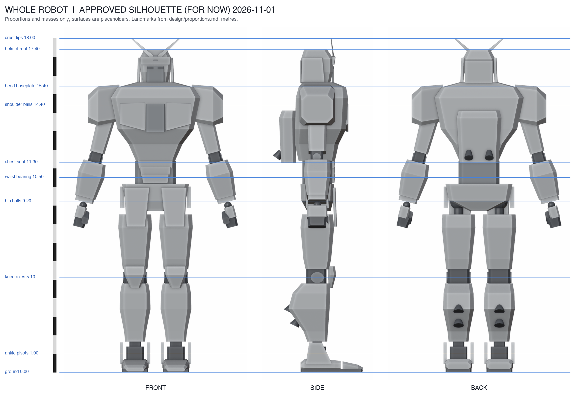
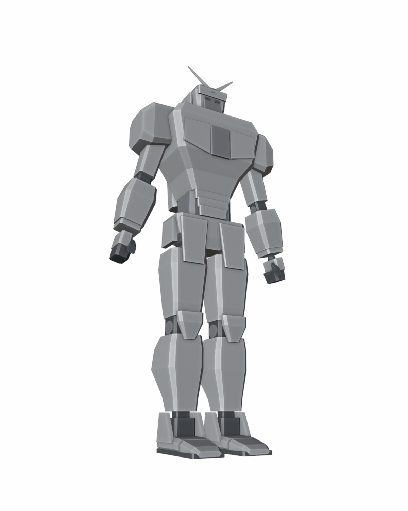

# Whole-robot silhouette

Approved for now: 2026-11-01 · **Proportions and masses approved; surfaces are placeholders**

A blockout of the complete 18 m robot. It is the geometric source of the
revised envelopes in [proportions.md](../../design/proportions.md) and the
proportion guide for whole-robot concept art in the
[visual design brief](../../design/visual-design/README.md).





## What is approved

The masses and proportions, not the surfaces:

- Joint heights unchanged from the accepted proportions: hips 9.20, knees
  5.10, ankles 1.00, waist bearing 10.50, shoulders 14.40, head base 15.40,
  roof 17.40, crest 18.00. Shoulder balls at |X| 2.45.
- Pauldrons reach **outward**, not up: |X| 1.95–3.62 (7.24 m across),
  Y ±0.95, Z 13.30–15.50, tops near chin level and sloping down outboard; each
  arm hangs below its middle.
- A dominant upper chest: 4.80 m wide around Z 14.8, front projecting to
  Y +1.65, a flat top at Z 15.35 and a collar to Z 15.62 so the head sits down
  into the body with no neck showing.
- Narrow 2.20 m waist; 3.60 m hip armor with front guards down to Z 7.85.
- Full limbs: upper arm 1.01 × 1.12, forearm 1.45, thigh 1.80, calf 1.65 wide
  (2.24 deep with thrusters), large fists, feet 3.36 × 1.46.

## What is not approved

- Plate outlines, facets, panel breaks, face and helmet details, hands and all
  surface detail are plain placeholders. Do not copy them into concept prompts
  beyond proportion and placement.
- The fists are a relaxed concept pose. The dimensioned reference pose keeps
  fingers extended to the 7.25 m fingertip height.
- Lower-leg and thigh lengths between joints are the mannequin's own choices
  within the joint spans.

## Files

| File | Use |
| --- | --- |
| [build.py](build.py) | Blender generator: the approved parameters (`P`), geometry, cameras and renders |
| [compose_sheet.py](compose_sheet.py) | Pillow script assembling the turnaround sheets |
| [turnaround-annotated.png](output/turnaround-annotated.png) | Front/side/back with landmark heights and a metre scale, for review |
| [turnaround-clean.png](output/turnaround-clean.png) | The same views without annotation, attached to concept prompts |
| [mannequin-hero_low.png](output/mannequin-hero_low.png) | Low three-quarter view from a person's eye height, attached to three-quarter prompts |
| [mannequin-three_quarter.png](output/mannequin-three_quarter.png) | Higher three-quarter view |
| [silhouette-front.png](output/silhouette-front.png) · [side](output/silhouette-side.png) · [back](output/silhouette-back.png) | Flat black fills for silhouette comparison |

Ignored by Git and regenerated by the scripts: `mannequin.blend`, the individual
`clean-*` views, and the `mannequin-front/side/back` views with a 1.75 m person
and an 18 m scale column.

## Regenerate

```sh
blender -b --python models/silhouette-mannequin/build.py
python3 models/silhouette-mannequin/compose_sheet.py
```

Tested with Blender 5.2.3 (Workbench renderer, about 10 s) and Pillow 12.

## How it was chosen

The first mannequin used the earlier accepted envelopes (5.6 m pauldrons with
tops at 15.05, 4.0 m chest, slim limbs). The user found it weak ("looks like a
total weenie"), chiefly the shoulders, and gave a classic real-robot figure as
the target. Round 1 tried taller pauldrons up to eye level, added bulk, and
flared shins; the user rejected the tall pauldrons as shrugging ("go UP instead
of OUT") and asked for a more prominent chest, giving a second reference.
Round 2's "broad wide" profile, with the shoulder balls moved out, was approved
for now. The flared-shin study was not adopted. The rejected profiles are in
Git history; the decision is in [decision history](../../design/decisions.md).

## Consequences still to resolve

The component specifications, the FA-01 detailed foot and the workshop game
still use the earlier envelopes. Revising them to this silhouette involves:

- moving the torso's shoulder sockets and crossmember ends to |X| 2.45, with
  the elbow and wrist landmarks and the workshop's arm alignment positions;
- deepening the chest armor to Y +1.65, which moves the sternum hatch hinge,
  hatch sweep, cockpit entry patch and upper-chest deck forward;
- the larger pauldron (top 0.10 m above the head base; 0.95 m inner gap to the
  helmet, up from 0.62) and its part, handling, delivery and the 16.4 m deck
  notch;
- larger limb, hip and foot envelopes in handling and route clearances (coarse
  boxes plus margin, per the current workshop rule) and a resized FA-01 foot.
